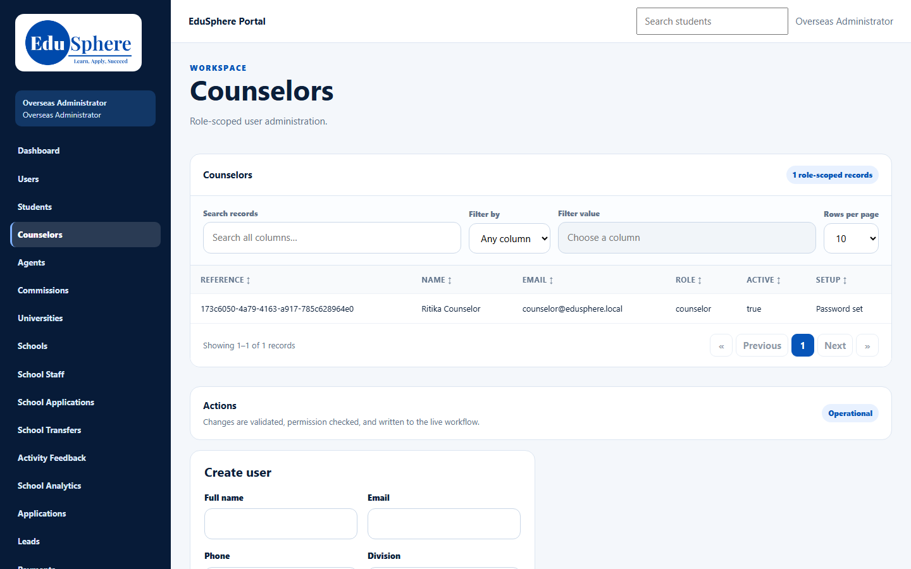
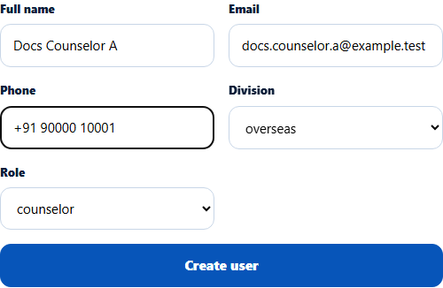
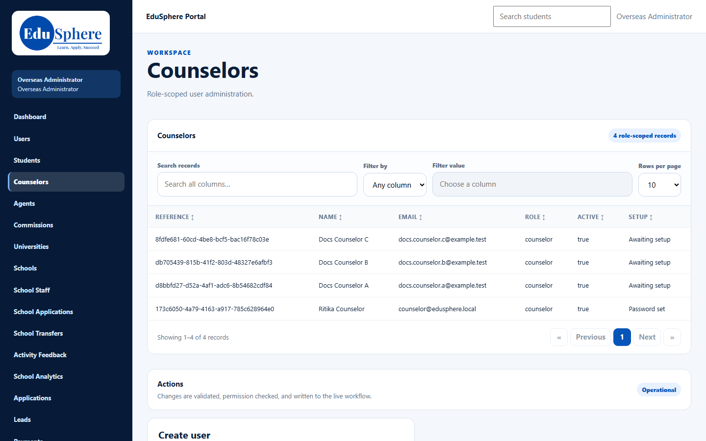
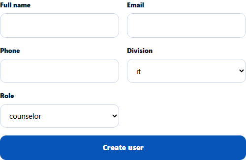
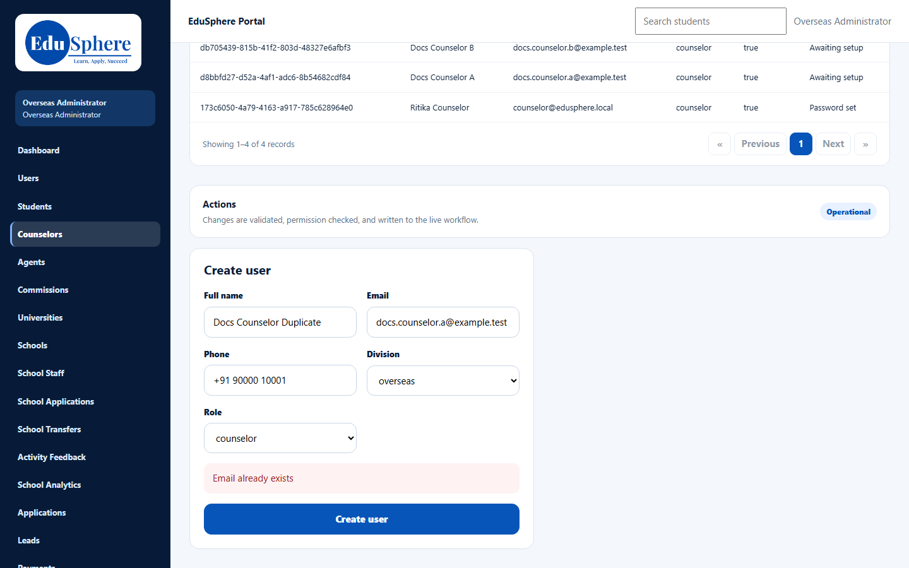

# Create a counselor account
> Doc ID: DOC-CNS-ADM-001 · Verified on 2026-10-30 against `main` @ `045d8c40` · Roles: Overseas Admin, Super Admin

## Purpose
Give a new Overseas counselor their own EduSphere account. The counselor receives an email with a link to set their password, and can then sign in to the Overseas portal.

## Who Can Use This Feature
- **Overseas Admin**: on **Counselors** or **Users**.
- **Super Admin**: on **Users** in the administration portal.

### What each role sees
| | Overseas Admin | Super Admin |
|---|---|---|
| Where | **Counselors** (or **Users**) | **Users** (`/admin/users`) |
| **Division** | Fixed to **overseas** | Starts on **it**; you must choose **overseas** |
| **Role** options | overseas student, counselor, university rep, agent, overseas admin | All roles in every division |

## Prerequisites
- You are signed in as an Overseas Admin (Overseas portal) or Super Admin (`/admin/login`).
- The counselor's email address is not used by any other EduSphere account.

## How to Access
- Overseas Admin: sidebar **Counselors**. The **Create user** form is below the counselor list.
- Super Admin: sidebar **Users**.

## Steps
### Step 1 — Open Counselors
In the sidebar, select **Counselors**. The table lists every counselor with their **Setup** state: **Password set** or **Awaiting setup**.

### Step 2 — Fill in the Create user form
In **Create user**, enter the counselor's **Full name**, **Email** and **Phone**. Leave **Division** on **overseas** and choose **counselor** in **Role**.

### Step 3 — Create the account
Select **Create user**. The message **User created. A set-password link was emailed and is valid for 72 hours.** appears under the form, and the new counselor appears in the list with **Awaiting setup**.

### Step 4 (Super Admin only) — Choose the Overseas division
On `/admin/users` the **Division** list starts on **it**. Choose **overseas** before you select **counselor**. If you leave **it**, the account becomes an IT counselor, who cannot sign in to the Overseas portal.

## Fields
| Field | Description | Required | Example |
|---|---|---|---|
| Full name | The counselor's name as it appears to students and colleagues | Yes | Docs Counselor A |
| Email | Sign-in email; the set-password link goes here | Yes | docs.counselor.a@example.test |
| Phone | Contact number | No | +91 90000 10001 |
| Division | **overseas** for Overseas counselors (fixed for the Overseas Admin) | Yes | overseas |
| Role | Choose **counselor** | Yes | counselor |

## Expected Result
- The account exists with **Awaiting setup**.
- A welcome email with a set-password link (valid for 72 hours) is sent to the counselor.
- Once the counselor sets a password, the Setup state changes to **Password set**. See [Set your first password](../../user-manual/account-access/auth-002-first-password.md).

## Validation Messages
| Message | When |
|---|---|
| User created. A set-password link was emailed and is valid for 72 hours. | Success |
| User created. The email was not delivered (…). Re-send the link from the Users page or dashboard once email works, or ask the user to use "Forgot your password?" on the sign-in page. | The account was created but email could not be sent |
| Email already exists | Another account already uses this email |
| Cannot create users in another division | An Overseas Admin tried to create a user outside Overseas |
| Role is not valid for the selected division | The role does not exist in the chosen division |

## Common Errors
**Problem:** "Email already exists". **Cause:** The address belongs to another account, which may be inactive. **Resolution:** Search for it on **Users**. Reactivate that account or use a different email.

**Problem:** The new counselor cannot sign in at the Overseas portal. **Cause:** A Super Admin created the account with **Division** left on **it**. **Resolution:** Create the account again with **overseas**, or ask an Overseas Admin to create it.

**Problem:** The counselor did not get the email. **Resolution:** Re-send the link from **Users**. See [Manage counselor users](adm-002-manage-counselor-users.md).

## Tips
- The counselor table shows an internal **reference** code and **true/false** in **Active**; you do not need either to create a counselor.
- Creating the account does not give the counselor any students or leads. Assign them afterwards (see Related Features).

## Related Features
- [Manage counselor users](adm-002-manage-counselor-users.md)
- [Assign or change a student's counselor](adm-003-student-counselor.md)
- [Assign or change an application's counselor](adm-004-application-counselor.md)
