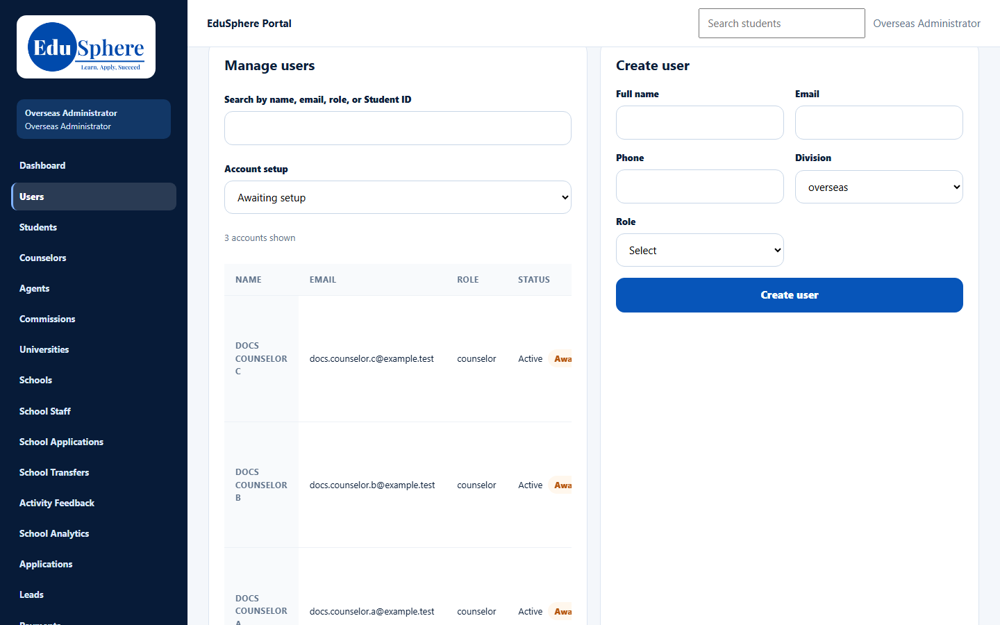
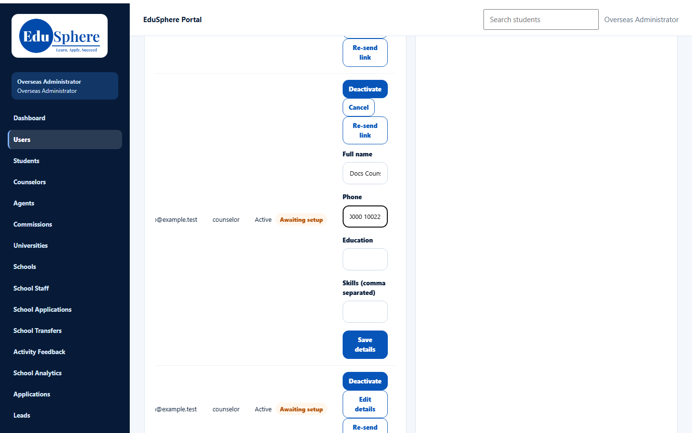
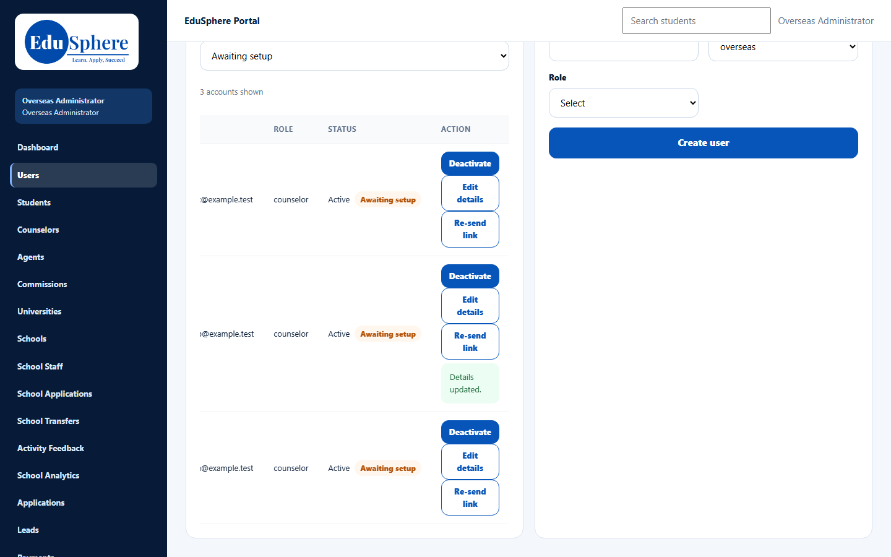
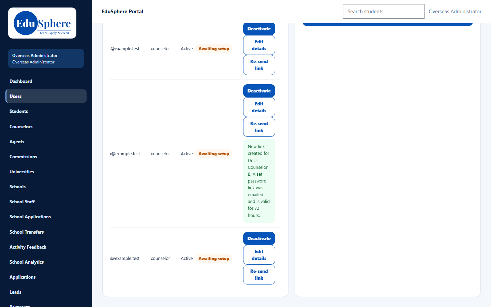
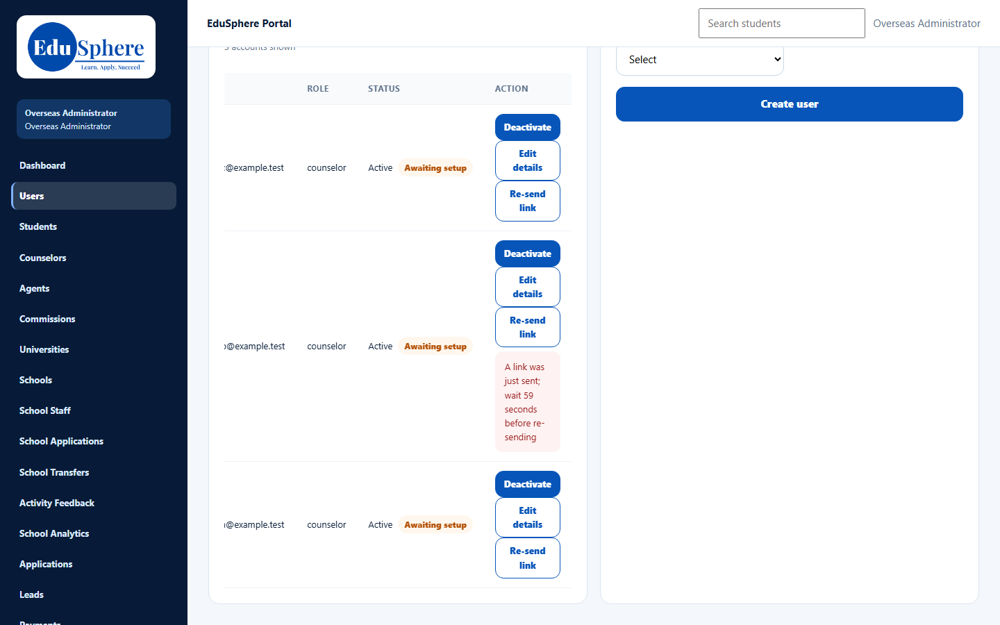

# Manage counselor users: set-up status, re-send link, edit, deactivate
> Doc ID: DOC-CNS-ADM-002 · Verified on 2026-10-30 against `main` @ `045d8c40` · Roles: Overseas Admin, Super Admin

## Purpose
Find counselors who have not yet set their password, re-send their set-password link, correct their details, and deactivate an account when a counselor leaves.

## Who Can Use This Feature
- **Overseas Admin**: the **Manage users** panel is on **Users** only. The **Counselors** page has the create form but no Manage users panel.
- **Super Admin**: the same panel on the administration portal's user pages.

## Prerequisites
- At least one counselor account exists. See [Create a counselor account](adm-001-create-counselor.md).

## How to Access
Sidebar **Users** → scroll to **Manage users**.

## Steps
### Step 1 — Find counselors awaiting set-up
In **Manage users**, set **Account setup** to **Awaiting setup**. The count above the table (for example, **3 accounts shown**) updates. Use **Search by name, email, role, or Student ID** to find one person.

> The Manage users table is wider than its panel at normal desktop widths. Scroll it sideways to reach the **Status** and **Action** columns. When you act on a row, the table scrolls so that the **Action** column is in view and the name column is hidden.

### Step 2 — Edit details
In the counselor's row, select **Edit details**. Change **Full name**, **Phone**, **Education** or **Skills (comma separated)**, then select **Save details**. **Details updated.** appears in the row. Select **Cancel** to close without saving.

### Step 3 — Re-send the set-password link
In the row of a counselor who is **Awaiting setup** (or whose link has expired), select **Re-send link**. The message **New link created for {name}. A set-password link was emailed and is valid for 72 hours.** appears. The earlier link stops working.

If you select **Re-send link** again within a minute, you see **A link was just sent; wait {n} seconds before re-sending**.

### Step 4 — Deactivate or reactivate a counselor
VERIFICATION REQUIRED. This is captured in session S10 with a dedicated test counselor. From code: **Deactivate** → **Confirm deactivate** shows "{name} deactivated."; **Reactivate** shows "{name} reactivated.". Any change to active/inactive cancels open set-password links. Deactivation does **not** move the counselor's leads, students, applications or tasks to anyone else.

## Fields
| Field | Description | Required | Example |
|---|---|---|---|
| Search by name, email, role, or Student ID | Narrows the table as you type | No | docs.counselor |
| Account setup | **All accounts**, **Awaiting setup** or **Link expired** | No | Awaiting setup |
| Full name (Edit details) | Display name | Yes | Docs Counselor B |
| Phone (Edit details) | Contact number | No | +91 90000 10022 |
| Education / Skills (Edit details) | Optional profile details | No | — |

## Expected Result
- Details are saved and shown immediately.
- A re-sent link arrives by email and is valid for 72 hours; the status stays **Awaiting setup** until the counselor sets a password.

## Validation Messages
| Message | When |
|---|---|
| Details updated. | Edit saved |
| New link created for {name}. A set-password link was emailed and is valid for 72 hours. | Link re-sent |
| A link was just sent; wait {n} seconds before re-sending | Re-sent less than a minute ago |
| This account has no pending invitation (its password is already set) | The counselor has already set a password; they can use **Forgot your password?** instead |
| Reactivate this account before re-sending its link | The account is inactive |
| Cannot manage another division / Cannot edit another division | An Overseas Admin acting on a non-Overseas account |

## Common Errors
**Problem:** The **Action** buttons are not visible. **Cause:** The table is wider than its panel. **Resolution:** Scroll the table to the right.

**Problem:** "This account has no pending invitation". **Resolution:** The counselor has already set a password. Ask them to use **Forgot your password?** on the sign-in page.

**Problem:** A deactivated counselor's students and leads still show their name. **Cause:** Deactivation does not reassign work. **Resolution:** Reassign the students and applications before or after deactivating. See Related Features.

## Tips
- Use **Link expired** each week to catch counselors who never finished set-up.
- The **Counselors** page shows the same **Setup** state, but it has no re-send or deactivate buttons; use **Users**.

## Related Features
- [Create a counselor account](adm-001-create-counselor.md)
- [Assign or change a student's counselor](adm-003-student-counselor.md)
- [Assign or change an application's counselor](adm-004-application-counselor.md)
- [Set your first password](../../user-manual/account-access/auth-002-first-password.md)
