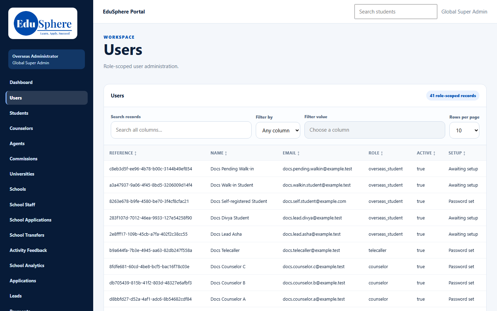
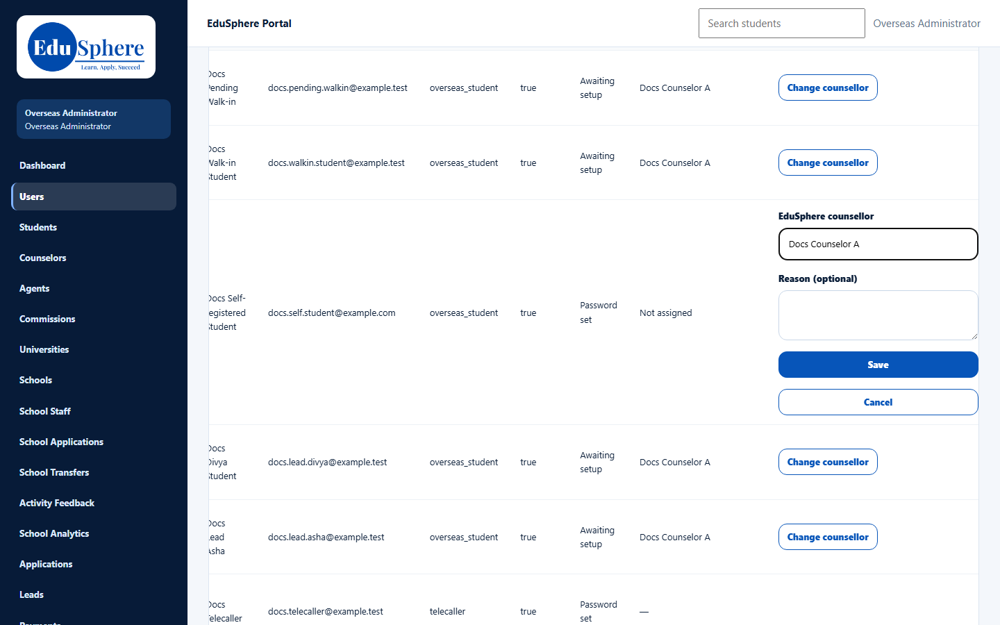
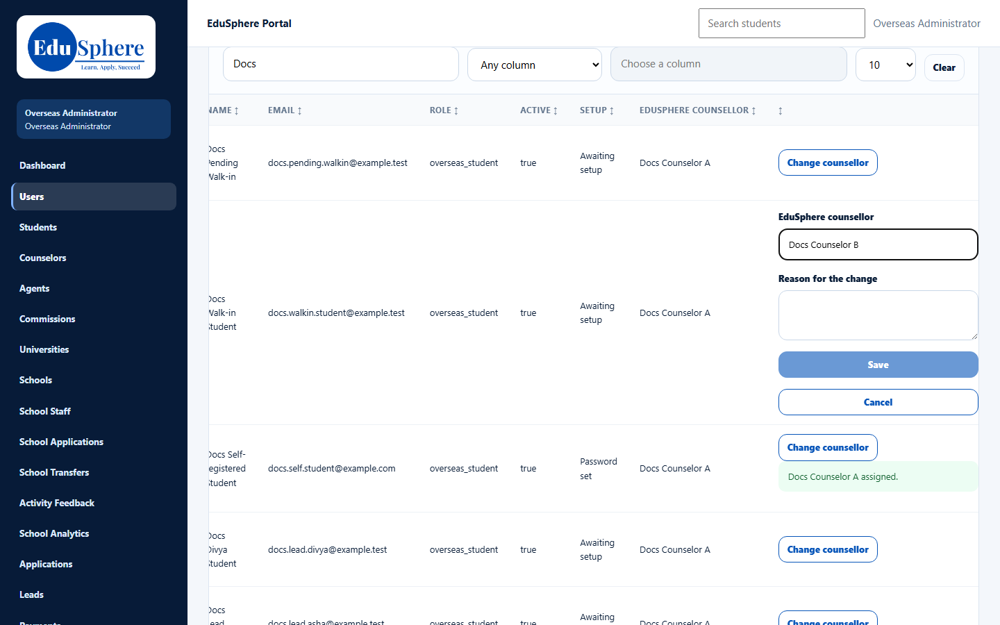
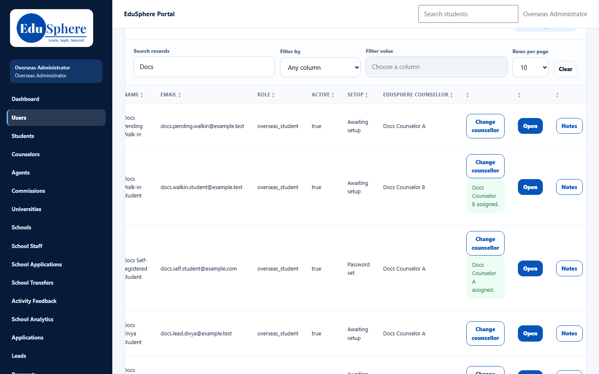

# Assign or change a student's counselor
> Doc ID: DOC-CNS-ADM-003 · Verified on 2026-10-30 against `main` @ `045d8c40` · Roles: Overseas Admin

## Purpose
Give a student an EduSphere counselor, or move them to another counselor with a recorded reason.

## Who Can Use This Feature
### What each role sees
| | Overseas Admin | Super Admin |
|---|---|---|
| **EduSphere counsellor** column | Yes, with **Assign counsellor** / **Change counsellor** | No column; can't assign |

## Prerequisites
The counselor is an active Overseas counselor.

## How to Access
Sidebar **Users** → the overseas student's row → **EduSphere counsellor** column.

## Steps
### Step 1 — Find the student
Use **Search records** to find the student. **EduSphere counsellor** shows their counselor or **Not assigned**.

### Step 2 — Assign a first counselor
Select **Assign counsellor**. Type in **EduSphere counsellor** and pick the counselor. **Reason (optional)** can be left empty. Select **Save**. **{counselor} assigned.** appears.

### Step 3 — Change the counselor
Select **Change counsellor** and pick the new counselor. **Reason for the change** is required, and **Save** stays disabled until you enter one.

## Fields
| Field | Description | Required | Example |
|---|---|---|---|
| EduSphere counsellor | An active Overseas counselor | Yes | Docs Counselor B |
| Reason (optional) / Reason for the change | Why; required when replacing a counselor | When changing | Balancing caseloads this week. |

## Expected Result
- The student moves to the new counselor's **My students**, and the previous counselor no longer sees them.
- Both counselors get an in-app notice.
- The reason is shown in the student's **History**.

## Validation Messages
| Message | When |
|---|---|
| {counselor} assigned. | Success |
| Give a reason for the reassignment | Changing without a reason |
| Choose an active overseas counselor | Invalid counselor |
| Only the Overseas Admin can assign a counselor | Any other role |

## Tips
- Write reasons the counselors will understand; they read them in History.

## Related Features
- [Assign or change an application's counselor](adm-004-application-counselor.md)
- [When a student is reassigned (counselor view)](../../user-manual/students/stu-010-reassignment.md)
