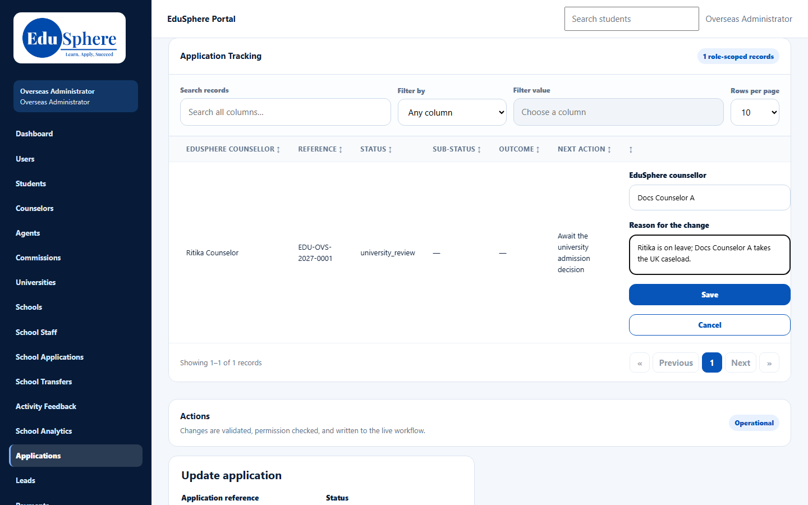
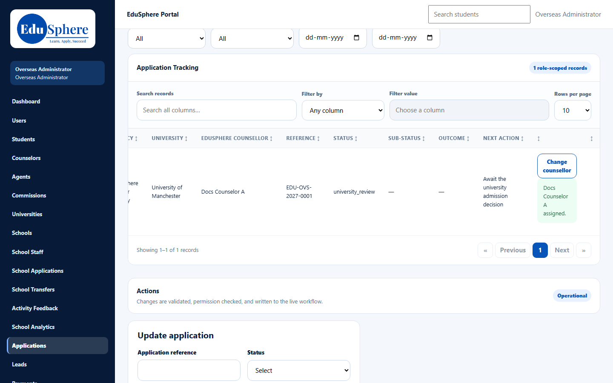

# Assign or change an application's counselor
> Doc ID: DOC-CNS-ADM-004 · Verified on 2026-10-30 against `main` @ `045d8c40` · Roles: Overseas Admin

## Purpose
Decide which counselor handles an application, including agency applications that arrive with no counselor.

## Who Can Use This Feature
The Overseas Admin. The Super Admin can't assign counselors.

## Prerequisites
The application is open (not withdrawn or enrolled).

## How to Access
Sidebar **Applications** (or **Students**). The page title is **Application Tracking**, and the **EduSphere counsellor** column has the controls.

## Steps
### Step 1 — Find the application
Filter by **Counsellor** (choose **Not assigned** to find new agency applications), **Agency**, **University** and the other filters.

### Step 2 — Assign or change
Select **Assign counsellor** or **Change counsellor**, pick the counselor in **EduSphere counsellor**, and enter **Reason for the change** (required when replacing). Select **Save**. **{counselor} assigned.** appears and the column updates.

## Fields
| Field | Description | Required | Example |
|---|---|---|---|
| EduSphere counsellor | An active Overseas counselor | Yes | Docs Counselor A |
| Reason for the change | Required when replacing | When changing | Ritika is on leave; Docs Counselor A takes the UK caseload. |

## Expected Result
- The application appears in the new counselor's **Application Tracking**, and its student in their **My students**.
- Counselors are notified ("Application assigned to you" / "Application reassigned").

## Validation Messages
| Message | When |
|---|---|
| {counselor} assigned. | Success |
| This application is closed | Withdrawn or enrolled |
| Choose an active overseas counselor | Invalid counselor |
| Only the Overseas Admin can assign a counselor | Any other role |

## Common Errors
**Problem:** No assign control on a row. **Cause:** The application is closed.

## Tips
- Check **Counsellor = Not assigned** daily; agency applications arrive unassigned and nobody is alerted.

## Related Features
- [Assign or change a student's counselor](adm-003-student-counselor.md)
- [Agency students and applications](../../user-manual/handoffs/ho-003-agency-students.md)
