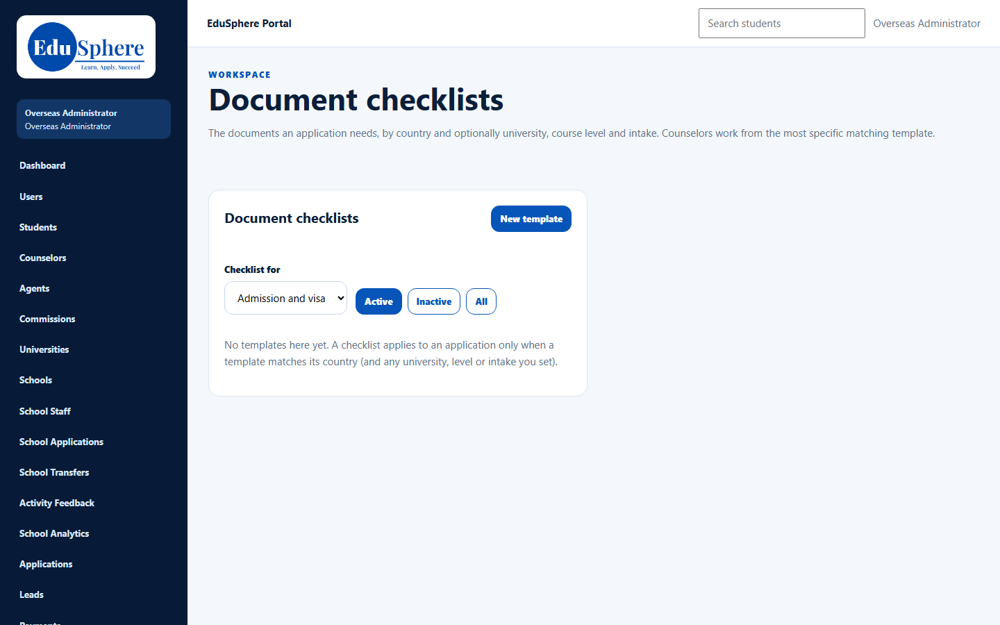
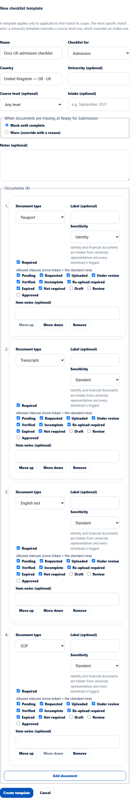
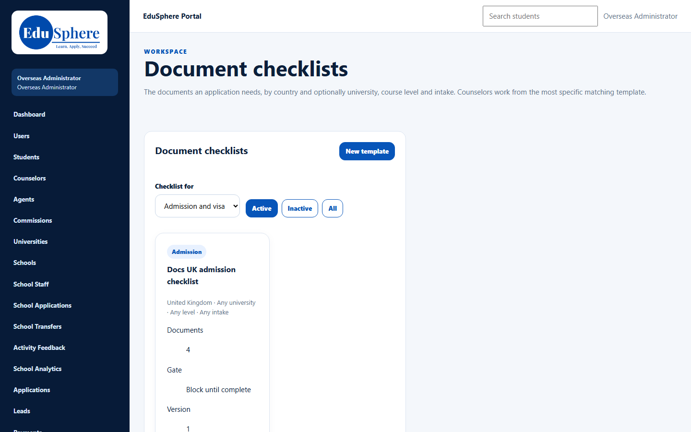

# Document checklist templates
> Doc ID: DOC-CNS-CFG-001 · Verified on 2026-10-30 against `main` @ `045d8c40` · Roles: Overseas Admin (Super Admin by direct link)

## Purpose
Define which documents an application needs, by country and optionally by university, course level and intake. Counselors work from the most specific template that matches each application. The template also decides what happens at **Ready for Submission** when documents are missing.

## Who Can Use This Feature
- **Overseas Admin**: create, edit and deactivate templates.
- **Super Admin**: can open the page by its address (`/overseas/admin/checklists`); it is not in the Super Admin sidebar.
- **Counselors** only read the resulting checklist on each application.

## Prerequisites
- You know the country (and, if needed, the university, course level or intake) the checklist is for.

## How to Access
Sidebar **Document checklists**.

## Steps
### Step 1 — Open Document checklists
Select **Document checklists**. Before any template exists, the page says **No templates here yet.**

### Step 2 — Start a new template
Select **New template**. The editor **New checklist template** opens. It explains that the most specific match wins: a university template overrides a course-level one, which overrides an intake one.

### Step 3 — Set the scope and the gate
Enter a **Name** and choose **Checklist for** (**Admission** or **Visa**). Type the **Country** and pick it from the list (for example **United Kingdom — GB · UK**). Optionally set **University**, **Course level** and **Intake**. Under **When documents are missing at Ready for Submission**, choose **Block until complete** or **Warn (override with a reason)**.

### Step 4 — Add the documents
For each document, choose a **Document type**, an optional **Label**, keep **Required** ticked if it is mandatory, and choose its **Sensitivity**. **Identity** and **Financial** documents are hidden from university representatives, and every download is logged. Leave **Allowed statuses** as they are unless you need fewer. Select **Add document** for the next one; use **Move up**, **Move down** and **Remove** to arrange them.

### Step 5 — Create the template
Select **Create template**. The message **Created {name} (version 1).** appears and the template card shows its scope, number of documents, gate and version.

## Fields
| Field | Description | Required | Example |
|---|---|---|---|
| Name | Template name shown to admins | Yes | Docs UK admission checklist |
| Checklist for | **Admission** or **Visa** | Yes | Admission |
| Country | Country the applications are for | Yes | United Kingdom |
| University (optional) | Limits the template to one university | No | — |
| Course level (optional) | **Any level**, UG, PG, PhD, Diploma, Foundation | No | Any level |
| Intake (optional) | Limits to one intake | No | September 2027 |
| When documents are missing at Ready for Submission | **Block until complete** or **Warn (override with a reason)** | Yes | Block until complete |
| Notes (optional) | Internal notes | No | — |
| Document type | Passport, Academic certificates, Transcripts, English test, CV, SOP, LOR, Financial documents, Offer letter, Other | Yes | Passport |
| Label (optional) | Custom name for the document | No | — |
| Required | Whether the document must be complete | — | Ticked |
| Sensitivity | **Standard**, **Identity**, **Financial** | Yes | Identity |
| Allowed statuses | The statuses counselors can set; none ticked means the standard nine | No | Defaults |
| Item notes (optional) | Guidance for this document | No | — |

## Expected Result
The template appears under **Active**. Applications that match its scope get this checklist, and the **Ready for Submission** step follows its gate. See [Application document checklist](../../user-manual/documents/doc-001-application-checklist.md) and [Sub-status and the Ready-for-Submission gate](../../user-manual/applications/app-005-sub-status-ready-gate.md).

## Validation Messages
| Message | When |
|---|---|
| Created {name} (version 1). | Template created |
| Someone else saved this template since you opened it; reload to see their changes | Two admins edited the same template |
| Checklist template not found | The template was removed or the link is wrong |

## Common Errors
**Problem:** Counselors don't see the checklist on an application. **Cause:** No template matches the application's country (and any university, level or intake you set). **Resolution:** Check the template's scope on its card.

**Problem:** Your save was rejected because someone else saved first. **Resolution:** Reload the page, then make your change again.

## Tips
- Start with one broad country template, then add narrower ones only where a university needs something different.
- Use the **Active**, **Inactive** and **All** buttons and the **Checklist for** filter to find templates.

## Related Features
- [Reminder rules](cfg-002-reminder-rules.md)
- [Application document checklist](../../user-manual/documents/doc-001-application-checklist.md)
