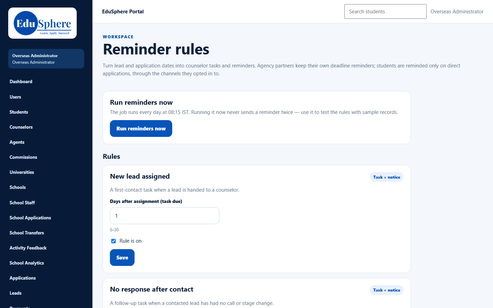
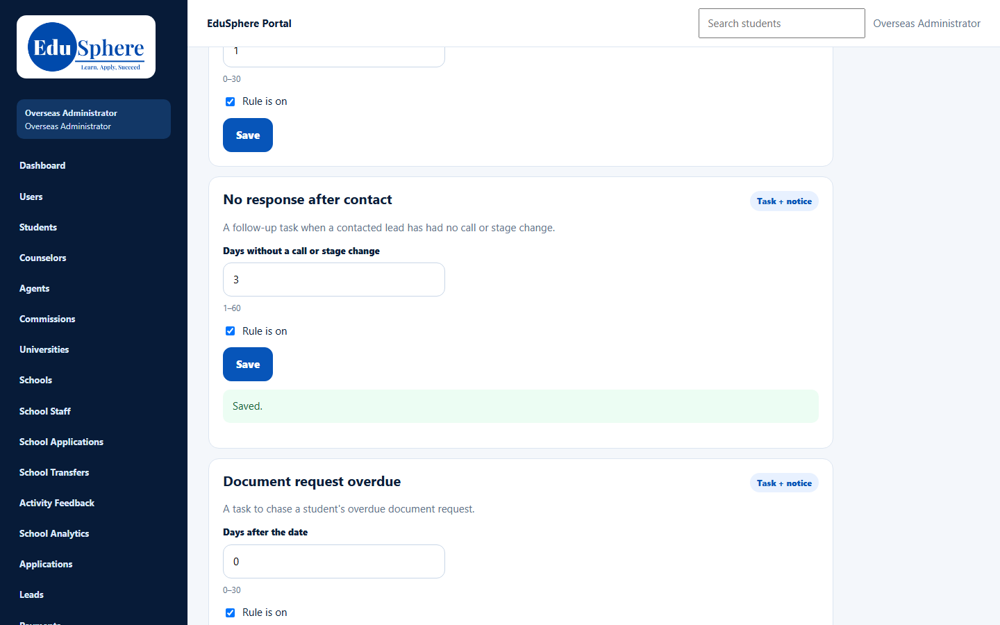
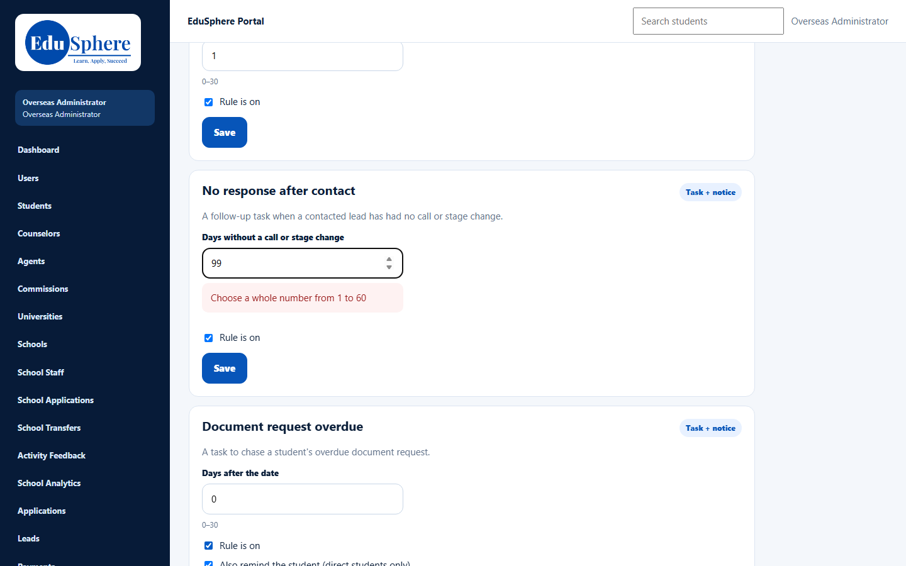
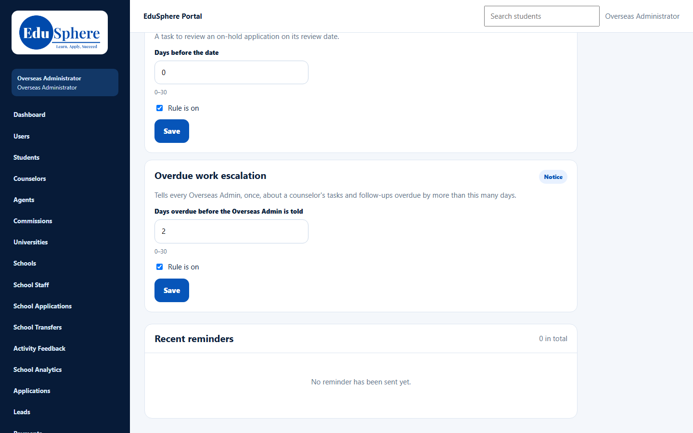

# Reminder rules and Run now
> Doc ID: DOC-CNS-CFG-002 · Verified on 2026-10-30 against `main` @ `045d8c40` · Roles: Overseas Admin (Super Admin by direct link)

## Purpose
Turn lead and application dates into counselor tasks and reminders, for example a first-contact task when a lead is handed over or a notice before an offer deadline. Each rule can be switched on or off and its number of days changed.

## Who Can Use This Feature
- **Overseas Admin**.
- **Super Admin** can open the page by its address (`/overseas/admin/reminder-rules`); it is not in the Super Admin sidebar.

## Prerequisites
None. Every rule is on by default.

## How to Access
Sidebar **Reminder rules**.

## Steps
### Step 1 — Review the rules
Select **Reminder rules**. Each card names the rule, says whether it creates a **Task + notice** or only a **Notice**, describes when it fires, and shows the allowed range of days under the number box.

### Step 2 — Change a rule
Change the number of days, tick or untick **Rule is on** and, where offered, **Also remind the student (direct students only)**. Then select **Save** on that card. **Saved.** appears.

If the number is outside the range, the card shows **Choose a whole number from {min} to {max}** and nothing is saved.

### Step 3 — Check recent reminders
Scroll to **Recent reminders** to see what the rules have created (When · Rule · About · Task · Told). Before the first run it says **No reminder has been sent yet.**

### Step 4 — Run reminders now
VERIFICATION REQUIRED (captured in session S9, when there are overdue items). The rules run every day at 08:15 IST. **Run reminders now** runs them immediately. Running it again never sends the same reminder twice.

## The rules
| Rule | Creates | Days setting | Range | Can remind the student |
|---|---|---|---|---|
| New lead assigned | Task + notice | Days after assignment (task due) | 0–30 | No |
| No response after contact | Task + notice | Days without a call or stage change | 1–60 | No |
| Document request overdue | Task + notice | Days after the date | 0–30 | Yes |
| Application deadline approaching | Notice | Days before the date | 0–60 | No |
| University decision overdue | Task + notice | Days after the date | 0–30 | No |
| Offer deadline approaching | Notice | Days before the date | 0–60 | Yes |
| Deposit due | Notice | Days before the date | 0–60 | Yes |
| Offer condition due | Notice | Days before the date | 0–60 | Yes |
| Visa appointment approaching | Notice | Days before the date | 0–30 | Yes |
| On-hold review date | Task + notice | Days before the date | 0–30 | No |
| Overdue work escalation | Notice to every Overseas Admin | Days overdue before the Overseas Admin is told | 0–30 | No |

Students are reminded only on direct applications, through the channels they opted in to. Agency partners keep their own deadline reminders.

## Validation Messages
| Message | When |
|---|---|
| Saved. | The rule was saved |
| Choose a whole number from {min} to {max} | The number is outside the rule's range |

## Common Errors
**Problem:** A counselor says they never see reminder notices. **Cause:** The counselor portal has no Notifications page. Reminder **tasks** appear on the counselor's **Tasks** page, but notices have nowhere to show. **Resolution:** Rely on the task-creating rules (**Task + notice**) for work counselors must act on.

## Tips
- Turning a rule off stops new reminders; it does not delete tasks already created.
- The **Overdue work escalation** rule is how Overseas Admins hear about overdue counselor work. See [Overdue by counselor and the escalation notice](../escalation/esc-002-overdue-escalation.md).

## Related Features
- [Counselor tasks (admin view)](../escalation/esc-001-counselor-tasks-admin.md)
- [Automatic reminders (counselor view)](../../user-manual/follow-ups/fup-003-automatic-reminders.md)
