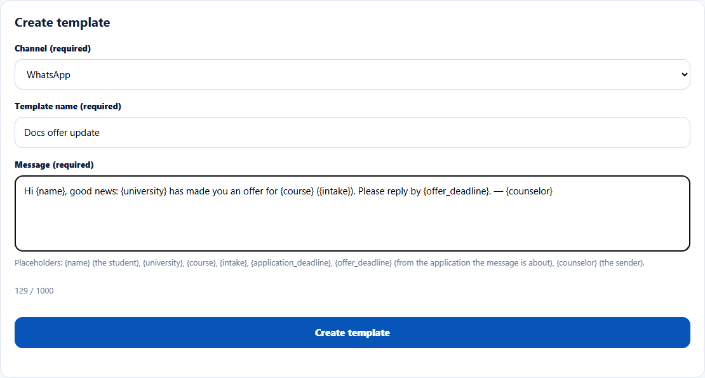
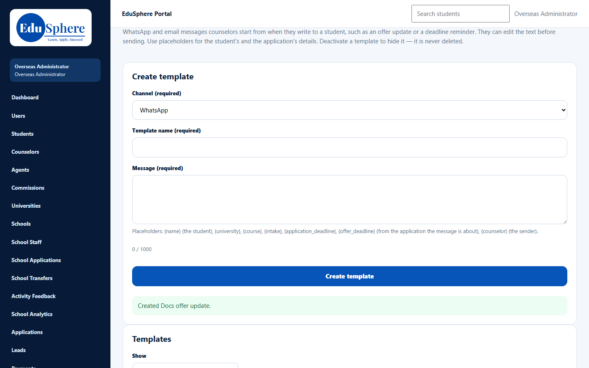
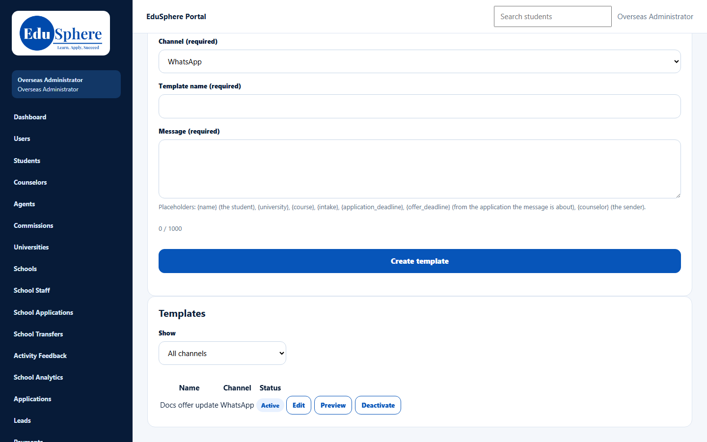

# Counselor message templates
> Doc ID: DOC-CNS-CFG-003 · Verified on 2026-10-30 against `main` @ `045d8c40` · Roles: Overseas Admin, Super Admin (by direct link)

## Purpose
Give counselors ready-made WhatsApp and email messages, such as an offer update or a deadline reminder, to start from when they write to a student. Counselors can edit the text before sending.

## Who Can Use This Feature
- **Overseas Admin**.
- **Super Admin** can open the page by its address (`/overseas/admin/message-templates`).

## Prerequisites
None.

## How to Access
Sidebar **Message templates**.

## Steps
### Step 1 — Fill in Create template
Choose the **Channel** (**WhatsApp** or **Email**), enter a **Template name** and write the **Message**. Use placeholders for the student's and the application's details; they are filled in when the counselor uses the template. The counter shows how many of the 1000 characters you have used.

### Step 2 — Create it
Select **Create template**. **Created {name}.** appears.

### Step 3 — Manage templates
In **Templates**, filter with **Show** (**All channels**, **WhatsApp**, **Email**). Each template shows its **Name**, **Channel** and **Status** with **Edit**, **Preview** and **Deactivate** buttons. Deactivating hides a template from counselors; templates are never deleted.

## Fields
| Field | Description | Required | Example |
|---|---|---|---|
| Channel | WhatsApp or Email | Yes | WhatsApp |
| Template name | Name counselors pick from | Yes | Docs offer update |
| Message | Up to 1000 characters, with placeholders | Yes | Hi {name}, good news: {university} has made you an offer… |

**Placeholders:** `{name}` (the student), `{university}`, `{course}`, `{intake}`, `{application_deadline}`, `{offer_deadline}` (from the application the message is about), `{counselor}` (the sender).

## Expected Result
The template is **Active**, and counselors can choose it when they message a student.

## Validation Messages
| Message | When |
|---|---|
| Created {name}. | Template created |

## Common Errors
**Problem:** A placeholder appears as typed (for example `{offer_deadline}`) in the counselor's draft. **Cause:** The message is not about an application that has that date. **Resolution:** Counselors should edit the text before sending.

## Tips
- Keep WhatsApp templates short; use Email for longer explanations.
- Use **Preview** to check how the text reads before counselors use it.

## Related Features
- [Counselor Chat with students](../../user-manual/chat/chat-001-counselor-chat.md)
- [Reminder rules](cfg-002-reminder-rules.md)
