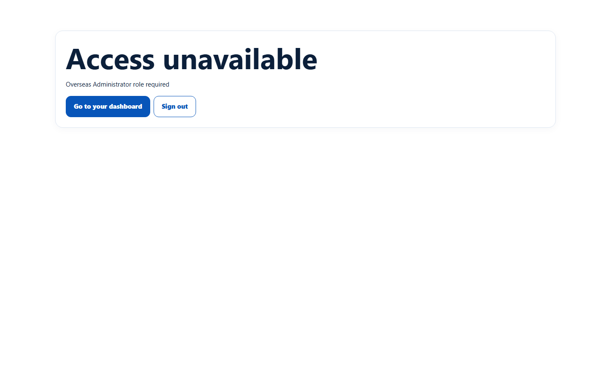
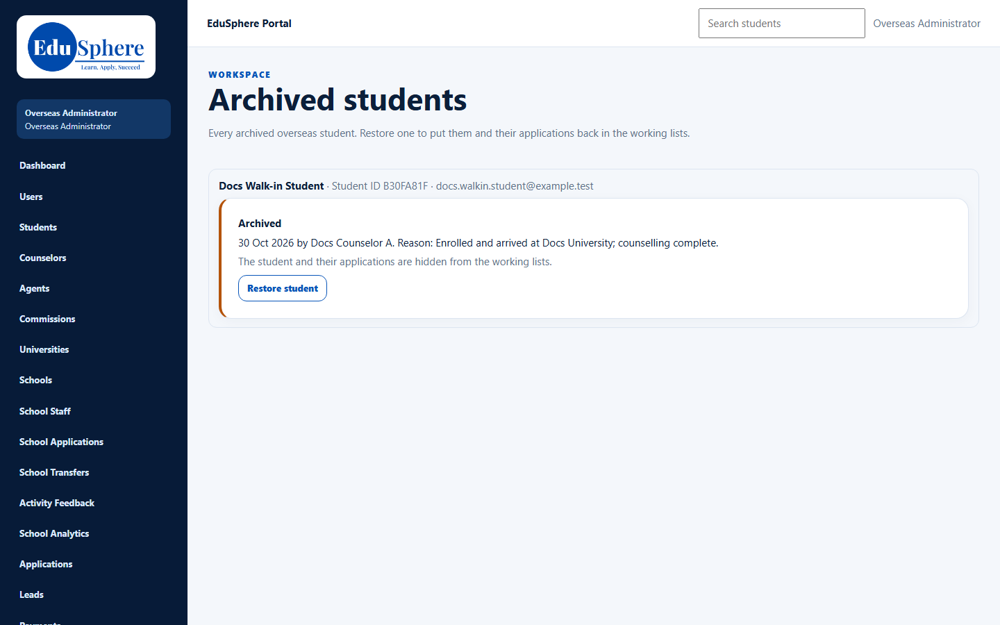
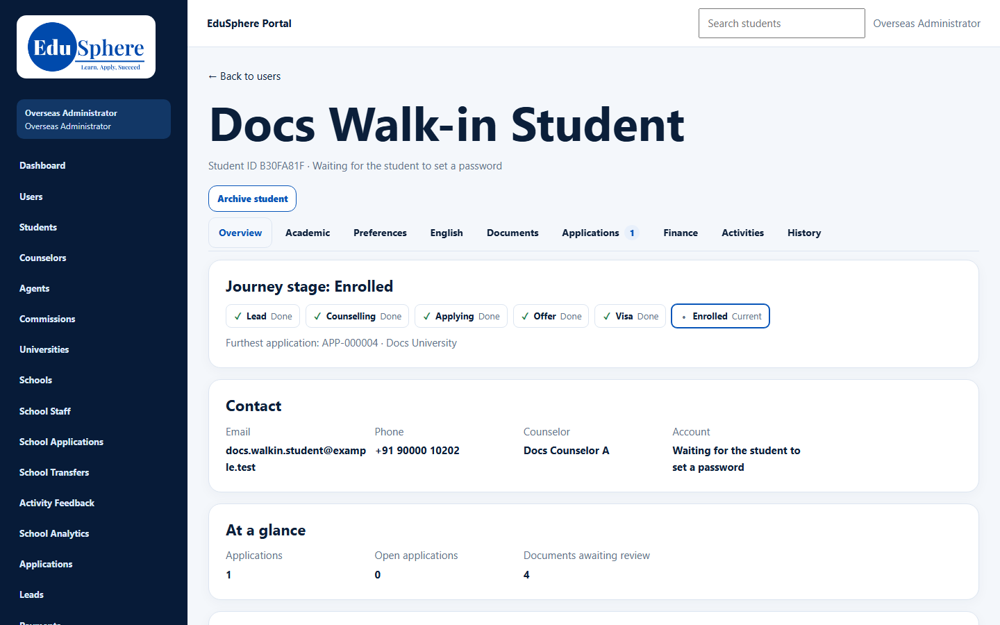

# Archived students: restore
> Doc ID: DOC-CNS-CFG-004 · Verified on 2026-10-30 against `main` @ `045d8c40` · Roles: Overseas Admin

## Purpose
See every archived Overseas student and bring one back into the working lists.

## Who Can Use This Feature
### What each role sees
| | Overseas Admin | Super Admin |
|---|---|---|
| **Archived students** page | Every archived student, with **Restore student** | "Access unavailable — Overseas Administrator role required" |

## Prerequisites
At least one student is archived (see [Archive a student](../../user-manual/students/stu-008-archive.md)).

## How to Access
Sidebar **Archived students**.

## Steps
### Step 1 — Find the student
The page says "Every archived overseas student. Restore one to put them and their applications back in the working lists." Each row shows the name, Student ID, email and the archive banner (date, who and reason).

### Step 2 — Restore
Select **Restore student** on the row, or open the student and select it there. The banner disappears.

## Expected Result
The student and their applications return to the counselor's lists. The counselor is notified ("Student restored"), and **History** shows "Restored".

## Validation Messages
| Message | When |
|---|---|
| Overseas Administrator role required | Any other role opens the page |
| Only the Overseas Admin can restore a student | Any other role tries to restore |

## Related Features
- [Archive a student (counselor)](../../user-manual/students/stu-008-archive.md)
