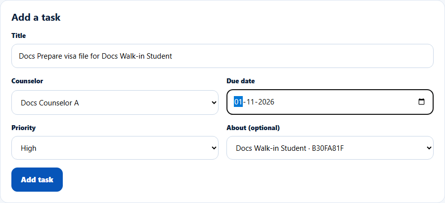
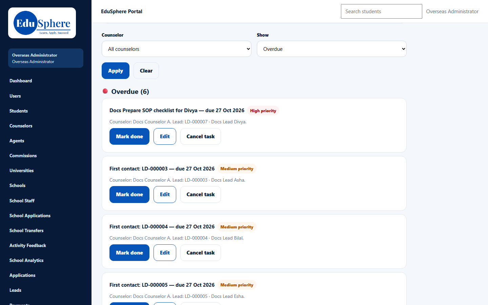

# Counselor tasks (admin view)
> Doc ID: DOC-CNS-ESC-001 · Verified on 2026-10-30 against `main` @ `045d8c40` · Roles: Overseas Admin, Super Admin (by address)
> Overdue items in the screenshots were prepared by moving test dates back in the documentation database (owner instruction, 2026-10-30).

## Purpose
See every Overseas counselor's tasks, and give a counselor a task.

## Who Can Use This Feature
- **Overseas Admin**: sidebar **Counselor tasks**.
- **Super Admin**: the page opens by its address (`/overseas/admin/counselor-tasks`) with the Overseas Admin's sidebar.

## Prerequisites
None.

## How to Access
Sidebar **Counselor tasks**.

## Steps
### Step 1 — Read the page
The summary line counts every counselor's tasks, for example "5 overdue · 1 due today · 1 upcoming". Below it are **Overdue by counselor** (see [ESC-002](esc-002-overdue-escalation.md)), **Add a task** and the task list grouped by band.

### Step 2 — Give a counselor a task
In **Add a task**, enter the **Title**, choose the **Counselor**, **Due date** and **Priority**, and optionally **About**: one of that counselor's leads, students or applications. Select **Add task**. **Task added.** appears, and the counselor is notified.

On the counselor's **My tasks**, the task shows "Given by {you}". The counselor can mark it done or cancel it, but not edit it.

### Step 3 — Filter
Use **Counselor** (All counselors or one) and **Show**: Open and recently done, Overdue, Today, Upcoming, Done (last 7 days) or Cancelled. Select **Apply**. Each task has **Mark done**, **Reopen**, **Edit** and **Cancel task**.

## Fields
| Field | Description | Required | Example |
|---|---|---|---|
| Title | 2–200 characters | Yes | Docs Prepare visa file for Docs Walk-in Student |
| Counselor | An Overseas counselor | Yes | Docs Counselor A |
| Due date | Today or later | Yes | 1 Nov 2026 |
| Priority | High, Medium, Low | Yes | High |
| About (optional) | That counselor's lead, student or application | No | Docs Walk-in Student |

## Expected Result
The task appears on the counselor's **My tasks** and in this list, and counts in the summary line and in **Overdue by counselor** once it is overdue.

## Validation Messages
| Message | When |
|---|---|
| Task added. | Success |
| Give the title (2-200 characters) / Choose the counselor / Choose the due date / The due date can't be in the past | Missing or invalid fields |
| No counselor has an open task. / No tasks match these filters. | Empty list |

## Related Features
- [Overdue by counselor and the escalation notice](esc-002-overdue-escalation.md)
- [My tasks (counselor)](../../user-manual/tasks/task-001-my-tasks.md)
