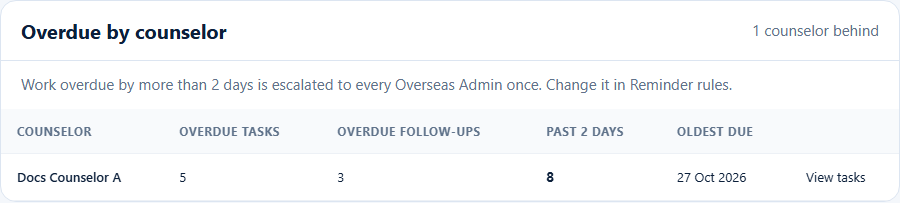
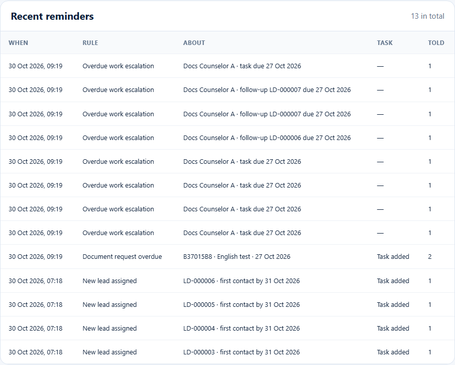

# Overdue by counselor and the escalation notice
> Doc ID: DOC-CNS-ESC-002 · Verified on 2026-10-30 against `main` @ `045d8c40` · Roles: Overseas Admin
> Overdue items in the screenshots were prepared by moving test dates back in the documentation database (owner instruction, 2026-10-30).

## Purpose
Spot counselors whose tasks and follow-ups are overdue, before students are affected.

## Who Can Use This Feature
The Overseas Admin.

## Prerequisites
The **Overdue work escalation** reminder rule is on (it is by default, at 2 days).

## How to Access
Sidebar **Counselor tasks** → **Overdue by counselor**.

## Steps
### Step 1 — Read Overdue by counselor
The card shows "{n} counselor(s) behind" and the rule: "Work overdue by more than {N} days is escalated to every Overseas Admin once. Change it in Reminder rules." For each counselor it lists:
- **Overdue tasks** and **Overdue follow-ups**;
- **Past {N} days**: the items past the escalation threshold;
- **Oldest due**.

Select **View tasks** to see that counselor's tasks.

### Step 2 — The escalation notice
When the reminder rules run (daily at 08:15 IST, or **Run reminders now**), each item overdue past the threshold creates an "Overdue work escalated" notice for every active Overseas Admin, once per item. These appear in **Recent reminders** as "Overdue work escalation".

## Expected Result
You can follow up with the counselor, give them a task, or reassign their students.

## Common Errors
**Problem:** You never see the "Overdue work escalated" notice. **Cause:** The notice is created, but the Overseas Admin portal has no notifications page to show it. **Resolution:** Check **Overdue by counselor** and **Recent reminders** instead.

## Tips
- Overdue work of a deactivated counselor is escalated too, so reassign it.

## Related Features
- [Counselor tasks (admin view)](esc-001-counselor-tasks-admin.md)
- [Reminder rules](../config/cfg-002-reminder-rules.md)
