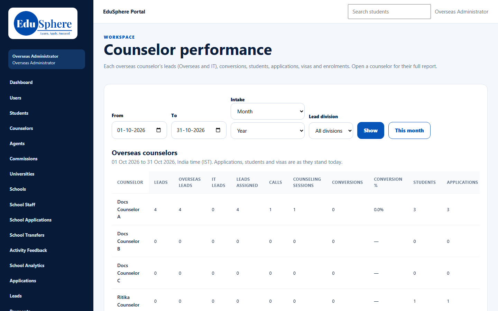
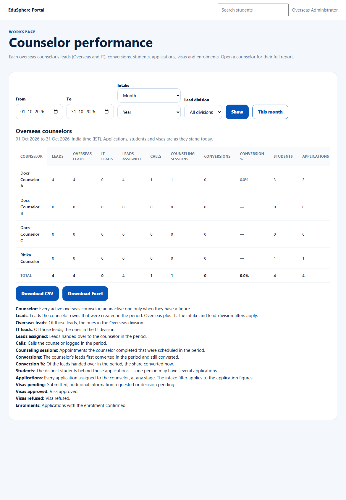

# Team performance
> Doc ID: DOC-CNS-PERF-001 · Verified on 2026-10-30 against `main` @ `045d8c40` · Roles: Overseas Admin, Super Admin (by address)

## Purpose
Compare every Overseas counselor's leads, conversions, students, applications, visas and enrolments.

## Who Can Use This Feature
The Overseas Admin. The Super Admin can open it by its address (`/overseas/admin/counselor-performance`).

## Prerequisites
None.

## How to Access
Sidebar **Counselor performance**.

## Steps
### Step 1 — Choose the period and filters
Set **From** / **To** (the default is this month), optionally **Intake** and **Lead division**, then select **Show**.

### Step 2 — Read the table
**Overseas counselors** has one row per counselor and a **Total** row. The columns are:
- Leads, Overseas leads, IT leads, Leads assigned;
- Calls, Counseling sessions, Conversions, Conversion %;
- Students, Applications;
- Visas pending/approved/refused, Enrolments.

Definitions are listed under the table.

### Step 3 — Export or drill in
**Download CSV** or **Download Excel** exports the table. Select a counselor's name for their [full report](perf-002-counselor-report.md).

## Expected Result
Every active Overseas counselor is listed; an inactive one appears only when they have a figure.

## Related Features
- [One counselor's report](perf-002-counselor-report.md)
- [My performance (counselor view)](../../user-manual/reports/rep-001-my-performance.md)
