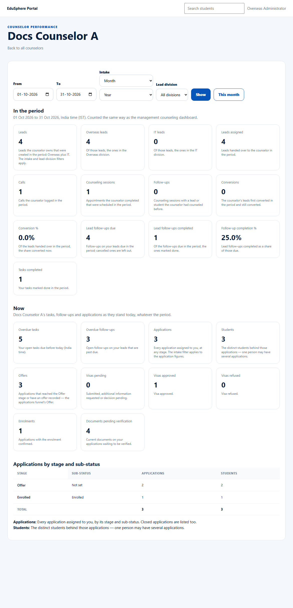

# One counselor's report
> Doc ID: DOC-CNS-PERF-002 · Verified on 2026-10-30 against `main` @ `045d8c40` · Roles: Overseas Admin

## Purpose
See one counselor's full report, exactly as they see it on **My performance**.

## Who Can Use This Feature
The Overseas Admin.

## Prerequisites
None.

## How to Access
**Counselor performance** → select the counselor's name.

## Steps
### Step 1 — Read the report
The page is headed with the counselor's name (marked "(inactive)" if deactivated) and has a **Back to all counselors** link. It shows:
- the same period filters as Team performance;
- **In the period** figures, each with its definition;
- **Now** figures;
- **Applications by stage and sub-status**.

## Expected Result
The figures match the counselor's own [My performance](../../user-manual/reports/rep-001-my-performance.md).

## Validation Messages
| Message | When |
|---|---|
| No applications are assigned to {name} yet. | No applications |

## Related Features
- [Team performance](perf-001-team-performance.md)
