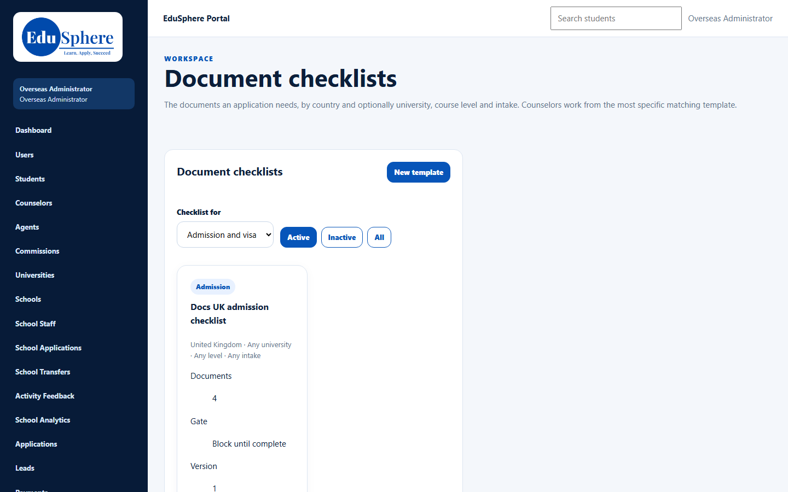

# Role guide: Overseas Admin — counselors

You run the counselor team: you create counselors, decide who handles which student and application, set up the counselor tools, and step in when work is overdue.

## Setting up the team
1. [Create each counselor](../admin-manual/accounts/adm-001-create-counselor.md). They receive a 72-hour set-password link.
2. Each week, filter [Manage users](../admin-manual/accounts/adm-002-manage-counselor-users.md) by **Awaiting setup** or **Link expired** and re-send links.
3. Configure the tools before counselors need them:
   - [Document checklist templates](../admin-manual/config/cfg-001-checklist-templates.md), one per country at least, with the right gate (block or warn);
   - [Reminder rules](../admin-manual/config/cfg-002-reminder-rules.md);
   - [Message templates](../admin-manual/config/cfg-003-message-templates.md).

## Daily
- **Assign new work:**
  - New agency applications arrive unassigned. Filter **Applications** by **Counsellor = Not assigned** and [assign a counselor](../admin-manual/accounts/adm-004-application-counselor.md).
  - Self-registered students need a counselor too: [assign on Users](../admin-manual/accounts/adm-003-student-counselor.md).
- **Overdue work:** the escalation notice and the counselor tasks view (coming in S9) show who is behind.

## When things change
| Situation | What to do |
|---|---|
| A counselor goes on leave | Change the counselor of their students and applications, with a reason ([students](../admin-manual/accounts/adm-003-student-counselor.md), [applications](../admin-manual/accounts/adm-004-application-counselor.md)) |
| A counselor leaves | Reassign their work first, then [deactivate](../admin-manual/accounts/adm-002-manage-counselor-users.md). Deactivation doesn't move work |
| A lead must move to another counselor | No screen for this: the counselor returns it to the telecaller, who hands it to the new counselor |
| A closed application must be reopened | Only you can reopen it |
| A visa decision was recorded wrongly | Only you can correct it |

## Things counselors will ask you
- To change an application's intake: there is no counselor screen for it.
- To unlink a converted lead's student: only an admin can.
- Why they don't see reminder notices: counselors have no notifications page; rely on the task-creating rules.

## Related
[Admin manual index](../admin-manual/README.md) · [Counselor role guide](overseas-counselor.md) · [Troubleshooting](../troubleshooting.md)
