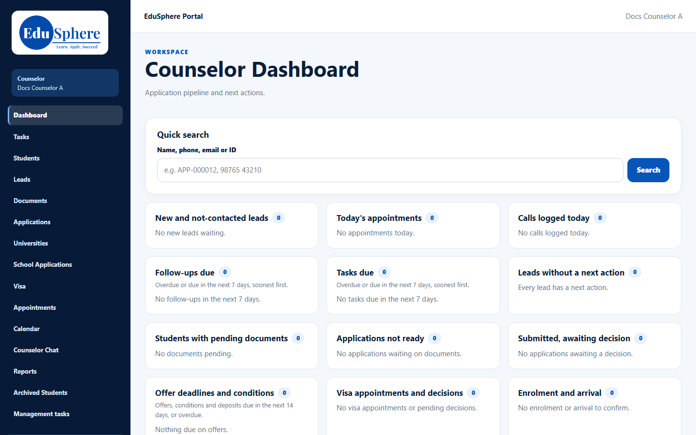

# Role guide: Overseas Counselor

You guide students from their first conversation to their first week at a university abroad. This guide puts the manual pages in the order you use them. Each step links to the full page.

## Your workspace at a glance

- **Sign in** at the Overseas Education Portal: [Sign in](../user-manual/account-access/auth-001-sign-in.md). Your first password comes from the welcome email: [Set your first password](../user-manual/account-access/auth-002-first-password.md).
- The sidebar takes you everywhere: [Portal tour](../user-manual/navigation/nav-001-portal-tour.md). On a phone, sign out from **My profile** → **Logout**: [Sign out](../user-manual/account-access/auth-006-sign-out.md).

## A typical day
1. **Start on the dashboard.** The [Counselor dashboard](../user-manual/dashboard/dash-001-dashboard.md) lists overdue follow-ups and tasks first; [Quick search](../user-manual/dashboard/srch-001-quick-search.md) finds anyone.
2. **Then Tasks.** [My tasks](../user-manual/tasks/task-001-my-tasks.md) shows what is overdue, due today and upcoming, including reminder tasks such as "First contact".
3. **Confirm today's appointments.** Use [Lead appointments](../user-manual/calendar/cal-001-lead-appointments.md), and keep them in your own calendar with the [calendar feed](../user-manual/calendar/cal-002-calendar-feed.md).
4. **Work your leads.** Open each lead from [My leads](../user-manual/leads/lead-001-my-leads.md).
5. **Move applications forward.** Use **Evaluate Applications** on the **Students** page ([Advance stage](../user-manual/applications/app-004-advance-stage.md)).
6. **Clear the document queue.** Review documents in [Document Verification](../user-manual/documents/doc-002-documents-and-status.md).

## Workflow 1: from handover to student account
| Step | Page |
|---|---|
| A telecaller hands you a lead (or you record a walk-in) | [Handover](../user-manual/handoffs/ho-001-telecaller-handover.md) · [Walk-in lead](../user-manual/leads/lead-002-new-walk-in-lead.md) |
| Set a next action, log calls and messages, add follow-ups | [Next action](../user-manual/leads/lead-005-next-action.md) · [Log a call](../user-manual/activity/act-001-log-call.md) · [Follow-ups](../user-manual/follow-ups/fup-001-follow-ups.md) |
| Record qualification and move the lead to **Qualified** | [Qualification](../user-manual/leads/lead-007-qualification.md) · [Change stage](../user-manual/leads/lead-006-change-stage.md) |
| Convert to a student, or link an existing account | [Convert](../user-manual/conversion/conv-001-convert-to-student.md) · [Link](../user-manual/conversion/conv-002-link-student.md) |
| Not ready? Return it to the telecaller with a reason | [Return](../user-manual/leads/lead-008-return-to-telecaller.md) |
| Not going ahead? Close it with a lost reason | [Change stage](../user-manual/leads/lead-006-change-stage.md) |

## Workflow 2: walk-in student
1. [Add a walk-in student](../user-manual/students/stu-003-walk-in-student.md). They get a set-password email.
2. Fill the [profile](../user-manual/students/stu-005-profile.md) and add [notes](../user-manual/students/stu-006-notes.md).
3. [Add an application](../user-manual/applications/app-001-add-application.md).

## Workflow 3: application to offer
| Step | Page |
|---|---|
| Create the checklist from the template | [Document checklist](../user-manual/documents/doc-001-application-checklist.md) |
| Upload or request documents, tied to the application | [Upload](../user-manual/documents/doc-004-upload-document.md) · [Request](../user-manual/documents/doc-003-document-requests.md) |
| Verify documents | [Document Verification](../user-manual/documents/doc-002-documents-and-status.md) |
| **Ready for submission** (the checklist gate), then **Submitted** | [Sub-status and gate](../user-manual/applications/app-005-sub-status-ready-gate.md) |
| Record the offer, its conditions and any interview | [Offers](../user-manual/offers/ofr-001-offers.md) · [Conditions](../user-manual/offers/ofr-002-offer-conditions.md) · [Interviews](../user-manual/offers/ofr-003-interviews.md) |

## Workflow 4: offer to arrival
| Step | Page |
|---|---|
| Record the acceptance and the university deposit | [Offers](../user-manual/offers/ofr-001-offers.md) · [Deposit](../user-manual/finance/fin-001-deposit.md) |
| Upload receipts, check fees | [Finance tab](../user-manual/finance/fin-002-finance-tab.md) · [Upload a receipt](../user-manual/finance/fin-003-upload-receipt.md) |
| Run the visa case to a decision | [Visa case](../user-manual/visa/visa-001-visa-case.md) |
| Confirm enrolment, then arrival and orientation | [Enrolment](../user-manual/arrival/arr-001-confirm-enrolment.md) · [Arrival](../user-manual/arrival/arr-002-arrival.md) |

## Rules worth remembering
- An open stage needs a **next action** first.
- Due dates for follow-ups, tasks and document requests must be today or later.
- Tie every uploaded document to its application, or it can't be reviewed.
- **Enrolled** is reached only through **Confirm enrolment**, never **Advance stage**.
- Closed applications, and changing a counselor, are for the Overseas Admin.

## Related
[User manual index](../user-manual/README.md) · [FAQ](../faq.md) · [Troubleshooting](../troubleshooting.md)
