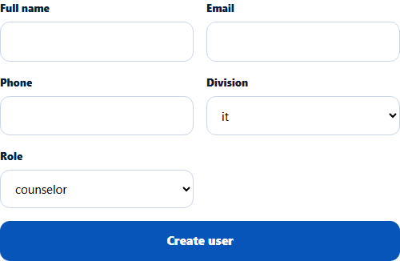
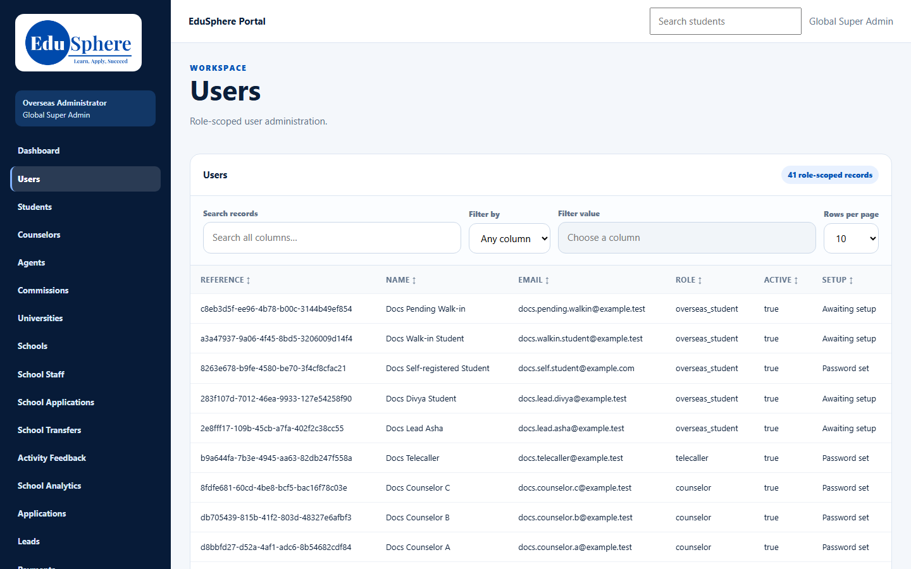

# Role guide: Super Admin — counselors

The Super Admin governs both divisions, but most counselor work is the Overseas Admin's. This guide lists what you can do for counselors and what you can't.

## What you can do
- **Create a counselor** on **Users** (`/admin/users`). Set **Division** to **overseas** before choosing **counselor**; it starts on **it**, and an IT counselor can't sign in to the Overseas portal ([details](../admin-manual/accounts/adm-001-create-counselor.md)).

- **Manage users:** re-send set-up links, edit details, deactivate ([Manage counselor users](../admin-manual/accounts/adm-002-manage-counselor-users.md)).
- **Open the counselor-admin pages by address:** Document checklists (`/overseas/admin/checklists`), Reminder rules (`/overseas/admin/reminder-rules`), Message templates (`/overseas/admin/message-templates`), Counselor tasks and Counselor performance. They are not in your sidebar, and they show the Overseas Admin's sidebar. VERIFICATION REQUIRED: checked in the browser in session S9.

## What you can't do
| Task | Who does it |
|---|---|
| Assign or change a student's or an application's counselor | Overseas Admin; you have no **EduSphere counsellor** column |
| Restore an archived student † | Overseas Admin ("Overseas Administrator role required") |
| Receive the overdue-work escalation notice † | Overseas Admins only |
| Work in the counselor workspace (Leads, Dashboard) † | Counselors; the pages open for you but show load errors |

† From the code; checked in the browser in sessions S9–S10.

## Related
[Admin manual index](../admin-manual/README.md) · [Overseas Admin role guide](overseas-admin-counselors.md)
