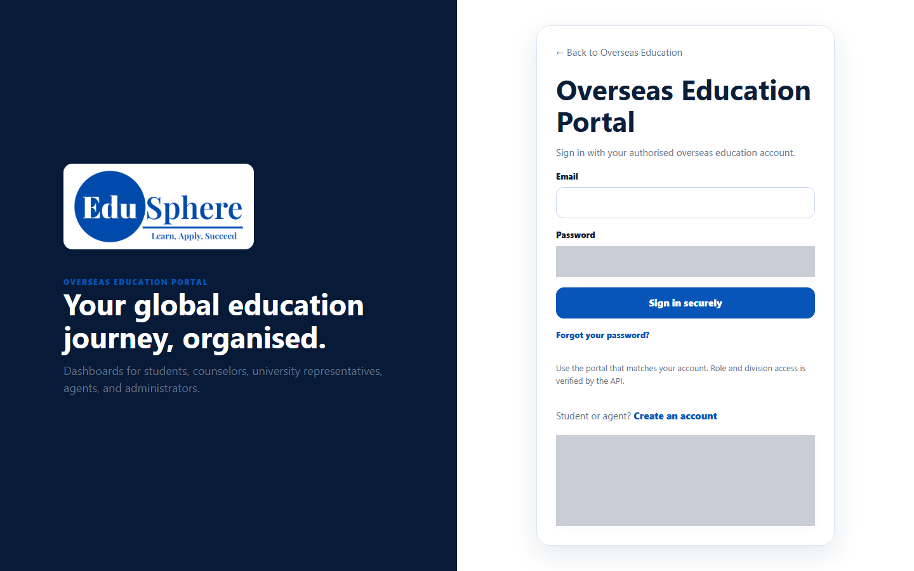
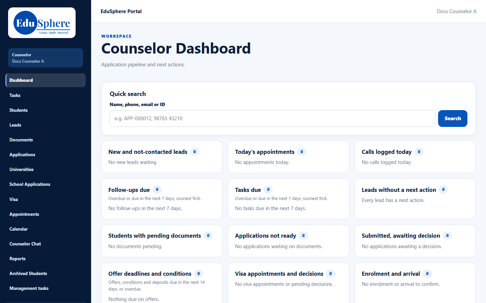
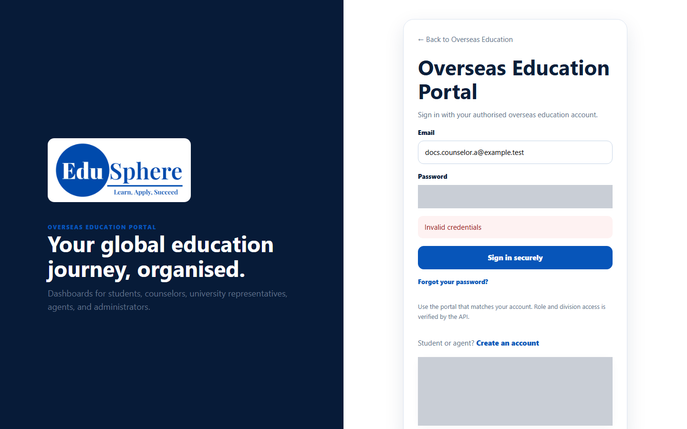
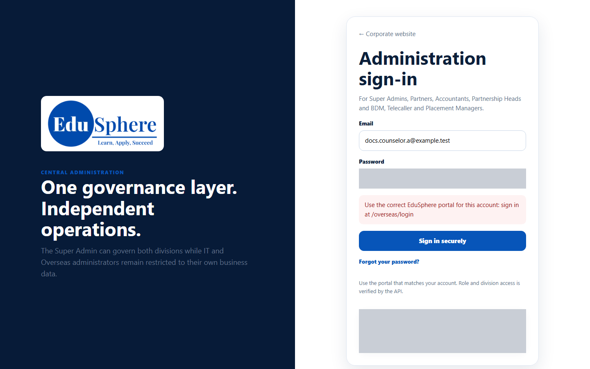

# Sign in to the Overseas portal
> Doc ID: DOC-CNS-AUTH-001 · Verified on 2026-10-30 against `main` @ `045d8c40` · Roles: Counselor

## Purpose
Open your counselor workspace: your leads, students, applications and daily tasks.

## Who Can Use This Feature
Overseas counselors with an active account and a password they have already set. If you have never signed in, first [set your first password](auth-002-first-password.md).

## Prerequisites
- Your account was created by an Overseas Admin.
- You have set your password from the welcome email.

## How to Access
Go to the EduSphere **Overseas Education Portal** sign-in page (`/overseas/login`). Counselors do **not** use the **Administration sign-in** page.

## Steps
### Step 1 — Open the sign-in page
The page is headed **Overseas Education Portal** — "Sign in with your authorised overseas education account."

### Step 2 — Enter your email and password
Type your work **Email** and **Password**, then select **Sign in securely**.

### Step 3 — Start on your dashboard
You arrive on the **Counselor Dashboard** ("Application pipeline and next actions"). If you opened a counselor link while signed out, you are taken to that page instead.

## Fields
| Field | Description | Required | Example |
|---|---|---|---|
| Email | The email your account was created with | Yes | docs.counselor.a@example.test |
| Password | Your password (at least 10 characters) | Yes | — |

## Expected Result
You are signed in and see the counselor sidebar with your name under **Counselor**.

## Validation Messages
| Message | When |
|---|---|
| Invalid credentials | The email or password is wrong, or the account has been deactivated |
| Use the correct EduSphere portal for this account: sign in at /overseas/login | You signed in on another portal's page (for example **Administration sign-in**) |

## Common Errors
**Problem:** "Invalid credentials" although you are sure of the password. **Cause:** Your account may have been deactivated; EduSphere shows the same message in that case. **Resolution:** Use [Forgot your password?](auth-003-forgot-password.md). If no email arrives, ask your Overseas Admin whether the account is active.

**Problem:** "Use the correct EduSphere portal for this account". **Resolution:** Go to the **Overseas Education Portal** page (`/overseas/login`) and sign in there.

**Problem:** You never received a password. **Resolution:** Counselors don't get a password by email — they set one from the welcome link. Ask your Overseas Admin to re-send it.

## Tips
- Bookmark the dashboard. If you are signed out, opening it takes you to sign-in and then back to the dashboard.
- **Create an account** on the sign-in page is for students and agents, not counselors.

## Related Features
- [Set your first password](auth-002-first-password.md)
- [Forgot / reset your password](auth-003-forgot-password.md)
- [Portal tour](../navigation/nav-001-portal-tour.md)
