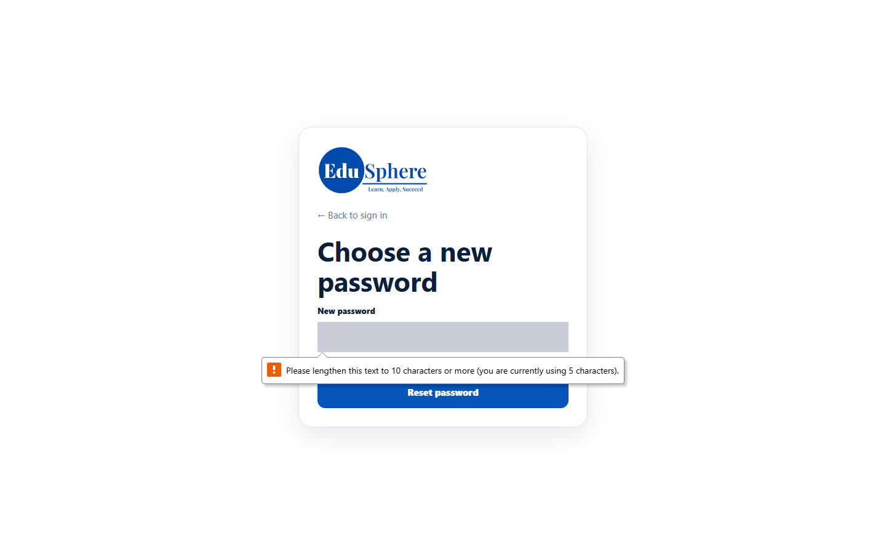
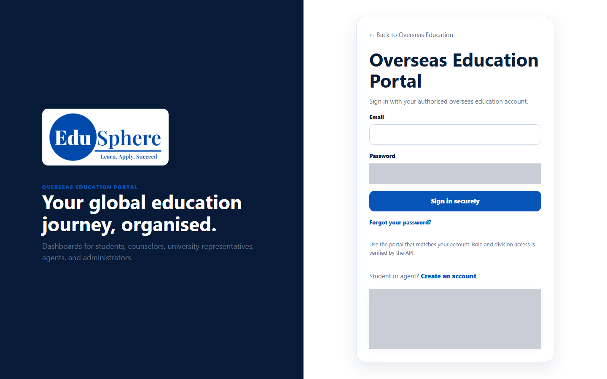
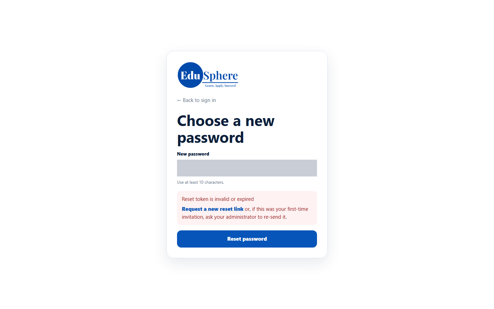

# Set your first password from the welcome email
> Doc ID: DOC-CNS-AUTH-002 · Verified on 2026-10-30 against `main` @ `045d8c40` · Roles: Counselor

## Purpose
Activate your new counselor account by choosing your own password.

## Who Can Use This Feature
A counselor whose account an Overseas Admin (or Super Admin) has just created.

## Prerequisites
- You received the email **Welcome to EduSphere -- set your password**.
- The link is less than **72 hours** old and has not been used or replaced by a newer one.

## How to Access
Open the link in the welcome email.

## Steps
### Step 1 — Open the link
The page **Choose a new password** opens.

### Step 2 — Enter a password
Type a **New password** of at least 10 characters. If it is too short, your browser asks you to lengthen it.

### Step 3 — Save it
Select **Reset password**. You are taken to the **Overseas Education Portal** sign-in page. Sign in with your email and the new password.

## Fields
| Field | Description | Required | Example |
|---|---|---|---|
| New password | 10 to 128 characters | Yes | — |

## Expected Result
Your account changes from **Awaiting setup** to **Password set**, and you can [sign in](auth-001-sign-in.md).

## Validation Messages
| Message | When |
|---|---|
| Please lengthen this text to 10 characters or more … | Browser check: the password is shorter than 10 characters |
| Password must be at least 10 characters / Password must be at most 128 characters | The server rejected the length |
| Reset token is invalid or expired — Request a new reset link or, if this was your first-time invitation, ask your administrator to re-send it. | The link was already used, is older than 72 hours, was replaced by a newer link, or the account is inactive |
| This reset link is missing its token. Request a new one from the forgot-password page. | The link was cut short when copied |

## Common Errors
**Problem:** "Reset token is invalid or expired". **Cause:** Each link works once, for 72 hours, and a re-sent link replaces the earlier one. **Resolution:** Use the newest email, or ask your Overseas Admin to select **Re-send link**.

**Problem:** The email never arrived. **Resolution:** Check spam, then ask your Overseas Admin to re-send the link.

## Tips
- Use the link from the most recent welcome email only.
- After you set the password, the same link cannot be used again; use [Forgot your password?](auth-003-forgot-password.md) in future.

## Related Features
- [Sign in](auth-001-sign-in.md)
- [Forgot / reset your password](auth-003-forgot-password.md)
- [Manage counselor users (admin)](../../admin-manual/accounts/adm-002-manage-counselor-users.md)
