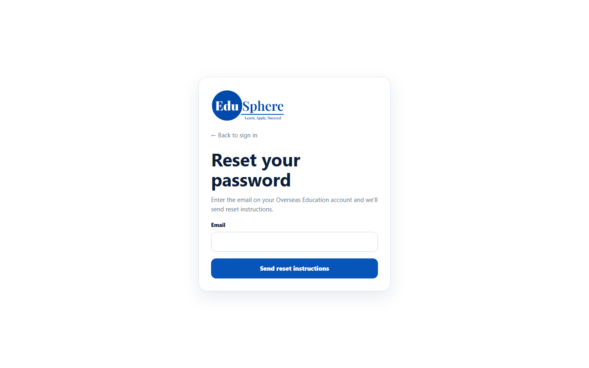
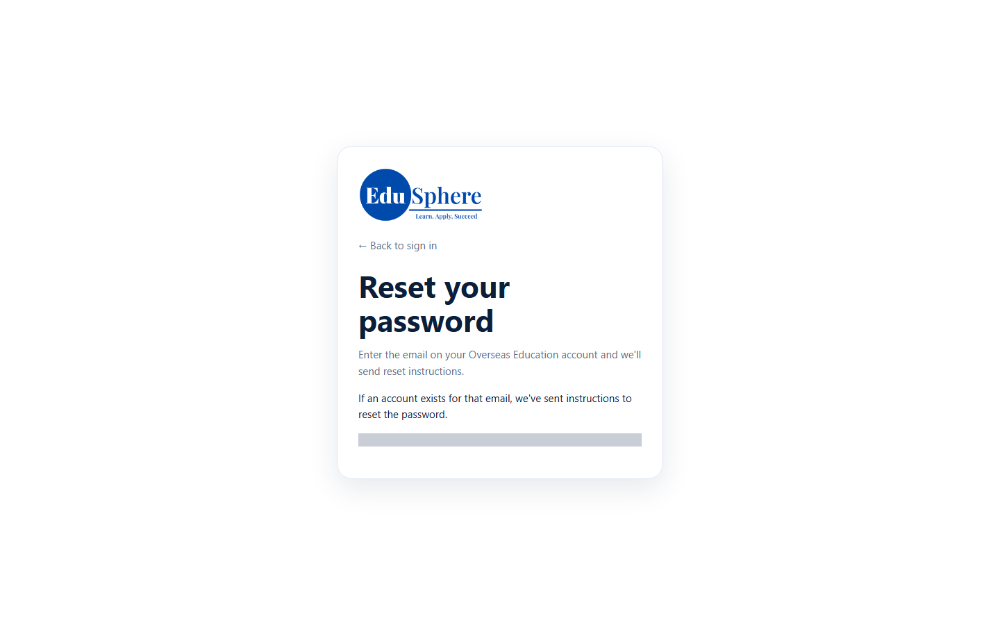

# Forgot / reset your password
> Doc ID: DOC-CNS-AUTH-003 · Verified on 2026-10-30 against `main` @ `045d8c40` · Roles: Counselor

## Purpose
Choose a new password when you have forgotten the current one.

## Who Can Use This Feature
Any active counselor who has set a password before.

## Prerequisites
You can open email at your work address.

## How to Access
On the **Overseas Education Portal** sign-in page, select **Forgot your password?**.

## Steps
### Step 1 — Open Reset your password
Enter the **Email** on your account.

### Step 2 — Send the instructions
Select **Send reset instructions**. The page always says **If an account exists for that email, we've sent instructions to reset the password.**, whether or not the email is registered.

### Step 3 — Use the emailed link
Open **Reset your EduSphere password** in your inbox and select the link within **30 minutes**. On **Choose a new password**, enter a **New password** (at least 10 characters) and select **Reset password**. You are taken to the sign-in page. The page is the same as in [Set your first password](auth-002-first-password.md).

## Fields
| Field | Description | Required | Example |
|---|---|---|---|
| Email | Your account email | Yes | docs.counselor.a@example.test |
| New password | 10 to 128 characters | Yes | — |

## Expected Result
You can sign in with the new password. Any older reset links stop working.

## Validation Messages
| Message | When |
|---|---|
| If an account exists for that email, we've sent instructions to reset the password. | Always, after **Send reset instructions** |
| Reset token is invalid or expired | The link is older than 30 minutes, was used, or a newer one was sent |

## Common Errors
**Problem:** No email arrives. **Cause:** The email is not registered, the account is inactive, or too many requests were sent recently. The page shows the same message in every case. **Resolution:** Wait a few minutes and try once more, then ask your Overseas Admin.

**Problem:** The link says it is invalid or expired. **Resolution:** Request a new link; reset links last 30 minutes.

## Tips
- If you are signed in and know your current password, use [Change your password](auth-004-change-password.md) instead.

## Related Features
- [Sign in](auth-001-sign-in.md)
- [Change your password](auth-004-change-password.md)
