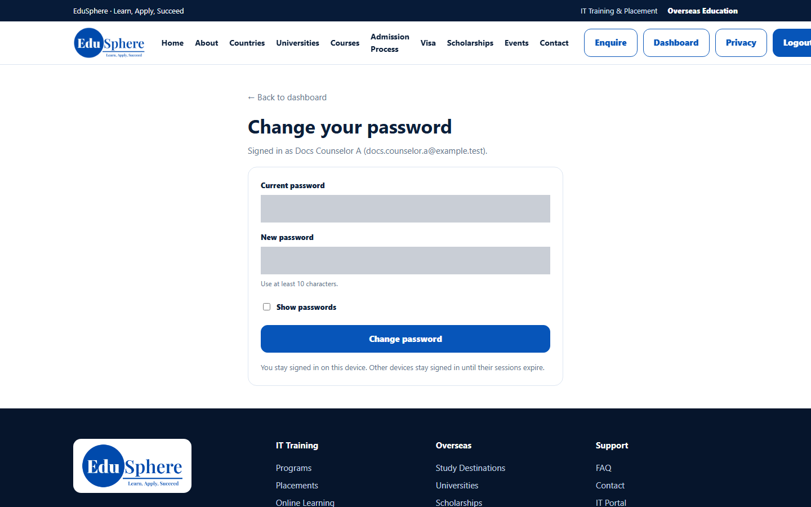
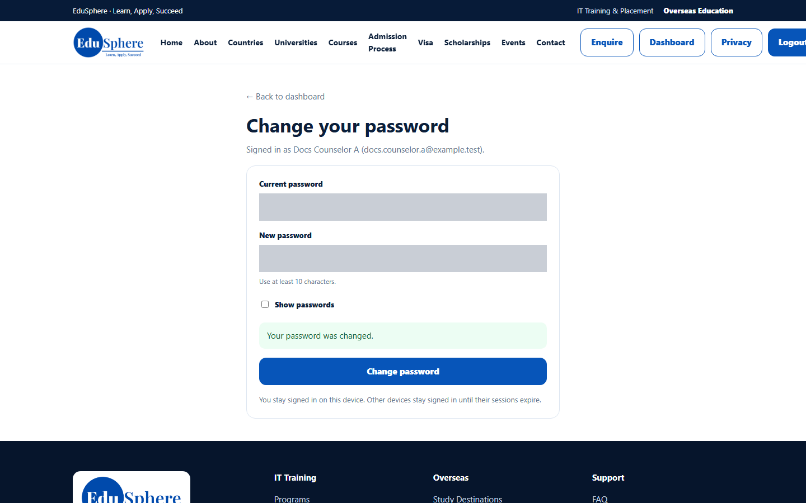
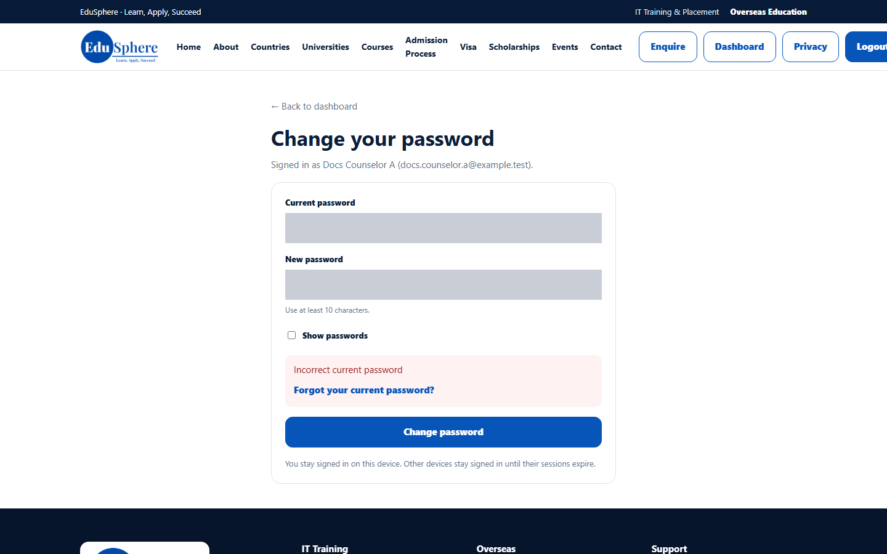
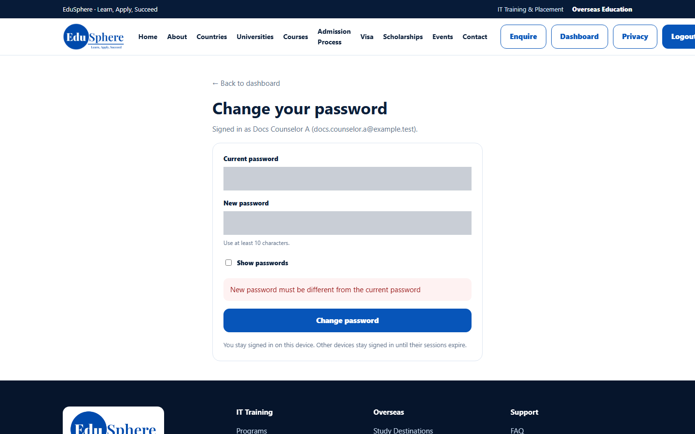

# Change your password
> Doc ID: DOC-CNS-AUTH-004 · Verified on 2026-10-30 against `main` @ `045d8c40` · Roles: Counselor

## Purpose
Replace your password while you are signed in.

## Who Can Use This Feature
Any signed-in counselor.

## Prerequisites
You know your current password.

## How to Access
Sidebar footer → **Change password**. On a phone: menu (☰) → **Change password**.

## Steps
### Step 1 — Open Change password
The page shows who is signed in ("Signed in as {name} ({email})") and a **← Back to dashboard** link. It opens inside the public website header.

### Step 2 — Enter both passwords
Type your **Current password** and a **New password** of at least 10 characters that is different from the current one.

### Step 3 — Save
Select **Change password**. **Your password was changed.** appears.

## Fields
| Field | Description | Required | Example |
|---|---|---|---|
| Current password | The password you signed in with | Yes | — |
| New password | 10 to 128 characters, different from the current one | Yes | — |

## Expected Result
Use the new password the next time you sign in. Any unused reset links are cancelled.

## Validation Messages
| Message | When |
|---|---|
| Your password was changed. | Success |
| Incorrect current password (with a **Forgot your current password?** link) | The current password is wrong |
| New password must be different from the current password | Both passwords are the same |
| Too many incorrect attempts; try again in {n} seconds | Five wrong current passwords within 15 minutes |
| Your session has expired. Sign in again to change your password. | You were signed out |

## Common Errors
**Problem:** "Incorrect current password". **Resolution:** Try again carefully, or select **Forgot your current password?** to reset it by email.

**Problem:** "Too many incorrect attempts". **Resolution:** Wait for the number of seconds shown, or reset by email.

## Tips
- Select **← Back to dashboard** to return to your workspace.

## Related Features
- [Forgot / reset your password](auth-003-forgot-password.md)
- [My profile](auth-005-my-profile.md)
