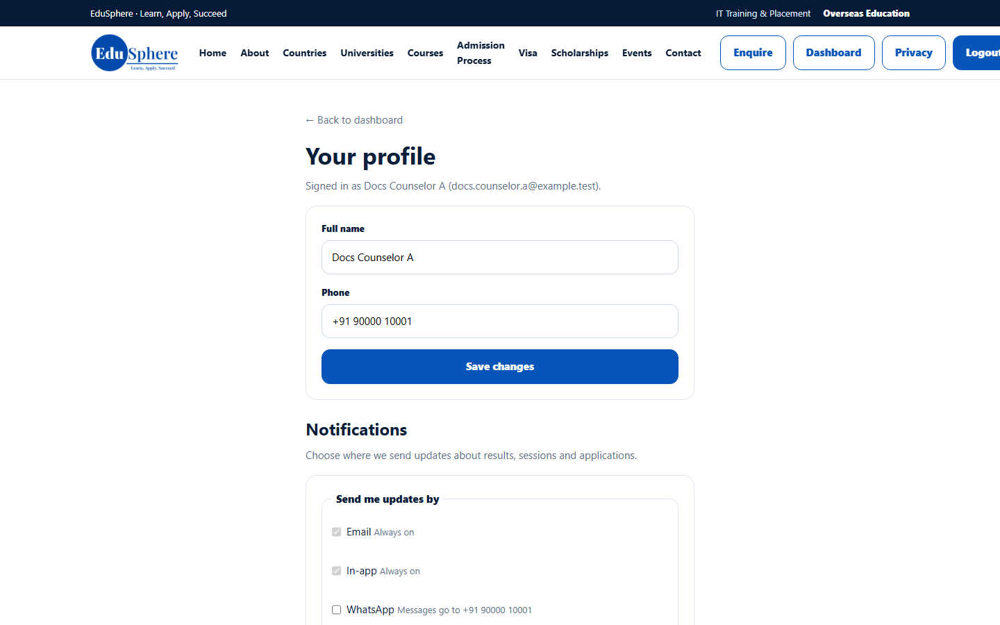
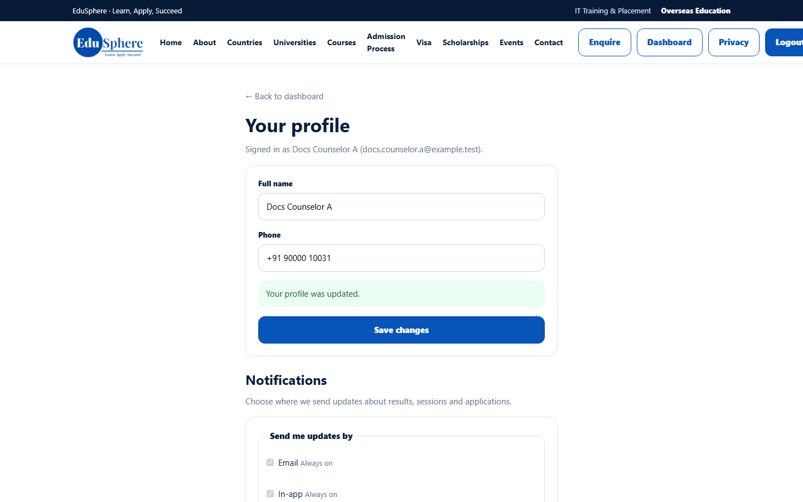

# My profile
> Doc ID: DOC-CNS-AUTH-005 · Verified on 2026-10-30 against `main` @ `045d8c40` · Roles: Counselor

## Purpose
Keep your name and phone number current, and choose how EduSphere sends you updates.

## Who Can Use This Feature
Any signed-in counselor.

## Prerequisites
None.

## How to Access
Sidebar footer → **My profile**. On a phone: menu (☰) → **My profile**.

## Steps
### Step 1 — Open Your profile
The page **Your profile** shows "Signed in as {name} ({email})" and opens inside the public website header.

### Step 2 — Update your details
Change **Full name** or **Phone**, then select **Save changes**. **Your profile was updated.** appears.

### Step 3 — Choose notification channels (optional)
Under **Notifications** → **Send me updates by**, **Email** and **In-app** are always on. Tick **WhatsApp** or **SMS** to also get messages at your phone number, then select **Save notification settings**. Turning on WhatsApp or SMS means you agree to receive these messages; you can turn them off here at any time. The WhatsApp and SMS boxes can only be ticked once a valid mobile number (a 10-digit Indian mobile number, or an international number starting with +) is saved in **Phone**.

## Fields
| Field | Description | Required | Example |
|---|---|---|---|
| Full name | Shown to colleagues and students | Yes | Docs Counselor A |
| Phone | Your contact number; also used for WhatsApp/SMS updates | No | +91 90000 10031 |
| WhatsApp / SMS | Extra channels for updates | No | Off |

## Expected Result
The new name appears in the sidebar and top bar the next time a page loads.

## Validation Messages
| Message | When |
|---|---|
| Your profile was updated. | Details saved |

## Common Errors
**Problem:** WhatsApp or SMS updates go to an old number. **Resolution:** Update **Phone** and save, then save the notification settings again.

## Tips
- Your email address cannot be changed here; ask your Overseas Admin.
- Select **← Back to dashboard** to return to your workspace.

## Related Features
- [Change your password](auth-004-change-password.md)
- [Portal tour](../navigation/nav-001-portal-tour.md)
