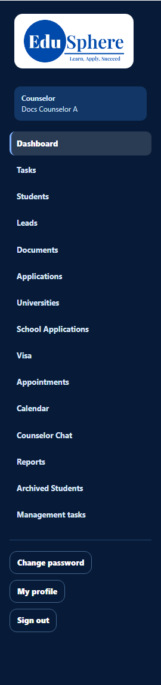
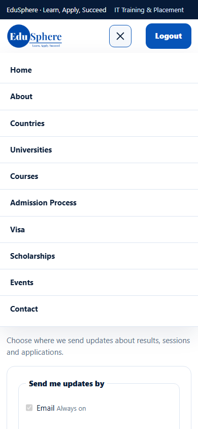
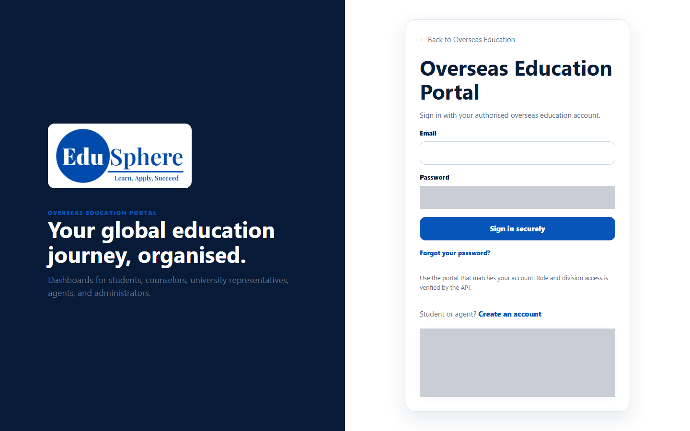
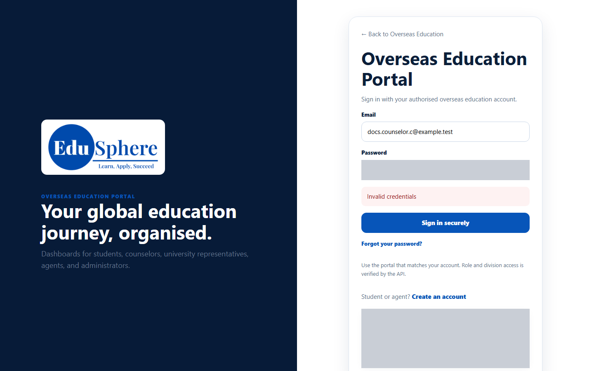

# Sign out, ended sessions, deactivated account
> Doc ID: DOC-CNS-AUTH-006 · Verified on 2026-10-30 against `main` @ `045d8c40` · Roles: Counselor

## Purpose
End your session safely, and understand what happens when a session ends or an account is deactivated.

## Who Can Use This Feature
Any signed-in counselor.

## Prerequisites
None.

## How to Access
- **Desktop:** sidebar footer → **Sign out**.
- **Phone or small tablet:** the portal menu has no Sign out. Open **My profile** (or **Change password**) from the menu, then select **Logout** in the website header at the top.

## Steps
### Step 1 — Sign out on a desktop
At the bottom of the sidebar, select **Sign out**. You are taken to the EduSphere home page.

### Step 2 — Sign out on a phone
Open the menu (☰) and select **My profile**. In the website header, select **Logout**. (The portal menu lists **Change password**, **My profile** and the workspace pages, but not Sign out.)

### Step 3 — After signing out
If you open a counselor page while signed out, you are sent to the **Overseas Education Portal** sign-in page. After you sign in, you return to the page you asked for.

### Deactivated account
When an Overseas Admin deactivates your account, signing in shows **Invalid credentials**, the same message as a wrong password. Forgot-password sends no email to an inactive account. Ask your Overseas Admin to reactivate you.

## Expected Result
Your session ends, and nobody using the same browser can open your workspace without signing in.

## Validation Messages
| Message | When |
|---|---|
| Invalid credentials | Signing in to a deactivated account |

## Common Errors
**Problem:** You can't find Sign out on your phone. **Resolution:** Menu → **My profile** → **Logout** in the header.

## Tips
- Always sign out on shared computers.

## Related Features
- [Sign in](auth-001-sign-in.md)
- [Portal tour](../navigation/nav-001-portal-tour.md)
- [Manage counselor users (admin)](../../admin-manual/accounts/adm-002-manage-counselor-users.md)
