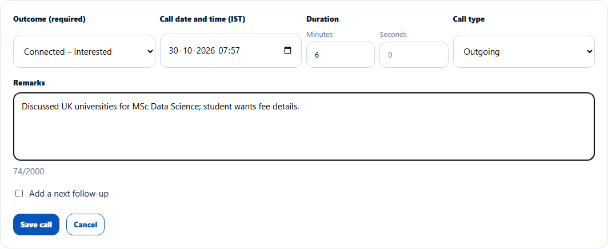
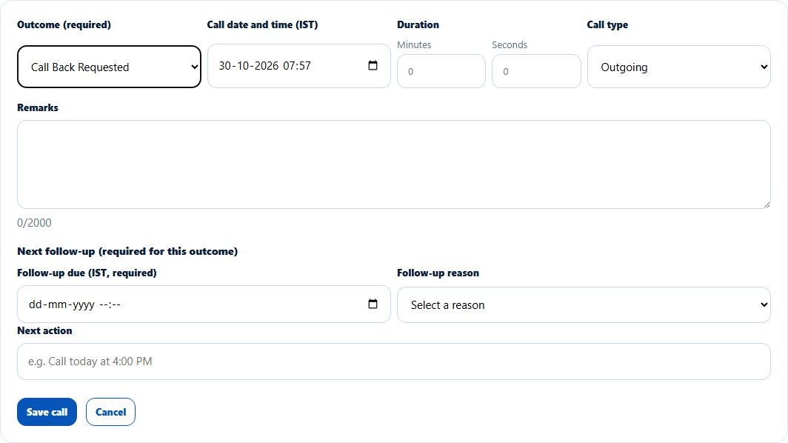
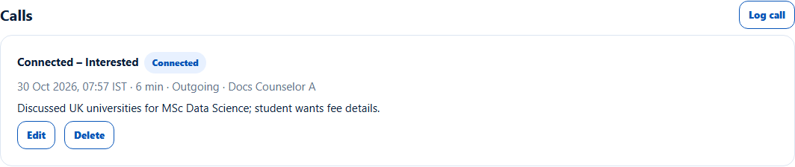

# Log a call
> Doc ID: DOC-CNS-ACT-001 · Verified on 2026-10-30 against `main` @ `045d8c40` · Roles: Counselor

## Purpose
Record every call with a lead (outcome, duration and what was said) so the lead's history is complete.

## Who Can Use This Feature
The counselor who owns the lead.

## Prerequisites
The lead is open (not closed).

## How to Access
Lead page → **Calls** → **Log call**.

## Steps
### Step 1 — Open the call form
Select **Log call**. Choose the **Outcome (required)**. **Call date and time (IST)** starts at now. Add the **Duration** (minutes and seconds), the **Call type** (Outgoing or Incoming) and **Remarks**.

### Step 2 — Add a follow-up when the outcome needs one
For **Connected – Follow-up Required** and **Call Back Requested**, the form adds **Next follow-up (required for this outcome)**: **Follow-up due (IST, required)**, **Follow-up reason** and **Next action**. For other outcomes you can tick **Add a next follow-up**.

### Step 3 — Save
Select **Save call**. **Call logged.** appears and the call is listed with its outcome, time, duration, type and who logged it.

## Fields
| Field | Description | Required | Example |
|---|---|---|---|
| Outcome | Connected – Interested / Need Information / Follow-up Required / Appointment Fixed, Not Interested, Call Back Requested, Already Joined Elsewhere, Duplicate Lead, Not Eligible, Wrong Number, Busy, No Answer, Switched Off | Yes | Connected – Interested |
| Call date and time (IST) | Not in the future; up to 7 days back | Yes | now |
| Duration | Minutes and seconds, up to 4 hours | No | 6 min |
| Call type | Outgoing or Incoming | Yes | Outgoing |
| Remarks | Up to 2000 characters; required for Duplicate Lead (name the other lead) | No | Discussed UK universities… |

## Expected Result
The call is in **Calls** and in the [activity timeline](act-006-activity-timeline.md). A counselor's call never changes the lead's stage, even for outcomes such as Not Interested. Change the stage yourself if needed.

## Validation Messages
| Message | When |
|---|---|
| Call logged. / Call updated. / Call deleted. | Success |
| Choose an outcome | No outcome |
| Choose the call date and time | No time |
| Enter whole minutes and seconds (0–59), up to 4 hours | Bad duration |
| The call time can't be in the future / Calls can be logged up to 7 days back | Time out of range |
| Add the next follow-up for this outcome | Follow-up missing for a call-back outcome |
| Only today's calls can be changed | Editing an older call |

## Common Errors
**Problem:** You can't edit yesterday's call. **Cause:** Only your own calls logged today (IST) can be edited or deleted. **Resolution:** Log a correction call with remarks.

## Tips
- Use **Call Back Requested** when the student asks for a call later; the follow-up is created with the call.

## Related Features
- [Follow-ups on a lead](../follow-ups/fup-001-follow-ups.md)
- [Lead activity timeline](act-006-activity-timeline.md)
