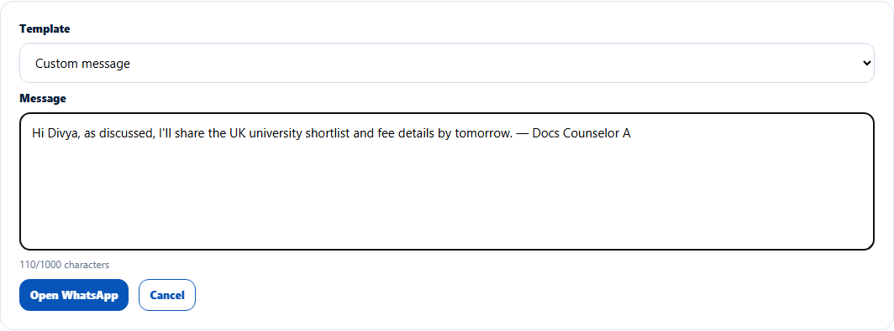
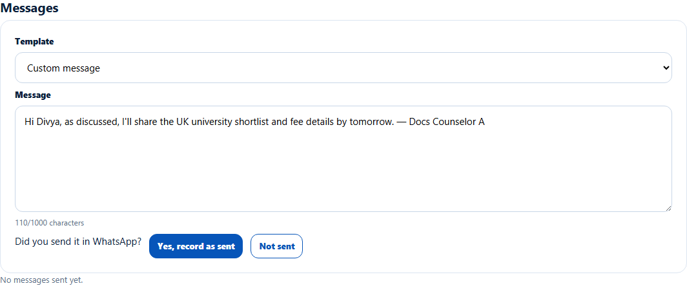

# Record a WhatsApp message
> Doc ID: DOC-CNS-ACT-002 · Verified on 2026-10-30 against `main` @ `045d8c40` · Roles: Counselor

## Purpose
Write a WhatsApp message to a lead (from a template or your own words), send it in WhatsApp, and keep a record on the lead.

## Who Can Use This Feature
The counselor who owns the lead.

## Prerequisites
- The lead is open and has a WhatsApp or mobile number.
- WhatsApp (app or web) is available on your computer or phone.

## How to Access
Lead page → **Messages** → **Send WhatsApp**.

## Steps
### Step 1 — Write the message
Choose a **Template** (for example **Welcome message**, **Fee details**, **Document request**) or **Custom message**, and edit the **Message** (up to 1000 characters).

### Step 2 — Send it in WhatsApp
Select **Open WhatsApp**. WhatsApp opens in a new tab with the message ready; send it there. EduSphere does not send WhatsApp messages itself.

### Step 3 — Record that you sent it
Back in EduSphere, answer **Did you send it in WhatsApp?**:
- Select **Yes, record as sent** to record it. **WhatsApp send recorded.** appears.
- Select **Not sent** to go back to the message.

## Fields
| Field | Description | Required | Example |
|---|---|---|---|
| Template | An active WhatsApp template, or Custom message | No | Custom message |
| Message | Up to 1000 characters | Yes | Hi Divya, as discussed… |

## Expected Result
The record appears under **Messages** as "WhatsApp sent – {date} – {time}" with the text. See [Email a lead](act-003-email.md) for the combined list.

## Validation Messages
| Message | When |
|---|---|
| WhatsApp send recorded. | Recorded |
| Message deleted. | You deleted a record |
| This template was made for another product. Check the text before sending. | Template for a different product |
| No WhatsApp or mobile number on this lead. | No number on the lead (**Send WhatsApp** is disabled) |
| Only today's messages can be deleted | Deleting an older record |

## Common Errors
**Problem:** You recorded a message you didn't actually send. **Resolution:** Select **Delete** on it the same day ("Delete this record? It does not unsend the WhatsApp message.").

## Tips
- Templates fill in the student's details; always read the text before sending.

## Related Features
- [Email a lead](act-003-email.md)
- [Lead activity timeline](act-006-activity-timeline.md)
