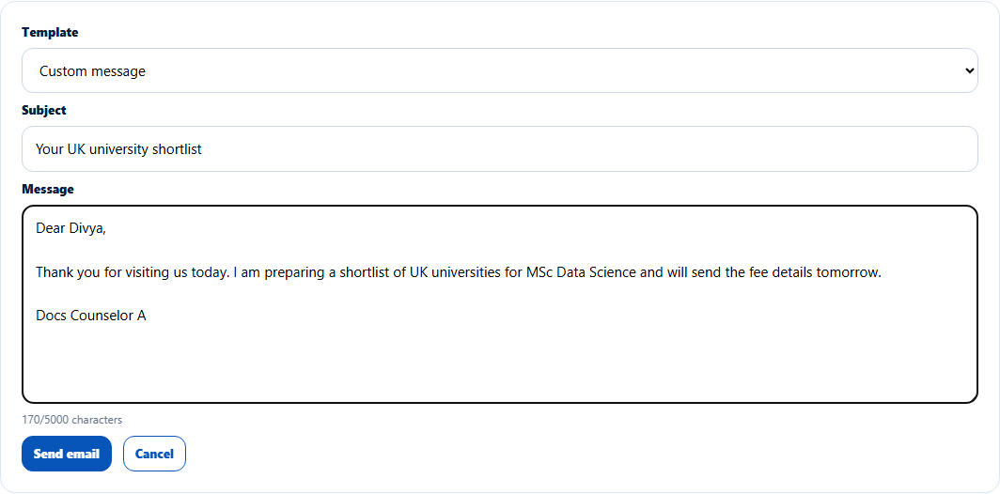
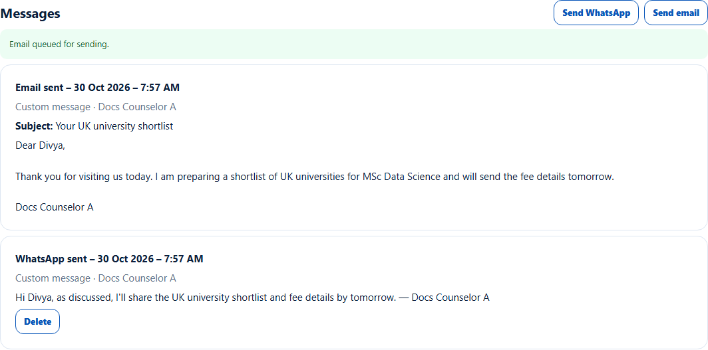

# Email a lead
> Doc ID: DOC-CNS-ACT-003 · Verified on 2026-10-30 against `main` @ `045d8c40` · Roles: Counselor

## Purpose
Send an email to a lead from EduSphere, so it is delivered and recorded on the lead.

## Who Can Use This Feature
The counselor who owns the lead.

## Prerequisites
The lead is open and has an email address.

## How to Access
Lead page → **Messages** → **Send email**.

## Steps
### Step 1 — Write the email
Choose a **Template** or write your own. Enter the **Subject** and the **Message**.

### Step 2 — Send
Select **Send email**. **Email queued for sending.** appears. EduSphere sends it within a few seconds and the record changes to **Email sent – {date} – {time}**.

## Fields
| Field | Description | Required | Example |
|---|---|---|---|
| Template | An active email template, or a custom email | No | — |
| Subject | Up to 200 characters | Yes | Your UK university shortlist |
| Message | Up to 5000 characters | Yes | Dear Divya, … |

## Expected Result
The student receives the email, and the email shows under **Messages** and in the [activity timeline](act-006-activity-timeline.md).

## Validation Messages
| Message | When |
|---|---|
| Email queued for sending. | Accepted |
| This email was not delivered. Check the lead's email address and send it again. | Delivery failed |
| The mail server didn't accept it yet. It will be retried automatically. | Temporary delay |
| This lead has no email address | No email on the lead |
| Email is not set up. Ask an administrator to configure SMTP. | Email isn't configured |

## Common Errors
**Problem:** "This email was not delivered." **Resolution:** Check the email in [Lead details](../leads/lead-004-lead-details.md) (ask the telecaller or admin to correct it), then send again.

## Tips
- Sent emails can't be deleted, so check before sending.
- Each counselor can send up to 100 lead emails a day.

## Related Features
- [Record a WhatsApp message](act-002-whatsapp.md)
- [Log a meeting](act-004-meetings.md)
