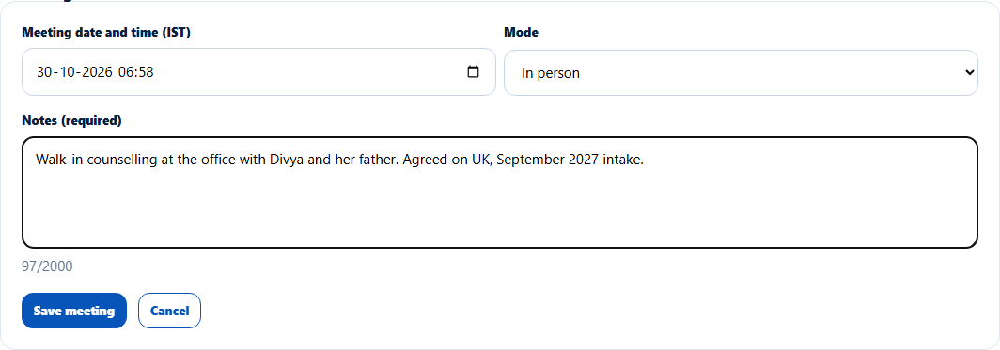
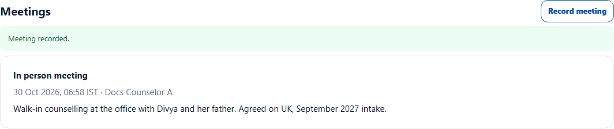

# Log a meeting
> Doc ID: DOC-CNS-ACT-004 · Verified on 2026-10-30 against `main` @ `045d8c40` · Roles: Counselor

## Purpose
Record a counselling meeting you have held with a lead (in person, online or by phone) and what was discussed.

## Who Can Use This Feature
The counselor who owns the lead.

## Prerequisites
The lead is open, and the meeting has already happened.

## How to Access
Lead page → **Meetings** → **Record meeting**.

## Steps
### Step 1 — Fill in the meeting
Enter the **Meeting date and time (IST)** (not in the future), choose the **Mode** (**In person**, **Online** or **Phone**) and write the **Notes**.

### Step 2 — Save
Select **Save meeting**. **Meeting recorded.** appears and the meeting is listed.

## Fields
| Field | Description | Required | Example |
|---|---|---|---|
| Meeting date and time (IST) | When it took place | Yes | today 07:00 |
| Mode | In person, Online, Phone | Yes | In person |
| Notes | What was discussed | Yes | Walk-in counselling with Divya and her father… |

## Expected Result
The meeting appears under **Meetings** and in the [activity timeline](act-006-activity-timeline.md). Meetings can't be edited or deleted.

## Validation Messages
| Message | When |
|---|---|
| Meeting recorded. | Success |
| Choose the meeting date and time | No time |
| Add what was discussed | No notes |
| The meeting time can't be in the future | Future time |
| This lead is closed, so no meeting can be recorded | Closed lead |

## Tips
- To plan a future session, use **Appointments** (booked by the telecaller) or a [follow-up](../follow-ups/fup-001-follow-ups.md).

## Related Features
- [Lead notes](act-005-notes.md)
- [Lead appointments](../calendar/cal-001-lead-appointments.md)
