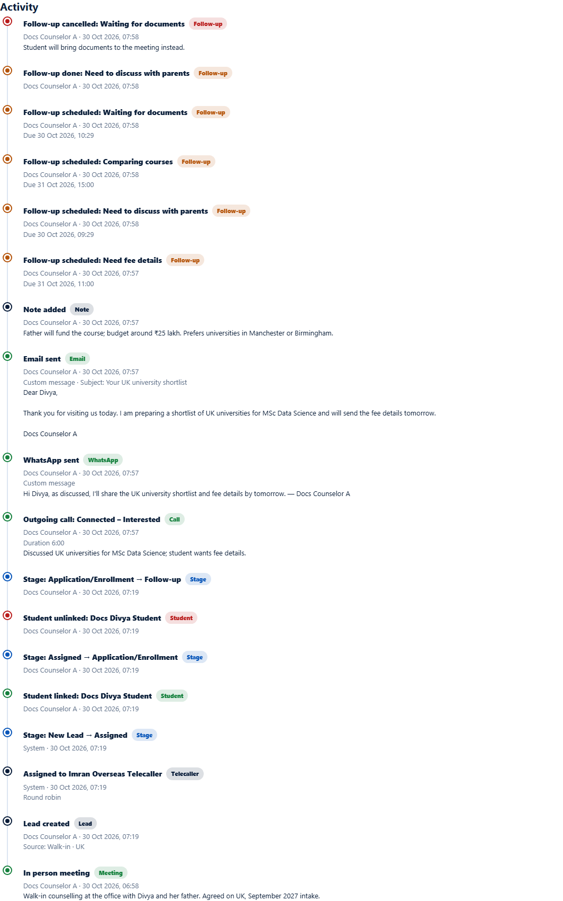

# Lead activity timeline
> Doc ID: DOC-CNS-ACT-006 · Verified on 2026-10-30 against `main` @ `045d8c40` · Roles: Counselor

## Purpose
See everything that has happened on a lead, newest first, in one list.

## Who Can Use This Feature
The counselor who owns the lead.

## Prerequisites
None.

## How to Access
Lead page → **Activity** (at the bottom).

## Steps
### Step 1 — Read the timeline
Each entry shows what happened, its type, who did it and when, plus any detail. Entry types include:
- Follow-up scheduled, done and cancelled (with the reason).
- Note added.
- Email sent (subject and text) and WhatsApp sent.
- Meetings, calls and stage changes.

### Step 2 — It updates as you work
The timeline refreshes after every action on the page.

## Expected Result
You can reconstruct the lead's history without opening each section.

## Tips
- Use the timeline before calling a lead someone else worked on.

## Related Features
- [Log a call](act-001-log-call.md)
- [Lead notes](act-005-notes.md)
- [Follow-ups on a lead](../follow-ups/fup-001-follow-ups.md)
