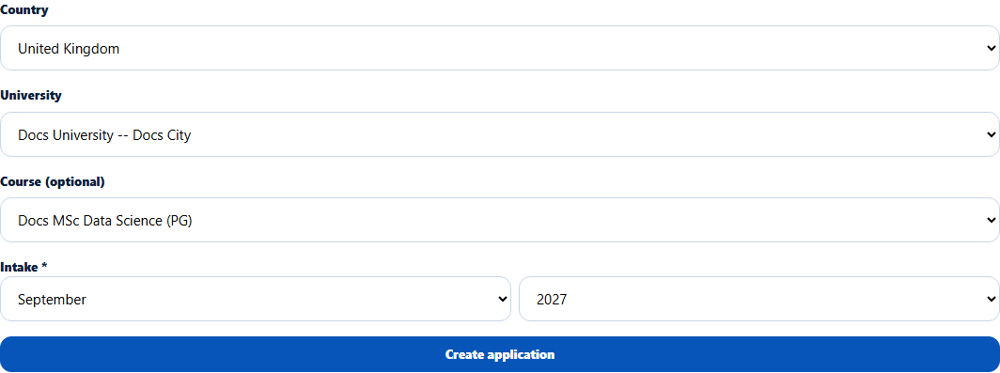
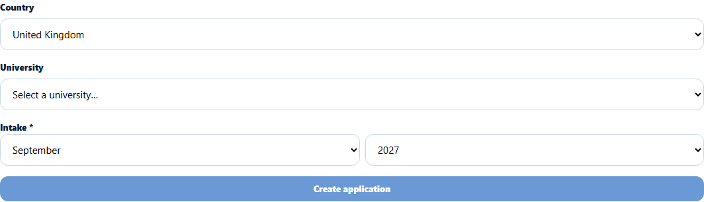
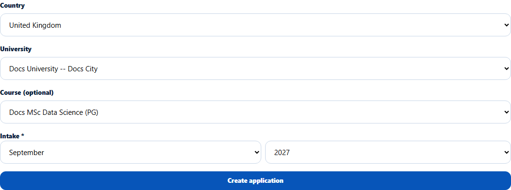

# Add an application from the Student 360
> Doc ID: DOC-CNS-APP-001 · Verified on 2026-10-30 against `main` @ `045d8c40` · Roles: Counselor

## Purpose
Start an application for one of your students to a university (and course) for a chosen intake.

## Who Can Use This Feature
Overseas counselors, for students in their caseload. The application is assigned to you.

## Prerequisites
- The university is published in the catalogue.
- The student isn't archived.

## How to Access
Student 360 → **Applications** → **Add application**.

## Steps
### Step 1 — Open Apply to a University
Select **Add application**. The **Apply to a University** form opens.

### Step 2 — Choose the university, course and intake
- Optionally narrow by **Country**.
- Choose the **University** (listed as "{name} -- {city}").
- Choose a **Course**, or leave it as **Undecided / any course**.
- Pick the **Intake** month and year (required; see [Intake picker](app-002-intake-picker.md)).

### Step 3 — Create it
Select **Create application**. **Application created. It is listed below.** appears. The application starts at stage **Enquiry** with the next action "Complete profile and required document checklist", and the student is notified.

## Fields
| Field | Description | Required | Example |
|---|---|---|---|
| Country | Filters the university list | No | United Kingdom |
| University | A published university | Yes | Docs University -- Docs City |
| Course | A course of that university, or undecided | No | Docs MSc Data Science (PG) |
| Intake | Month and year | Yes | September 2027 |

## Expected Result
The application appears on the **Applications** tab and in your **Application Tracking** table, with a new EduSphere ID (APP-…).

## Validation Messages
| Message | When |
|---|---|
| Application created. It is listed below. | Success |
| This student already has an open application for this university and course. | Duplicate |
| Choose the intake month and year. / Choose both the month and the year for the intake. | Intake missing |
| This student is not in your caseload | Not your student |
| Course does not belong to selected university | Course mismatch |

## Common Errors
**Problem:** The university isn't in the list. **Cause:** It isn't published in the catalogue. **Resolution:** Ask the Overseas Admin or partnership team to publish it.

**Problem:** You applied for an agency student, but the new application isn't an agency application. **Cause:** Applications created by a counselor are always direct (no agent).

## Tips
- You can't change an application's intake later from the counselor screens, so choose carefully.

## Related Features
- [Applications tab list](app-003-applications-tab.md)
- [Advance an application's stage](app-004-advance-stage.md)
