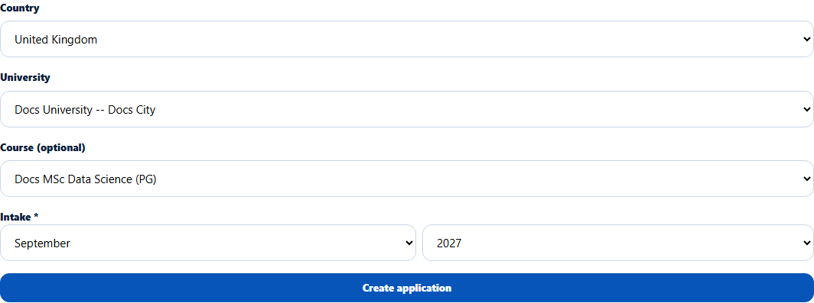

# Intake month and year picker
> Doc ID: DOC-CNS-APP-002 · Verified on 2026-10-30 against `main` @ `045d8c40` · Roles: Counselor

## Purpose
Record intakes in one consistent format ("Sep 2027"), so applications can be filtered and reported by intake.

## Who Can Use This Feature
Counselors, wherever an intake is asked for: on a new application and on the student's profile (Preferences).

## Prerequisites
None.

## How to Access
- **Add application** → **Intake**.
- Student 360 → **Preferences** → **Intake**.

## Steps
### Step 1 — Choose the month
In **Month**, pick January to December.

### Step 2 — Choose the year
In **Year**, pick this year or one of the next three.

## Expected Result
The intake is saved as "{Mon} {YYYY}" and shown as, for example, **Intake September 2027** on the application.

## Validation Messages
| Message | When |
|---|---|
| Choose the intake month and year. | Nothing chosen (required on applications) |
| Choose both the month and the year for the intake. | Only one chosen |
| Saved as "{value}". Choose a month and year to replace it. | An older free-text intake is shown |

## Common Errors
**Problem:** You need to change the intake of an existing application. **Cause:** There is no counselor screen for it. **Resolution:** Ask the Overseas Admin.

## Related Features
- [Add an application](app-001-add-application.md)
- [Structured profile](../students/stu-005-profile.md)
