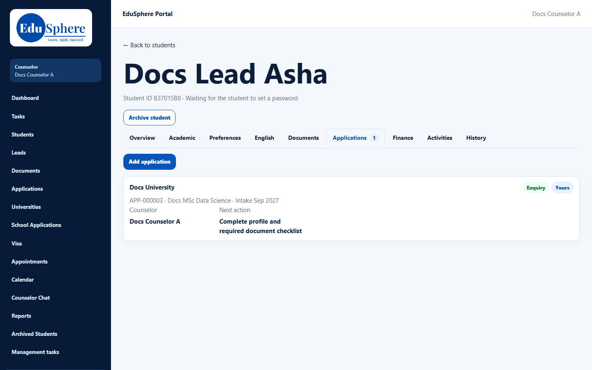
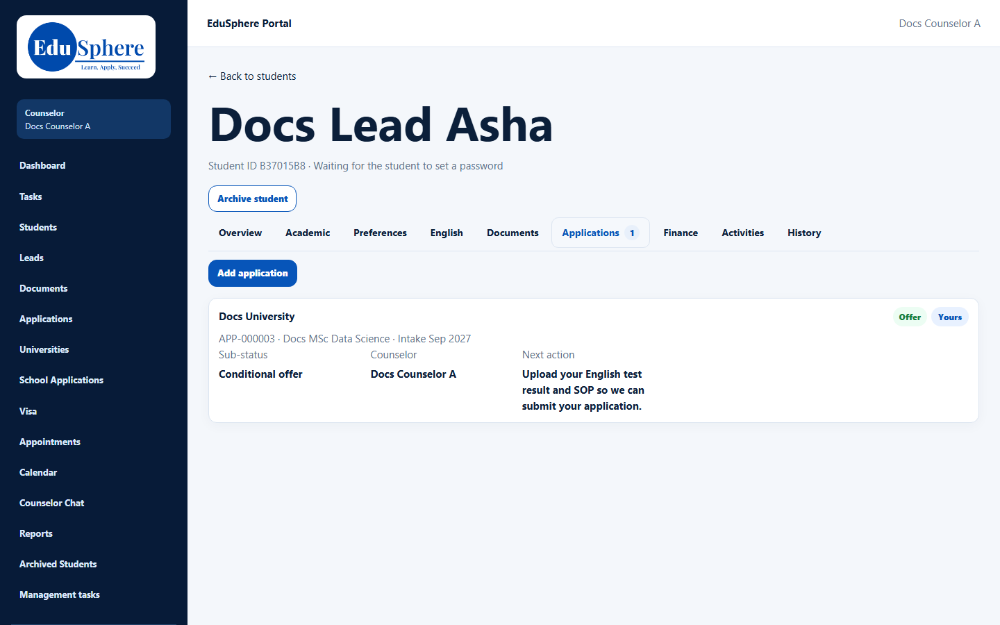

# Applications tab list
> Doc ID: DOC-CNS-APP-003 · Verified on 2026-10-30 against `main` @ `045d8c40` · Roles: Counselor, Overseas Admin

## Purpose
See all of a student's applications, including other counselors' and agency ones, with their EduSphere IDs.

## Who Can Use This Feature
Counselors (your students) and the Overseas Admin.

## Prerequisites
None.

## How to Access
Student 360 → **Applications** (the tab shows a count).

## Steps
### Step 1 — Read each application
Each card shows:
- the **University** and its stage (for example **Offer**);
- a **Yours** badge (your application) and an **Agency** badge (from an agent);
- "{EduSphere ID} · {course} · Intake {intake}";
- **Sub-status**, **Outcome**, **Counselor** and **Next action**.

### Step 2 — Work on an application
The tab only lists applications. To change one, go to **Students** (or **Applications**) → **Evaluate Applications**. See [Advance an application's stage](app-004-advance-stage.md).

## Expected Result
You see every application the student has, whoever handles it.

## Validation Messages
| Message | When |
|---|---|
| This student has no applications yet. | No applications |

## Tips
- The EduSphere ID (APP-…) is the number to quote to colleagues; it is also searchable in quick search.
- The **Evaluate Applications** cards show the student and university but not the EduSphere ID or intake, so check them here when a student has two applications to the same university.

## Related Features
- [Add an application](app-001-add-application.md)
- [Agency vs direct applications](app-010-agency-vs-direct.md)
