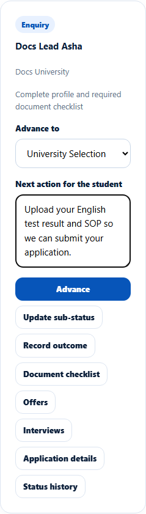
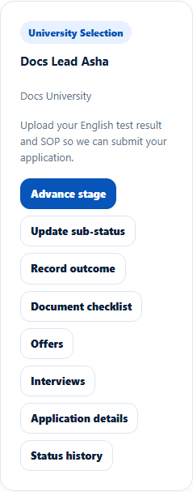

# Advance an application's stage
> Doc ID: DOC-CNS-APP-004 · Verified on 2026-10-30 against `main` @ `045d8c40` · Roles: Counselor

## Purpose
Move an application forward through its stages and tell the student what to do next.

## Who Can Use This Feature
The counselor assigned to the application.

## Prerequisites
The application is open and not on hold.

## How to Access
Sidebar **Students** (or **Applications**) → **Evaluate Applications** → the application's card.

## Steps
### Step 1 — Find the application
Each card shows the stage badge (and sub-status badge), the student, the university, the next action, and these buttons: **Advance stage**, **Update sub-status**, **Record outcome**, **Document checklist**, **Offers**, **Interviews**, **Application details** and **Status history**.

### Step 2 — Choose the next stage
Select **Advance stage**. In **Advance to**, choose a later stage: **Eligibility Evaluation**, **University Selection**, **Offer**, **Visa Documentation** or **Status Tracking**. You can skip stages. Enter **Next action for the student**.

### Step 3 — Advance
Select **Advance**. **Application advanced -- the student has been notified.** appears and the stage badge changes.

## Fields
| Field | Description | Required | Example |
|---|---|---|---|
| Advance to | Any later stage; never Enrolled | Yes | University Selection |
| Next action for the student | What the student should do now | No | Upload your English test result and SOP… |

## Expected Result
- The student is notified.
- The change is added to the [status history](app-009-status-history.md).
- Recording an offer later moves the application to **Offer** automatically.

## Validation Messages
| Message | When |
|---|---|
| Application advanced -- the student has been notified. | Success |
| Cannot advance from '{x}' to '{y}' -- must move forward along the confirmed sequence. | Moving backwards |
| Enrolment is confirmed with the enrolment confirmation document, not by a stage change | Trying to reach Enrolled |
| This application is on hold -- resume it before changing its stage | On hold |
| This application is closed -- only the Overseas Admin can reopen it. | Closed (shown on the card) |

## Common Errors
**Problem:** **Enrolled** isn't offered. **Resolution:** Confirm enrolment from **Enrolment** (see ARR-001).

**Problem:** An older application lists earlier stages such as **Enquiry**. **Cause:** Its status pre-dates the current stage list (for example "University review"). **Resolution:** Choose only a later stage.

**Problem:** The Application Tracking table shows a code such as `university_review` instead of a stage name. **Resolution:** Read the stage on the Evaluate Applications card or the 360 Applications tab.

## Tips
- The student's notification quotes the stage as a code (for example `visa_documentation`). Write the **Next action** in plain words so they know what to do.
- The cards are narrow on a normal screen; scroll inside a card to see all its buttons.

## Related Features
- [Sub-status and the Ready-for-Submission gate](app-005-sub-status-ready-gate.md)
- [Record an outcome / resume](app-007-outcome.md)
