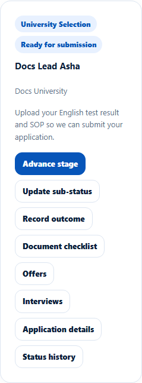
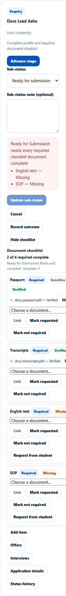

# Sub-status and the Ready-for-Submission gate
> Doc ID: DOC-CNS-APP-005 · Verified on 2026-10-30 against `main` @ `045d8c40` · Roles: Counselor

## Purpose
Show exactly where an application stands within its stage. EduSphere checks the document checklist before an application can be marked **Ready for submission**.

## Who Can Use This Feature
The counselor assigned to the application.

## Prerequisites
The application is open and not on hold.

## How to Access
**Evaluate Applications** → the application → **Update sub-status**.

## Steps
### Step 1 — Choose the sub-status
Select **Update sub-status**, choose the **Sub-status** and optionally add a **Sub-status note**. The sub-statuses by stage:
- **University selection:** Application created, Documents pending, Ready for submission, Submitted, Under review.
- **Offer:** Conditional offer, Unconditional offer, Offer accepted.
- **Visa documentation:** Visa preparation, Visa applied.
- **Status tracking:** Visa decision pending, Visa approved.

Choosing a sub-status of a later stage also moves the application to that stage.

### Step 2 — Save
Select **Update sub-status**. **Sub-status updated to {label}. The student has been notified.** appears.

### The Ready-for-Submission gate
When you choose **Ready for submission**, every required document on the [checklist](../documents/doc-001-application-checklist.md) must be complete. A document is complete when it is **Verified** or marked **Not required**. The checklist template decides what happens otherwise:
- **Block until complete:** the change is refused: "Ready for Submission needs every required checklist document complete", followed by the missing items (for example "English test — Missing").
- **Warn (override with a reason):** "Some required checklist documents are not complete -- give an override reason to continue". Enter an **Override reason** and select **Override and update**. The reason is kept in the status history. This is also what happens when no template matches.

## Fields
| Field | Description | Required | Example |
|---|---|---|---|
| Sub-status | See Step 1 | Yes | Ready for submission |
| Sub-status note (optional) | Context for the change | No | — |
| Override reason | Warn mode only | When overriding | Student will bring the SOP on Monday. |

## Expected Result
The sub-status badge shows on the card, the student is notified ("Status: {Stage} — {Sub-status}."), and the change appears in the status history.

## Validation Messages
| Message | When |
|---|---|
| Sub-status updated to {label}. The student has been notified. | Success |
| Ready for Submission needs every required checklist document complete | Block mode, documents missing |
| Some required checklist documents are not complete -- give an override reason to continue | Warn mode |

## Common Errors
**Problem:** Blocked although the student uploaded everything. **Cause:** Uploaded documents are only complete once **Verified** in Document Verification. **Resolution:** Review them first (see [Documents page](../documents/doc-002-documents-and-status.md)).

## Related Features
- [Application document checklist](../documents/doc-001-application-checklist.md)
- [Advance an application's stage](app-004-advance-stage.md)
- [Document checklist templates (admin)](../../admin-manual/config/cfg-001-checklist-templates.md)
