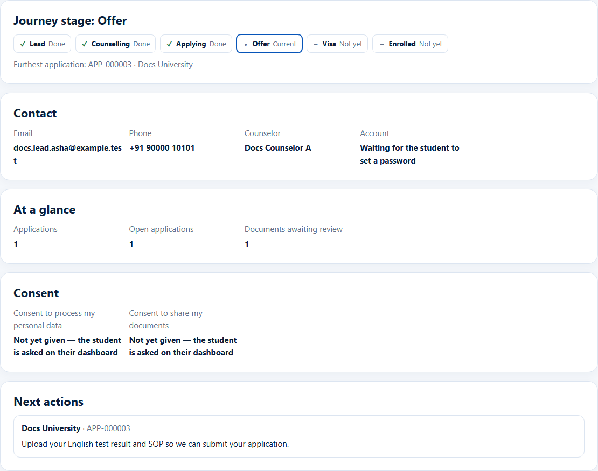

# Journey stage
> Doc ID: DOC-CNS-APP-006 · Verified on 2026-10-30 against `main` @ `045d8c40` · Roles: Counselor, Overseas Admin

## Purpose
See in one line how far the student has got overall, from lead to enrolment.

## Who Can Use This Feature
Counselors (your students) and the Overseas Admin.

## Prerequisites
None.

## How to Access
Student 360 → **Overview** → **Journey stage**.

## Steps
### Step 1 — Read the journey
**Journey stage: {stage}** shows six steps (**Lead**, **Counselling**, **Applying**, **Offer**, **Visa**, **Enrolled**), each marked done (✓), current (•) or not yet. **Furthest application** names the application that sets the stage.

## Expected Result
The journey is worked out from the student's furthest open application each time you open the page. You never set it yourself. Notes appear when all applications are closed, or one is on hold or deferred.

## Tips
- A student with no application shows **Lead** or **Counselling** (counselling once you are linked to them or an appointment is booked).

## Related Features
- [Student 360](../students/stu-004-student-360.md)
- [Advance an application's stage](app-004-advance-stage.md)
