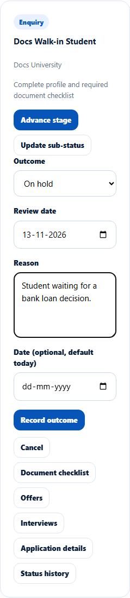
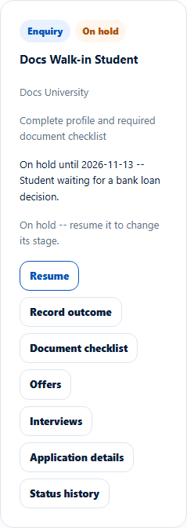
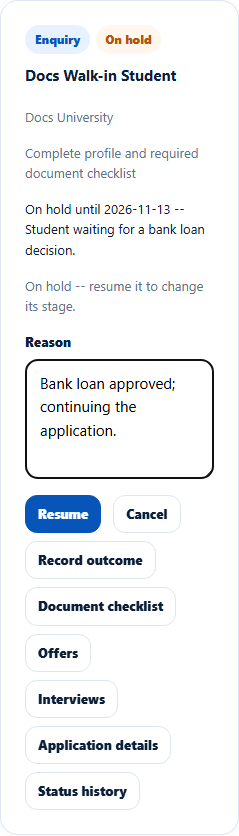
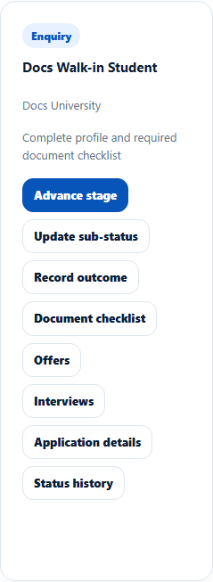

# Record an outcome or resume an application
> Doc ID: DOC-CNS-APP-007 · Verified on 2026-10-30 against `main` @ `045d8c40` · Roles: Counselor

## Purpose
Record what happened when an application stops or pauses (rejected, withdrawn, deferred or on hold), and resume a paused one.

## Who Can Use This Feature
The counselor assigned to the application. Only the Overseas Admin can reopen a closed application.

## Prerequisites
The application isn't enrolled.

## How to Access
**Evaluate Applications** → the application → **Record outcome**.

## Steps
### Step 1 — Choose the outcome
Select **Record outcome** and choose the **Outcome**: **Rejected**, **Withdrawn**, **Deferred** or **On hold**. After an offer there are also **Offer declined**, **Non arrival** and **Cancelled**. Extra fields appear as needed:
- **Deferred:** new intake and revised deadlines.
- **On hold:** **Review date**.

Add the **Reason**, **Suggested next steps (optional)** and **Date (optional, default today)**.

### Step 2 — Save
Select **Record outcome**. **Outcome recorded: {label}. The student has been notified.** appears. An on-hold card says "On hold -- resume it to change its stage."

### Step 3 — Resume an on-hold or deferred application
Select **Resume**, enter the **Reason** and select **Resume**. **Application resumed.** appears and the stage buttons return.

## Fields
| Field | Description | Required | Example |
|---|---|---|---|
| Outcome | See Step 1 | Yes | On hold |
| Review date | On hold only; not in the past | When on hold | 13 Nov 2026 |
| Reason | Why | Yes | Student waiting for a bank loan decision. |
| Suggested next steps (optional) | For the student | No | — |

## Expected Result
- **Rejected, Withdrawn, Offer declined, Non arrival, Cancelled:** these close the application ("This application is closed -- only the Overseas Admin can reopen it.").
- **On hold, Deferred:** these pause it until you resume it.

## Validation Messages
| Message | When |
|---|---|
| Outcome recorded: {label}. The student has been notified. | Success |
| Application resumed. | Resumed |
| The review date cannot be in the past | Past review date |
| An offer is needed before it can be declined | Declining with no offer |
| An enrolled application cannot be given an outcome | Enrolled |
| Only the Overseas Admin can reopen a closed application | Closed |

## Tips
- An on-hold application with a review date gets a reminder task on that date (reminder rule "On-hold review date").

## Related Features
- [Advance an application's stage](app-004-advance-stage.md)
- [Application status history](app-009-status-history.md)
