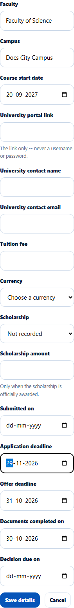
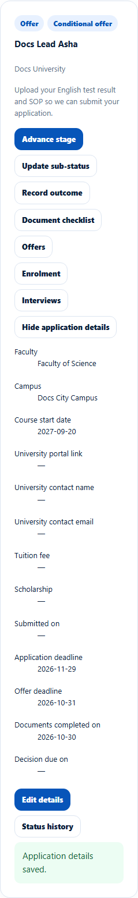

# Application details: fields and dates
> Doc ID: DOC-CNS-APP-008 · Verified on 2026-10-30 against `main` @ `045d8c40` · Roles: Counselor

## Purpose
Keep the university-side details of an application: faculty, campus, fees, scholarship, portal link, contact and key dates.

## Who Can Use This Feature
The counselor assigned to the application (in any state).

## Prerequisites
None.

## How to Access
**Evaluate Applications** → the application → **Application details** → **Edit details**.

## Steps
### Step 1 — Edit the details
Fill in what you know, then select **Save details**:
- **Faculty**, **Campus** and **Course start date**.
- **University portal link** ("The link only -- never a username or password.").
- **University contact name** and **University contact email**.
- **Tuition fee** and **Currency**.
- **Scholarship** and **Scholarship amount** ("Only when the scholarship is officially awarded.").
- Dates: **Submitted on**, **Application deadline**, **Offer deadline**, **Documents completed on** and **Decision due on**.

### Step 2 — Check the saved details
**Application details saved.** appears and the details show on the card.

## Fields
| Field | Allowed values | Example |
|---|---|---|
| Currency | INR, GBP, USD, EUR, CAD, AUD, NZD, SGD, AED | GBP |
| Scholarship | Not recorded, None, Applied, Awarded, Declined | Applied |

## Expected Result
The dates drive reminders, for example "Application deadline approaching" and "University decision overdue". The student is notified only when the scholarship changes.

## Validation Messages
| Message | When |
|---|---|
| Application details saved. | Success |
| Currency is required with a tuition fee or a scholarship amount | Amount without currency |
| A scholarship amount is recorded only when the scholarship is awarded | Amount without Awarded |

## Common Errors
**Problem:** You can't change the intake here. **Cause:** Intake isn't one of these fields. **Resolution:** Ask the Overseas Admin.

## Related Features
- [Reminder rules (admin)](../../admin-manual/config/cfg-002-reminder-rules.md)
- [Record, close or decide an offer](../offers/ofr-001-offers.md)
