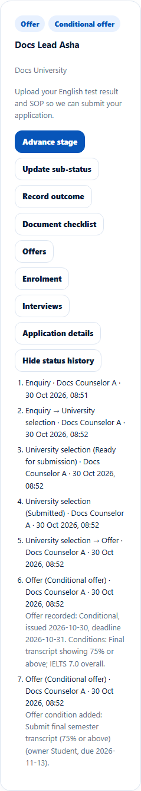

# Application status history
> Doc ID: DOC-CNS-APP-009 · Verified on 2026-10-30 against `main` @ `045d8c40` · Roles: Counselor

## Purpose
See every stage, sub-status and outcome change on an application, with who made it, when, and any reason.

## Who Can Use This Feature
The counselor assigned to the application.

## Prerequisites
None.

## How to Access
**Evaluate Applications** → the application → **Status history** (select **Hide status history** to close it).

## Steps
### Step 1 — Read the history
Each line shows the stage (and sub-status), the change, who made it and when. Examples: "Enquiry → University selection", "University selection (Ready for submission)", and "Offer recorded: Conditional, issued …, deadline …". Notes, reasons and gate overrides are shown with the change.

## Expected Result
A complete, permanent record of how the application moved.

## Validation Messages
| Message | When |
|---|---|
| No status changes recorded yet. | New application |
| Unable to load the status history. | Loading failed |

## Related Features
- [Advance an application's stage](app-004-advance-stage.md)
- [Activities and History tabs](../students/stu-007-activities-history.md)
