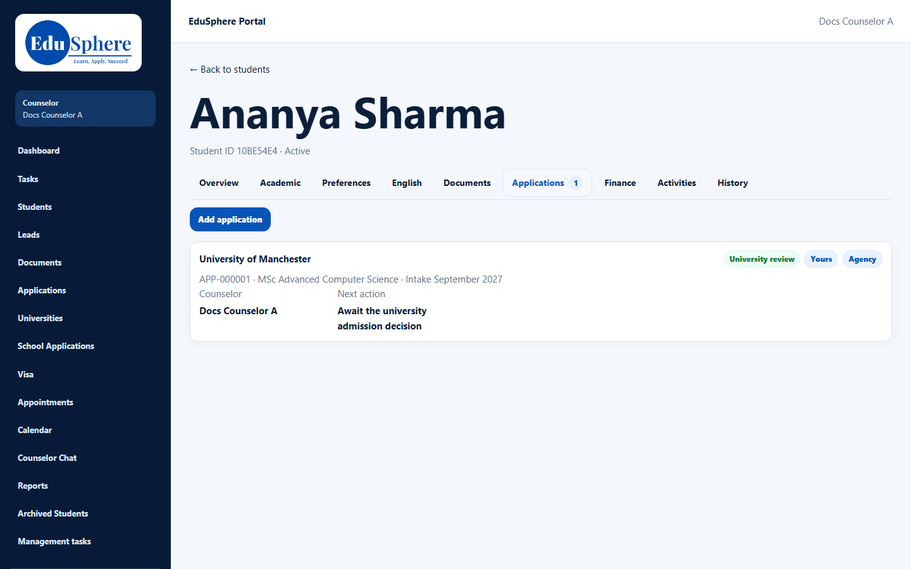
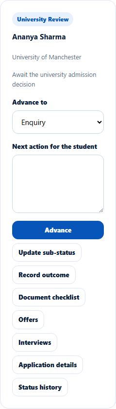

# Agency vs direct applications
> Doc ID: DOC-CNS-APP-010 · Verified on 2026-10-30 against `main` @ `045d8c40` · Roles: Counselor

## Purpose
Know what you can and can't do on an application submitted by an education agent.

## Who Can Use This Feature
Counselors assigned to agency applications.

### What you can do
| Action | Direct application | Agency application |
|---|---|---|
| Advance stage, sub-status, outcome | Yes | Yes (agency is notified) |
| Details, offers, conditions, interviews | Yes | Yes |
| University deposit | Record it | Read only (the agency pays) |
| Confirm enrolment | Yes | The **Enrolment** panel offers it, although stage changes say only the agency's Master confirms enrolment |
| Condition owner **Agent** | — | Available |

## Prerequisites
The Overseas Admin has assigned the agency application to you.

## How to Access
- **Application Tracking**: the **Agency** column shows the agency's name.
- Student 360 → **Applications**: the card has an **Agency** badge.

## Steps
### Step 1 — Recognise an agency application
On the 360, the card shows **Agency** next to **Yours**.

### Step 2 — Work on it from Evaluate Applications
The card is the same as for direct applications.

## Expected Result
The agency is informed of your changes and sees who its counselor is.

## Common Errors
**Problem:** "Use Advance stage to move an agency application". **Resolution:** Use **Advance stage**, not other edit forms.

**Problem:** An older agency application offers earlier stages (such as **Enquiry**) in **Advance to**. **Cause:** Its status ("University review") isn't in the current stage list. **Resolution:** Choose a later stage only.

## Tips
- A new application you create for an agency student is a direct application, not an agency one.

## Related Features
- [Agency students and applications](../handoffs/ho-003-agency-students.md)
- [Advance an application's stage](app-004-advance-stage.md)
