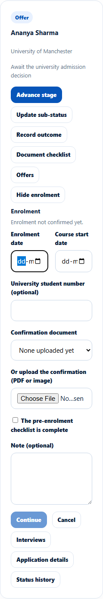
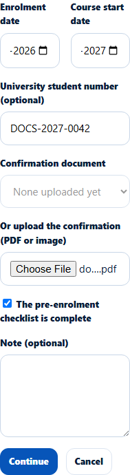
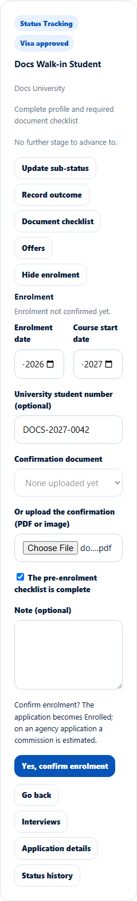
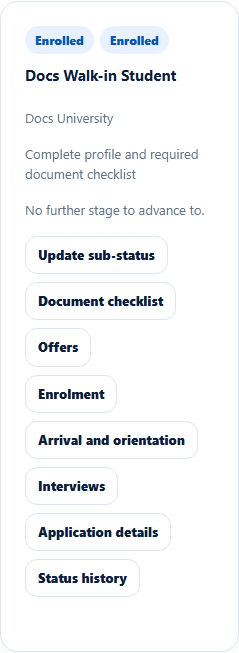

# Confirm enrolment
> Doc ID: DOC-CNS-ARR-001 · Verified on 2026-10-30 against `main` @ `045d8c40` · Roles: Counselor

## Purpose
Mark an application **Enrolled** once the university confirms the student's enrolment, with the confirmation document.

## Who Can Use This Feature
The counselor assigned to the application.

### What each role sees
| | Direct application | Agency application |
|---|---|---|
| **Enrolment** panel and **Confirm enrolment** | Yes | Also shown to the counselor. Stage changes say "Only the agency's Master confirms enrollment", but the Enrolment panel offers the same form |

## Prerequisites
- The application is at **Offer** or later and is open.
- You have the enrolment confirmation (PDF or image).

## How to Access
**Evaluate Applications** → the application → **Enrolment** → **Confirm enrolment**.

## Steps
### Step 1 — Fill in the enrolment
Enter the **Enrolment date**, **Course start date** and **University student number (optional)**. For **Confirmation document**, pick an uploaded one or use **Or upload the confirmation (PDF or image)**. Tick **The pre-enrolment checklist is complete** and add a **Note** if useful. Select **Continue**.

### Step 2 — Confirm
EduSphere asks: "Confirm enrolment? The application becomes Enrolled; on an agency application a commission is estimated." Select **Yes, confirm enrolment**, or **Go back**.

### Step 3 — Done
**Enrolment confirmed.** appears. The application is **Enrolled**, and **Arrival and orientation** becomes available.

## Fields
| Field | Description | Required | Example |
|---|---|---|---|
| Enrolment date | Date of enrolment | Yes | 30 Oct 2026 |
| Course start date | When the course starts | Yes | 20 Sep 2027 |
| University student number (optional) | The university's ID | No | DOCS-2027-0042 |
| Confirmation document | Uploaded or new file | Yes | docs-offer-letter.pdf |
| The pre-enrolment checklist is complete | Your confirmation | Yes | Ticked |

## Expected Result
- The student is notified ("Enrolment confirmed").
- A linked lead becomes **Converted** within about 15 minutes.
- On an agency application, the agency commission is estimated.

## Validation Messages
| Message | When |
|---|---|
| Enrolment confirmed. / Enrolment details saved. / Nothing changed. | Success |
| Attach the enrolment confirmation: pick an uploaded one or upload the file. | No document |
| Confirm the pre-enrolment checklist is complete. | Box not ticked |
| Choose an enrolment confirmation uploaded for this application | Wrong document |

## Common Errors
**Problem:** **Advance stage** doesn't offer **Enrolled**. **Resolution:** Use this panel; enrolment is only confirmed with the confirmation document.

## Tips
- Enrolment doesn't require a visa decision, so check the [visa case](../visa/visa-001-visa-case.md) first.

## Related Features
- [Arrival and orientation](arr-002-arrival.md)
- [Student and milestones panel](../leads/lead-009-student-and-milestones.md)
