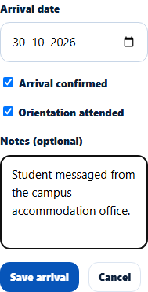
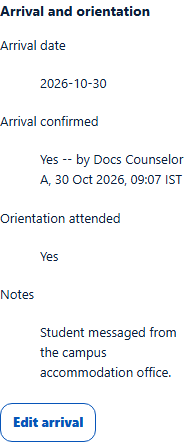

# Arrival and orientation
> Doc ID: DOC-CNS-ARR-002 · Verified on 2026-10-30 against `main` @ `045d8c40` · Roles: Counselor

## Purpose
Record that an enrolled student has arrived at the university and attended orientation.

## Who Can Use This Feature
The counselor assigned to the application.

## Prerequisites
Enrolment is confirmed (see [Confirm enrolment](arr-001-confirm-enrolment.md)).

## How to Access
**Evaluate Applications** → the application → **Arrival and orientation** → **Record arrival** (or **Edit arrival**).

## Steps
### Step 1 — Fill in the arrival
Enter the **Arrival date**. Tick **Arrival confirmed**, then **Orientation attended** (it can only be ticked once arrival is confirmed). Add **Notes**, for example how arrival was confirmed.

### Step 2 — Save
Select **Save arrival**. **Arrival saved.** appears. The panel shows the arrival date, "Arrival confirmed: Yes -- by {name}, {time}", orientation and notes.

## Fields
| Field | Description | Required | Example |
|---|---|---|---|
| Arrival date | Expected or actual; not in the future when confirmed | When confirmed | 30 Oct 2026 |
| Arrival confirmed | The student has arrived | No | Ticked |
| Orientation attended | Only after arrival is confirmed | No | Ticked |
| Notes | Up to 2000 characters | No | Student messaged from the campus accommodation office. |

## Expected Result
The arrival is recorded in the application's history (the agency is told on agency applications). The student is not notified.

## Validation Messages
| Message | When |
|---|---|
| Arrival saved. / Nothing changed. | Success |
| Arrival is recorded after enrolment is confirmed | Not enrolled |
| Enter the arrival date to confirm arrival | No date |
| A confirmed arrival date cannot be in the future | Future date |
| Confirm arrival before recording orientation | Orientation without arrival |

## Tips
- If the student never arrives, record the outcome **Non arrival** (see [Record an outcome](../applications/app-007-outcome.md)).

## Related Features
- [Confirm enrolment](arr-001-confirm-enrolment.md)
