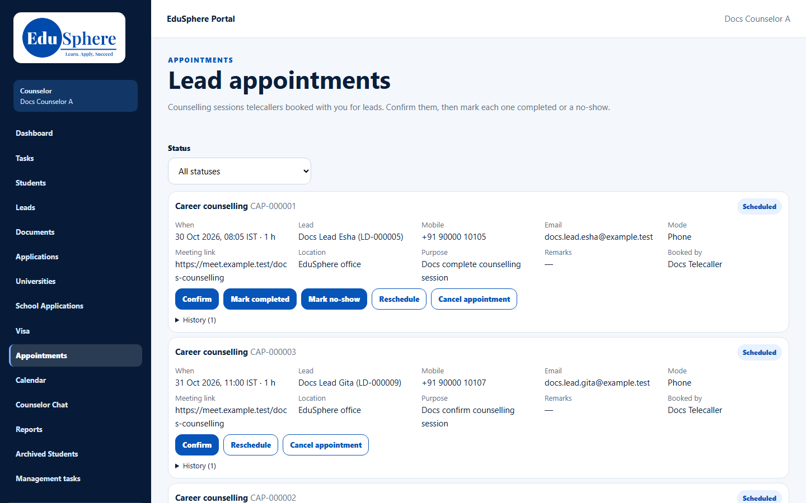
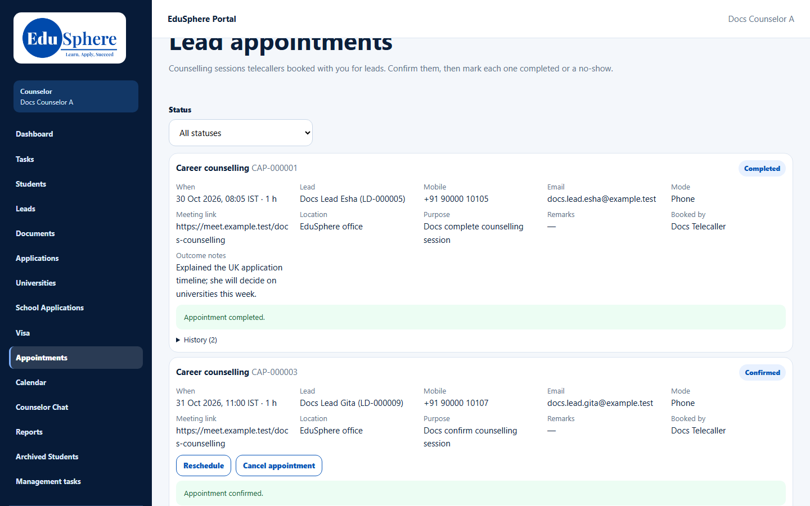
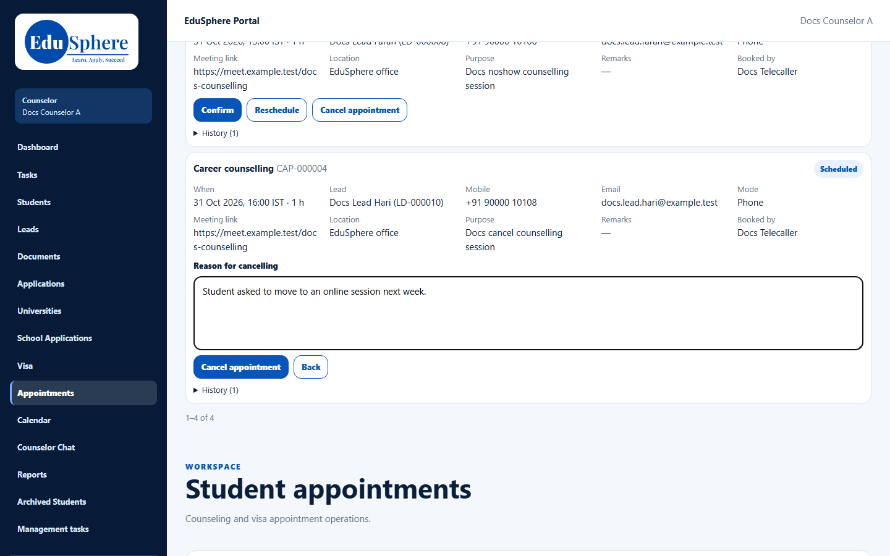
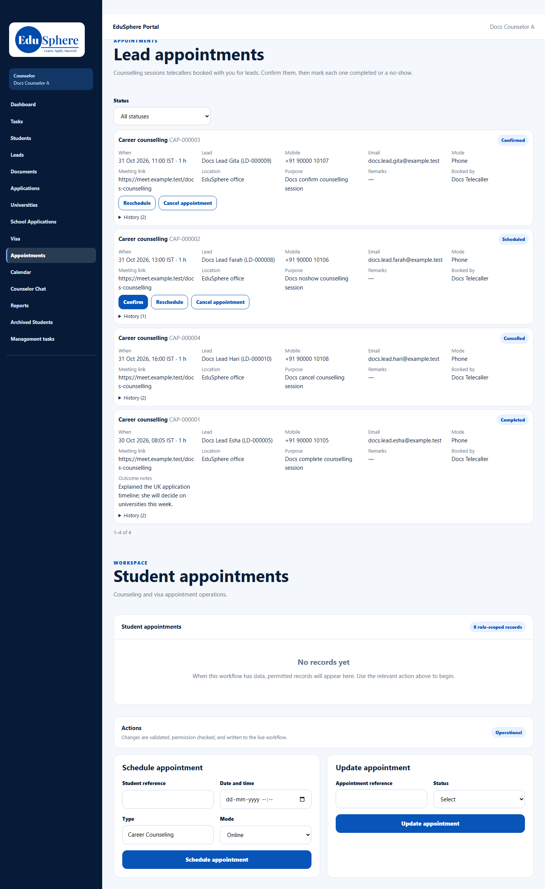

# Lead appointments
> Doc ID: DOC-CNS-CAL-001 · Verified on 2026-10-30 against `main` @ `045d8c40` · Roles: Telecaller, Counselor

## Purpose
Handle the counselling sessions telecallers book with you: confirm them, then mark each one completed or a no-show, or reschedule or cancel it.

## Who Can Use This Feature
- **Telecaller:** books the appointment on their lead (**Book counselling**).
- **Counselor:** confirms and records the outcome on **Appointments**.

## Prerequisites
A telecaller has booked an appointment with you. Each appointment lasts 60 minutes, and you can't have two at the same time.

## How to Access
Sidebar **Appointments** (page title **Lead appointments**).

## Steps
### Step 1 — See your appointments
Each card shows the type and code (for example **Career counselling CAP-000001**) and its status (**Scheduled**, **Confirmed**, **Rescheduled**, **Completed**, **Cancelled**, **No show**). It also shows when, the lead, mobile, email, mode, meeting link, location, purpose, remarks and who booked it. Filter with **Status**.

### Step 2 — Confirm
Select **Confirm**. **Appointment confirmed.** appears.

### Step 3 — After the session: completed or no-show
Once the start time has passed, **Mark completed** and **Mark no-show** appear. For a completed session, add **Outcome notes (optional)** and select **Mark completed**. **Appointment completed.** appears.

VERIFICATION REQUIRED: **Mark no-show** is captured in session S9 (an appointment booked for a later day).

### Step 4 — Reschedule or cancel
- **Reschedule**: choose a **New date and time (IST)** and an optional reason, then **Save new time**.
- **Cancel appointment**: enter the **Reason for cancelling** and confirm. **Appointment cancelled.** appears.

### Below the lead appointments
The page also lists **Student appointments**, with **Schedule appointment** and **Update appointment** forms for appointments with your students.

## Fields
| Field | Description | Required | Example |
|---|---|---|---|
| Outcome notes | What happened in the session | No | Explained the UK application timeline… |
| New date and time (IST) | For a reschedule; in the future | Yes (reschedule) | 1 Nov 2026, 11:00 |
| Reason for cancelling | Why it was cancelled | Yes (cancel) | Student asked to move to an online session… |

## Expected Result
The status changes on the card and in **History**. Your calendar feed updates too (see [Calendar and iCal feed](cal-002-calendar-feed.md)).

## Validation Messages
| Message | When |
|---|---|
| Appointment confirmed. / Appointment completed. / Appointment cancelled. | Success |
| Add a reason for cancelling. | No reason |
| Choose the new date and time. / Choose a time in the future | Reschedule time missing or past |
| The counselor already has an appointment at this time. Busy: {time} | Overlapping booking (seen by the telecaller) |
| Appointment is already {status} | The action was already taken |

## Common Errors
**Problem:** **Mark completed** isn't shown. **Cause:** The appointment hasn't started yet. **Resolution:** Wait until its start time.

**Problem:** You can't book counselling from your lead page. **Cause:** Telecallers book lead appointments; counselors confirm them.

## Tips
- Confirm appointments as soon as they arrive so the telecaller knows you will attend.

## Related Features
- [Calendar and iCal feed](cal-002-calendar-feed.md)
- [Log a meeting](../activity/act-004-meetings.md)
