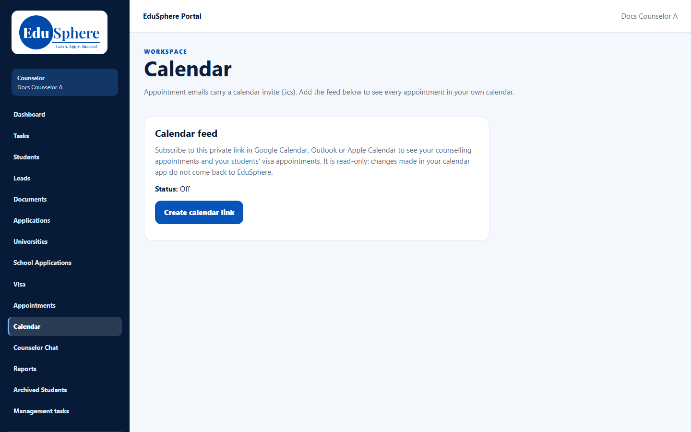
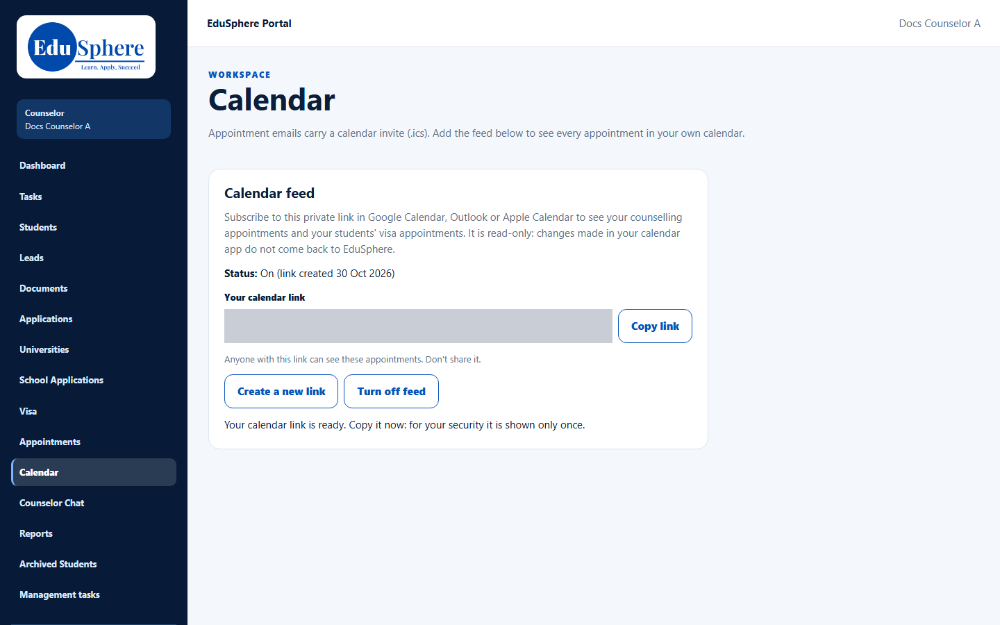

# Calendar and iCal feed
> Doc ID: DOC-CNS-CAL-002 · Verified on 2026-10-30 against `main` @ `045d8c40` · Roles: Counselor

## Purpose
See your counselling appointments, and your students' visa appointments, in Google Calendar, Outlook or Apple Calendar.

## Who Can Use This Feature
Overseas counselors.

## Prerequisites
A calendar app that can subscribe to a calendar by link.

## How to Access
Sidebar **Calendar**.

## Steps
### Step 1 — Create your calendar link
The **Calendar feed** card explains the feed and shows **Status: Off**. Select **Create calendar link**.

### Step 2 — Copy it now
**Your calendar link** appears with **Copy link**. The message says: "Your calendar link is ready. Copy it now: for your security it is shown only once." Select **Copy link**, then paste it into your calendar app's "subscribe to calendar" option.

### Step 3 — Replace or turn off the link
- **Create a new link** asks: "Create a new calendar link? The current link stops working at once, so calendars subscribed to it stop updating."
- **Turn off feed** stops the link at once ("The calendar feed is off. The old link no longer works.").

## Expected Result
Your calendar app shows a calendar called **EduSphere appointments**, covering the last 90 days onwards. It is read-only: changes made in your calendar app don't come back to EduSphere.

## Validation Messages
| Message | When |
|---|---|
| Your calendar link is ready. Copy it now: for your security it is shown only once. | Link created |
| Link copied. Paste it into your calendar app's "subscribe to calendar" option. | Copied |
| Copy the selected link by hand (Ctrl+C or long-press). | The browser blocked copying |

## Common Errors
**Problem:** You didn't copy the link and now it's hidden. **Resolution:** Select **Create a new link** and copy it straight away (the old link stops working).

**Problem:** Someone else may have your link. **Resolution:** Select **Create a new link** or **Turn off feed** immediately. "Anyone with this link can see these appointments. Don't share it."

## Tips
- Appointment emails also carry a calendar invite (.ics) you can add individually.

## Related Features
- [Lead appointments](cal-001-lead-appointments.md)
