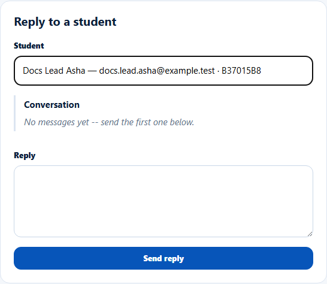
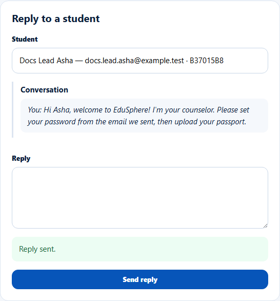
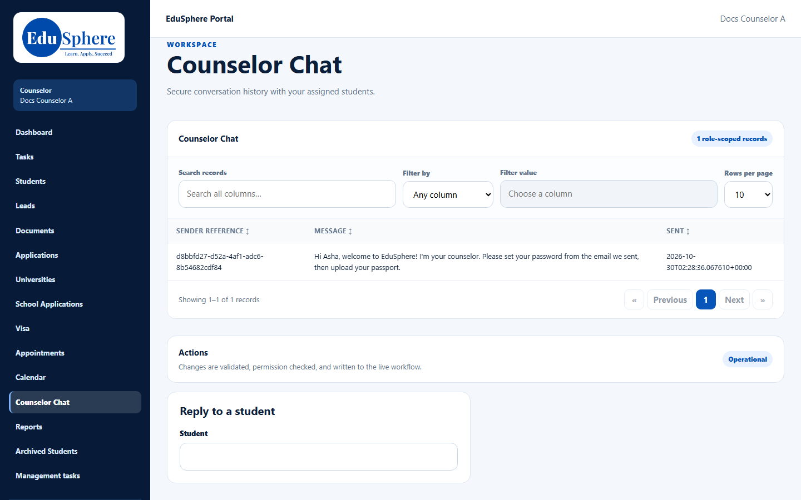

# Counselor Chat with students
> Doc ID: DOC-CNS-CHAT-001 · Verified on 2026-10-30 against `main` @ `045d8c40` · Roles: Counselor

## Purpose
Exchange secure messages with your students inside EduSphere.

## Who Can Use This Feature
Overseas counselors, with the students assigned to them.

## Prerequisites
The student has an EduSphere account and is one of your students (for example converted from your lead).

## How to Access
Sidebar **Counselor Chat**.

## Steps
### Step 1 — Choose the student
In **Reply to a student**, type part of the student's name in **Student** and pick them from the list (name — email · Student ID). Their **Conversation** loads. If you have not written yet, it says "No messages yet -- send the first one below."

### Step 2 — Write and send
Type your message in **Reply** and select **Send reply**. **Reply sent.** appears and your message shows in the conversation as "You: …".

### Step 3 — See the history
The **Counselor Chat** table at the top of the page lists the conversation history with your students.

## Fields
| Field | Description | Required | Example |
|---|---|---|---|
| Student | One of your students | Yes | Docs Lead Asha |
| Reply | Your message | Yes | Hi Asha, welcome to EduSphere!… |

## Expected Result
The student sees your message in their portal and can reply.

## Validation Messages
| Message | When |
|---|---|
| Reply sent. | Sent |

## Tips
- Use the WhatsApp or email [message templates](../../admin-manual/config/cfg-003-message-templates.md) for standard updates; use chat for questions and answers.

## Related Features
- [Portal tour](../navigation/nav-001-portal-tour.md)
- [Record a WhatsApp message](../activity/act-002-whatsapp.md)
