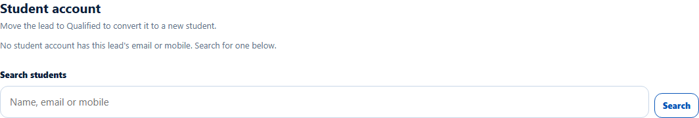
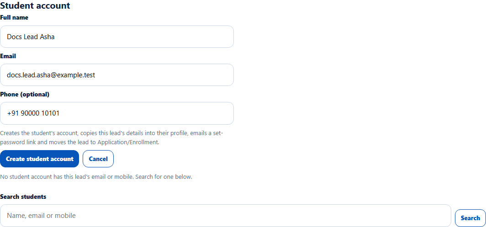
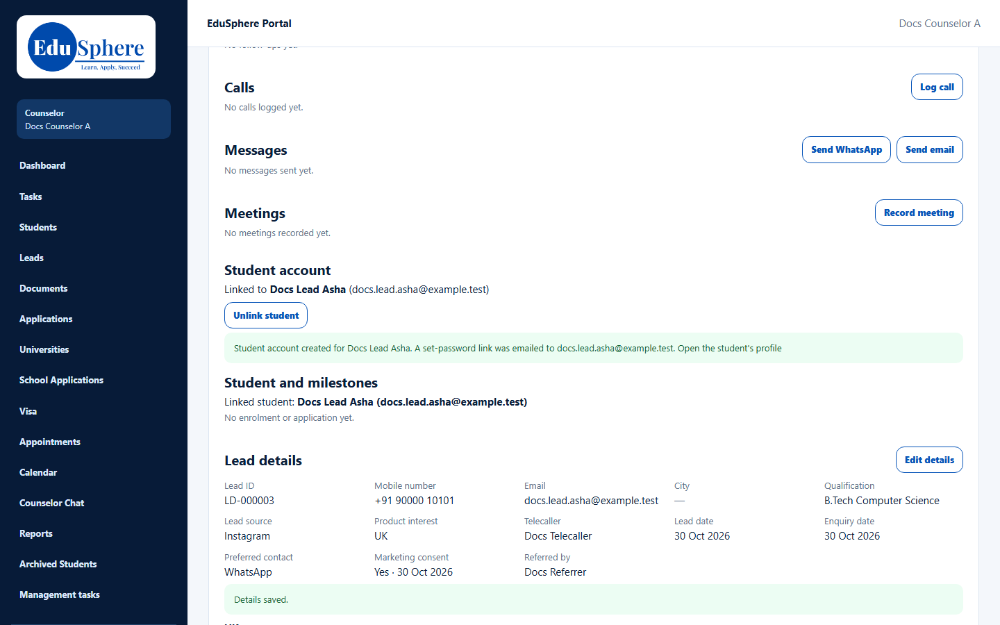

# Convert a lead to a new student
> Doc ID: DOC-CNS-CONV-001 · Verified on 2026-10-30 against `main` @ `045d8c40` · Roles: Counselor

## Purpose
Create the student's EduSphere account from a qualified lead in one step, so you can start their applications.

## Who Can Use This Feature
Overseas counselors who own the lead.

## Prerequisites
- The lead is at **Qualified**, **Interested**, **Follow-up**, **Counselling Scheduled** or **Counselling Completed**.
- No student account is linked to the lead.
- No student account already uses the lead's email or mobile number.

## How to Access
Lead page → **Student account** → **Convert to student**.

## Steps
### Step 1 — Check the lead is ready
Before the lead reaches **Qualified**, the section says **Move the lead to Qualified to convert it to a new student.** See [Change stage](../leads/lead-006-change-stage.md).

### Step 2 — Open the form
Select **Convert to student**. **Full name**, **Email** and **Phone (optional)** are filled in from the lead. The form explains that it "Creates the student's account, copies this lead's details into their profile, emails a set-password link and moves the lead to Application/Enrollment."

### Step 3 — Create the account
Select **Create student account**. The message **Student account created for {name}. A set-password link was emailed to {email}.** appears with **Open the student's profile**. The lead now shows **Linked to {name}** and its stage becomes **Application/Enrollment**.

## Fields
| Field | Description | Required | Example |
|---|---|---|---|
| Full name | The student's name | Yes | Docs Lead Asha |
| Email | The student's sign-in email; must not belong to another account | Yes | docs.lead.asha@example.test |
| Phone (optional) | Mobile number | No | +91 90000 10101 |

## Expected Result
- The student receives a set-password email and appears in your **My students**.
- The lead's qualification is copied into the student's profile.
- The lead moves to **Application/Enrollment**.

## Validation Messages
| Message | When |
|---|---|
| Student account created for {name}. A set-password link was emailed to {email}. | Success |
| Student account created for {name}, but the set-password email was not delivered. Re-send it from My students. | Email could not be sent |
| Add the student's name and email. | A required field is empty |
| Move the lead to Qualified before converting it | The lead's stage is too early |
| This lead is closed; reopen it before converting it | The lead is closed |
| A student account already has this email or mobile. Link the existing student instead. | Duplicate account |

## Common Errors
**Problem:** "A student account already has this email or mobile." **Resolution:** Use [Link an existing student](conv-002-link-student.md) instead.

**Problem:** The student didn't get the email. **Resolution:** Re-send the link from **Students** → **My students** (see STU-003).

## Tips
- Fill in the [qualification](../leads/lead-007-qualification.md) before converting; it carries over to the profile.

## Related Features
- [Link / unlink an existing student](conv-002-link-student.md)
- [Student and milestones panel](../leads/lead-009-student-and-milestones.md)
