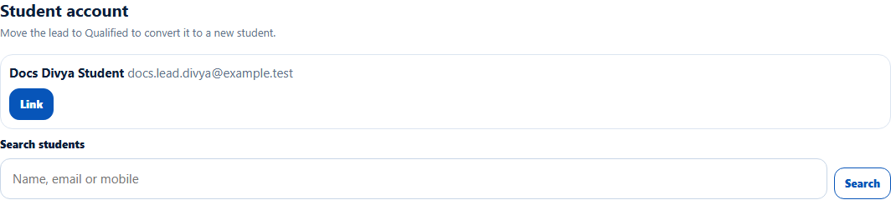
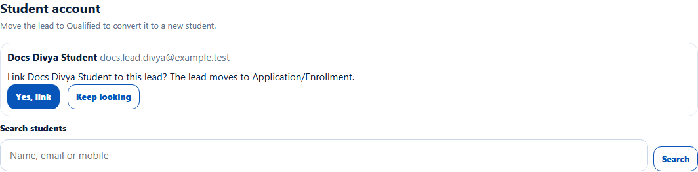
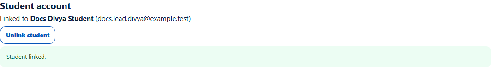
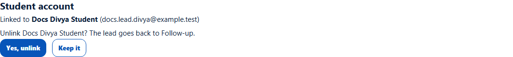
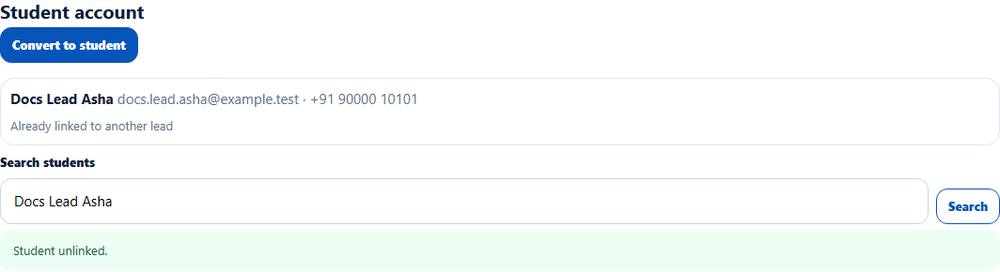

# Link or unlink an existing student account
> Doc ID: DOC-CNS-CONV-002 · Verified on 2026-10-30 against `main` @ `045d8c40` · Roles: Counselor

## Purpose
Connect a lead to a student who already has an EduSphere account, instead of creating a second account.

## Who Can Use This Feature
The counselor who owns the lead.

## Prerequisites
- The lead is open and has no linked student.
- The student account exists, for example a walk-in student you added (see STU-003).

## How to Access
Lead page → **Student account**.

## Steps
### Step 1 — Find the student
EduSphere suggests any student account with the lead's email or mobile. Otherwise it says "No student account has this lead's email or mobile. Search for one below." To search, type at least 3 characters of a name, email or mobile in **Search students** and select **Search**.

### Step 2 — Link
Select **Link** next to the student. Confirm with **Yes, link** ("Link {name} to this lead? The lead moves to Application/Enrollment."), or **Keep looking**.

**Student linked.** appears and the section shows **Linked to {name} ({email})**.

### Step 3 — Unlink if you linked the wrong student
Select **Unlink student** and confirm with **Yes, unlink** ("Unlink {name}? The lead goes back to Follow-up."), or **Keep it**. **Student unlinked.** appears.

### A student already linked elsewhere
A student who belongs to another lead shows **Already linked to another lead** and can't be linked again.

## Expected Result
- **Linked:** the lead moves to **Application/Enrollment**, and the student appears in [Student and milestones](../leads/lead-009-student-and-milestones.md).
- **Unlinked:** the lead goes back to **Follow-up**.

## Validation Messages
| Message | When |
|---|---|
| Student linked. / Student unlinked. | Success |
| Enter at least 3 characters. | Search text too short |
| No active student account matches that search. | Nothing found |
| This student is already linked to another lead | The student belongs to another lead |
| Only an admin can unlink a converted lead | The student has enrolled; the lead is **Converted** |

## Common Errors
**Problem:** **Unlink student** is missing. **Cause:** The student has enrolled, so the lead is **Converted** ("The student has enrolled, so the lead is converted. Only an admin can unlink it."). **Resolution:** Ask your Overseas Admin.

## Tips
- Always check the suggestion first; it matches on email and mobile.

## Related Features
- [Convert a lead to a new student](conv-001-convert-to-student.md)
- [Return a lead to the telecaller](../leads/lead-008-return-to-telecaller.md)
