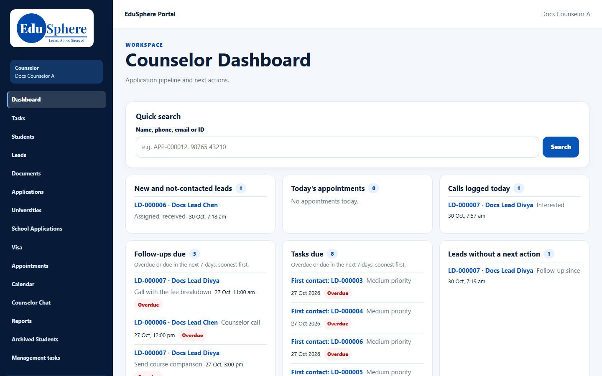
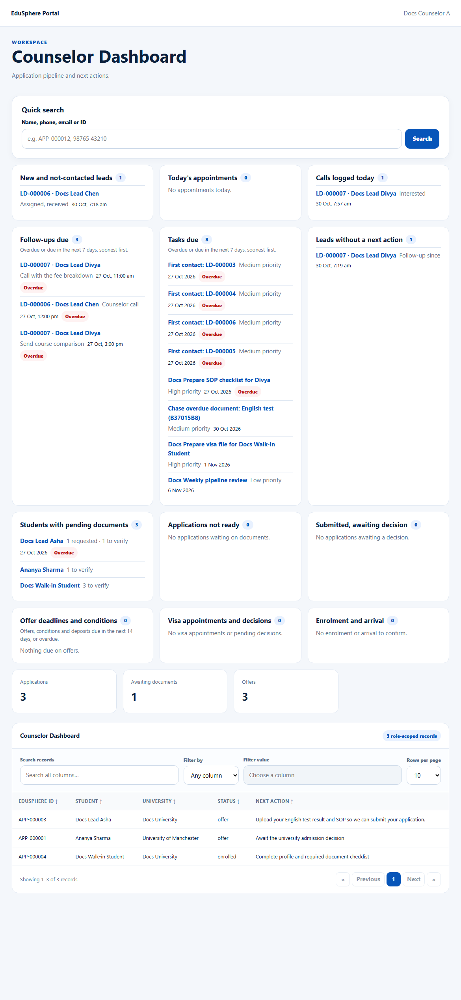
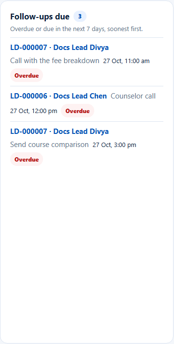

# Counselor dashboard
> Doc ID: DOC-CNS-DASH-001 · Verified on 2026-10-30 against `main` @ `045d8c40` · Roles: Counselor
> Overdue items in the screenshots were prepared by moving test dates back in the documentation database (owner instruction, 2026-10-30).

## Purpose
See at a glance what needs your attention today: new leads, appointments, calls, follow-ups, tasks, documents, offers, visas and enrolments.

## Who Can Use This Feature
Overseas counselors. You land here after signing in.

## Prerequisites
None.

## How to Access
Sidebar **Dashboard** (page title **Counselor Dashboard**).

## Steps
### Step 1 — Read the action sections
Below [Quick search](srch-001-quick-search.md), twelve sections each show a count and up to 10 items (dated work soonest first; new leads and today's calls newest first):
- New and not-contacted leads.
- Today's appointments.
- Calls logged today.
- Follow-ups due.
- Tasks due.
- Leads without a next action.
- Students with pending documents.
- Applications not ready.
- Submitted, awaiting decision.
- Offer deadlines and conditions.
- Visa appointments and decisions.
- Enrolment and arrival.

Overdue items carry a red **Overdue** tag.

### Step 2 — Follow-ups and tasks due
**Follow-ups due** and **Tasks due** list items overdue or due in the next 7 days, soonest first. **Offer deadlines and conditions** looks 14 days ahead and includes anything overdue.

### Step 3 — Open an item
Select an item to open its lead, task or application. When a section has more than 10 items, **View all {n}** opens the full list.

## Expected Result
Working through the sections from top to bottom covers your day.

## Validation Messages
| Message | When |
|---|---|
| No new leads waiting. / No appointments today. / No calls logged today. | Empty sections |
| No follow-ups in the next 7 days. / No tasks due in the next 7 days. / Every lead has a next action. | Empty sections |
| Dashboard sections are unavailable right now. (Try again) | Loading failed |

## Common Errors
**Problem:** **View all** opens the whole My leads list, not just the overdue follow-ups. **Cause:** The link goes to the unfiltered list. **Resolution:** Use the Stage filter, or work from the dashboard list itself.

## Tips
- Start with **Tasks due** and **Follow-ups due**; overdue work is escalated to the Overseas Admin after 2 days (default).

## Related Features
- [Quick search](srch-001-quick-search.md)
- [My tasks](../tasks/task-001-my-tasks.md)
- [Overdue follow-ups](../follow-ups/fup-002-overdue-follow-ups.md)
