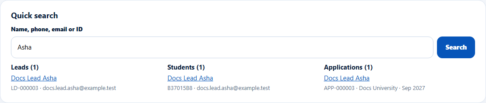
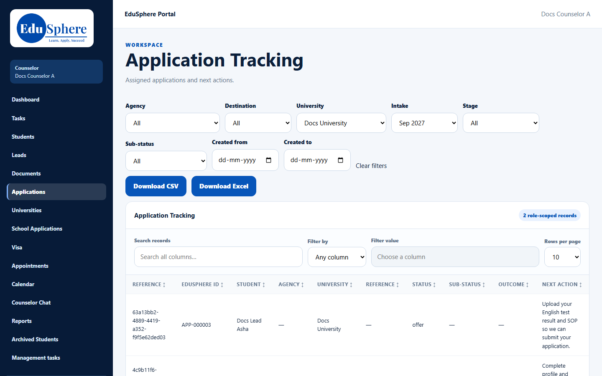
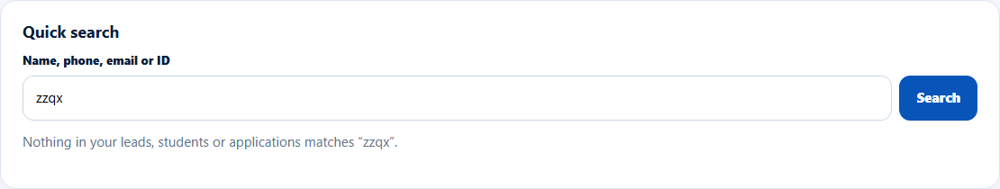

# Quick search
> Doc ID: DOC-CNS-SRCH-001 · Verified on 2026-10-30 against `main` @ `045d8c40` · Roles: Counselor

## Purpose
Find any of your leads, students or applications by name, phone, email or ID from one box.

## Who Can Use This Feature
Overseas counselors. Results only include your own leads, students and applications.

## Prerequisites
None.

## How to Access
**Dashboard** → **Quick search**.

## Steps
### Step 1 — Search
Type at least 3 characters in **Name, phone, email or ID** (for example "APP-000012" or "98765 43210") and select **Search**.

### Step 2 — Read the results
Results come in three groups: **Leads**, **Students** and **Applications**, each with up to 10 matches.

- A **lead** opens its lead page.
- A **student** opens their notes.
- An **application** opens **Application Tracking** filtered to that university and intake, not the application itself.

## Fields
| Field | Description | Required | Example |
|---|---|---|---|
| Name, phone, email or ID | 3–100 characters; phone numbers match ignoring spaces | Yes | Asha |

## Expected Result
You reach the record in two clicks.

## Validation Messages
| Message | When |
|---|---|
| Type at least 3 characters | Too short |
| Use at most 100 characters | Too long |
| Nothing in your leads, students or applications matches "{search}". | No results |
| Showing the first 10 -- refine your search. | More than 10 in a group |
| Too many searches; try again in {n} seconds | More than 30 searches a minute |

## Related Features
- [Counselor dashboard](dash-001-dashboard.md)
- [Application Tracking](../students/stu-001-application-tracking.md)
