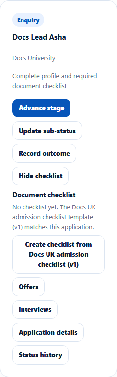
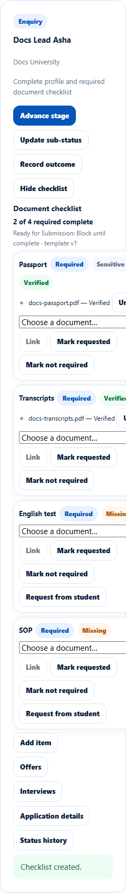
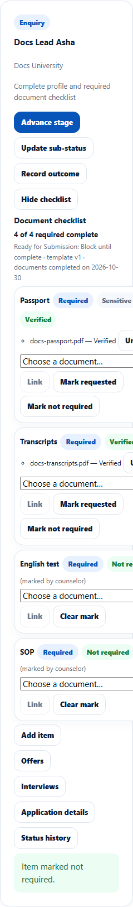

# Application document checklist
> Doc ID: DOC-CNS-DOC-001 · Verified on 2026-10-30 against `main` @ `045d8c40` · Roles: Counselor

## Purpose
Track the documents an application needs, from the Overseas Admin's checklist template, and see when they are complete.

## Who Can Use This Feature
The counselor assigned to the application.

## Prerequisites
A checklist template matches the application's country (and any university, level or intake). Templates are set by the Overseas Admin ([admin guide](../../admin-manual/config/cfg-001-checklist-templates.md)).

## How to Access
**Evaluate Applications** → the application → **Document checklist** (select **Hide checklist** to close it).

## Steps
### Step 1 — Create the checklist
The first time, the panel says "No checklist yet. The {template} template (v{n}) matches this application." Select **Create checklist from {template} (v{n})**. If no template matches, select **Create an empty checklist**.

### Step 2 — Read the checklist
- The summary shows "{x} of {y} required complete", the gate mode (for example **Ready for Submission: Block until complete**) and the template version.
- Each item shows **Required** or **Optional**, its sensitivity and its status (**Missing**, **Pending review**, **Verified**, …).
- Documents uploaded for the application are linked automatically.

### Step 3 — Work the items
- **Choose a document…** + **Link**: link one of the student's documents; **Unlink** removes it.
- **Mark requested**, **Mark not required** and **Clear mark** set the item's state; the item shows "(marked by counselor)".
- **Request from student**: sends a document request with a due date (see [Request documents](doc-003-document-requests.md)).
- **Add item**: adds a document that isn't on the template. Items you added can be removed with **Remove**.

When everything required is complete, the summary shows "documents completed on {date}".

## Expected Result
The checklist controls the [Ready-for-Submission gate](../applications/app-005-sub-status-ready-gate.md). An item counts as complete when its document is **Verified** or it is marked **Not required**.

## Validation Messages
| Message | When |
|---|---|
| Checklist created. / Checklist item added. / Document linked. / Document unlinked. | Success |
| Item marked requested. / Item marked not required. / Mark cleared. | Marks |
| A template item cannot be removed -- mark it Not required instead | Removing a template item |
| Choose a current document of this application's student | Wrong document |

## Common Errors
**Problem:** An uploaded document still shows **Pending review**. **Resolution:** Review it in **Documents** → Document Verification.

## Tips
- The cards are narrow on a normal screen, so item buttons may wrap or be clipped at the right edge; scroll within the card.

## Related Features
- [Sub-status and the Ready-for-Submission gate](../applications/app-005-sub-status-ready-gate.md)
- [Documents page and document status](doc-002-documents-and-status.md)
