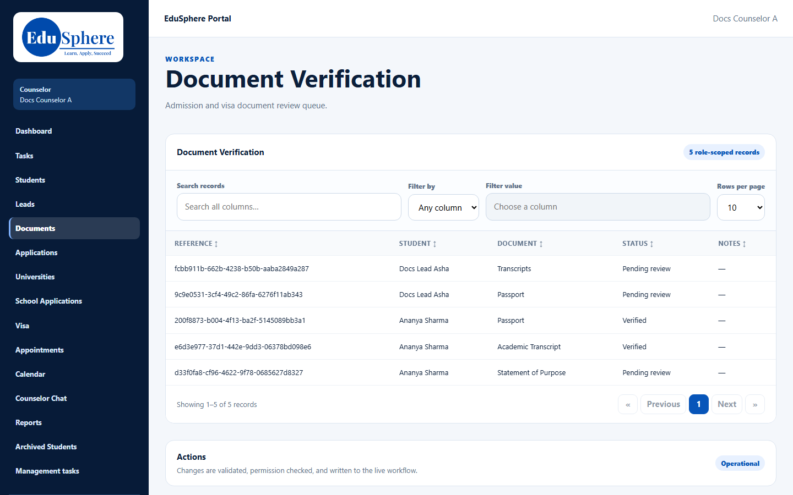
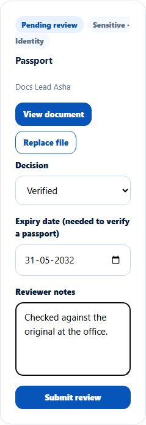
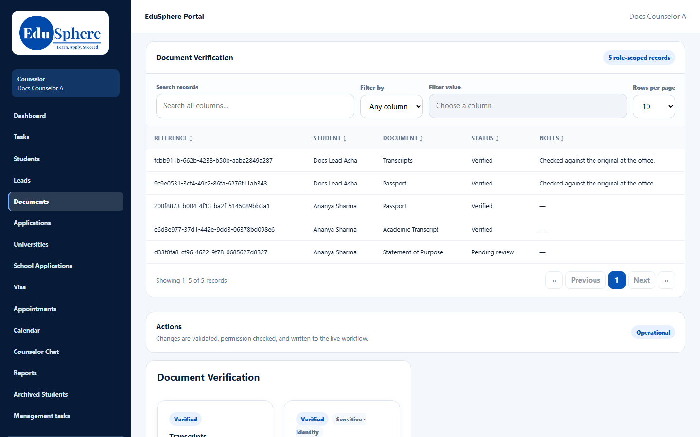

# Documents page and document status
> Doc ID: DOC-CNS-DOC-002 · Verified on 2026-10-30 against `main` @ `045d8c40` · Roles: Counselor

## Purpose
Review your students' application documents (verify them, ask for a re-upload or set an expiry date) and see each document's status.

## Who Can Use This Feature
Overseas counselors, for documents tied to their own applications.

## Prerequisites
The document is tied to one of your applications.

## How to Access
- **Review:** sidebar **Documents** (page **Document Verification**).
- **Status per student:** Student 360 → **Documents**.

## Steps
### Step 1 — Open Document Verification
The table lists the documents of your applications with **Student**, **Document**, **Status** and **Notes**. Below it, each document has **View document**, **Review** and **Replace file**.

### Step 2 — Review a document
Select **Review** and fill in:
- **Decision**: **Verified**, **Under review**, **Incomplete**, **Re-upload required** or **Not required**. CV and SOP also have Draft, Review and Approved.
- **Expiry date**: required to verify a passport.
- **Reviewer notes**.

Select **Submit review**. **Document reviewed -- the student has been notified.** appears.

### Step 3 — See status on the Student 360
The **Documents** tab lists the student's current documents. Each shows its status, application (or "Not linked to an application"), upload date, expiry and reviewer, with **Download** where allowed.

## Fields
| Status | Meaning |
|---|---|
| Pending review | Uploaded, not yet reviewed |
| Verified | Accepted |
| Under review / Incomplete / Re-upload required | Needs more work |
| Expired | Past its expiry date (nightly job) |
| Not required | Not needed for this student |

## Expected Result
Verified documents count as complete on the [checklist](doc-001-application-checklist.md).

## Validation Messages
| Message | When |
|---|---|
| Document reviewed -- the student has been notified. | Success |

## Common Errors
**Problem:** A document you uploaded isn't in Document Verification. **Cause:** The queue lists only documents tied to one of your applications. A document uploaded as "Not tied to an application" can't be reviewed here. **Resolution:** Upload it again and choose the application.

**Problem:** The 360 Documents tab has no Review button. **Resolution:** Review on the Documents page.

## Related Features
- [Upload a document for the student](doc-004-upload-document.md)
- [Application document checklist](doc-001-application-checklist.md)
