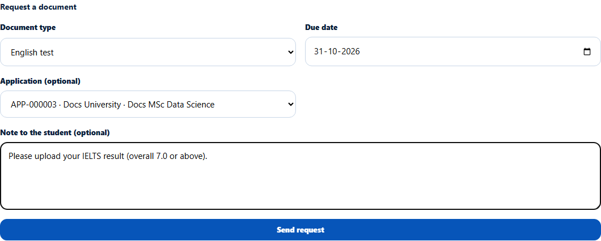
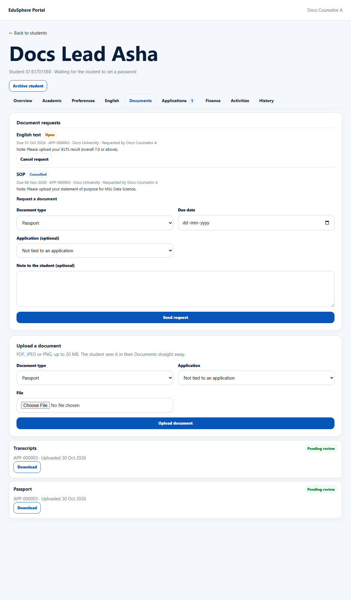
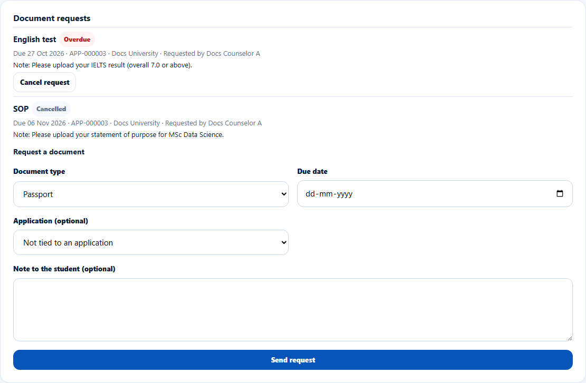

# Request documents from the student
> Doc ID: DOC-CNS-DOC-003 · Verified on 2026-10-30 against `main` @ `045d8c40` · Roles: Counselor

## Purpose
Ask the student to upload a document by a due date, and track whether they have.

## Who Can Use This Feature
Overseas counselors, for their students.

## Prerequisites
None. Tying the request to an application is optional.

## How to Access
Student 360 → **Documents** → **Document requests**.

## Steps
### Step 1 — Fill in Request a document
Fill in:
- **Document type**: Passport, Academic certificates, Transcripts, English test, CV, SOP, LOR, Financial documents or Other.
- **Name**: only when the type is Other.
- **Due date**: today or later.
- **Application (optional)** and **Note to the student (optional)**.

### Step 2 — Send
Select **Send request**. **Request sent to the student.** appears. The student is notified: "{name}: please upload it by {date}."

### Step 3 — Track requests
Each request shows its status (**Open**, **Uploaded**, **Cancelled**, or **Overdue** once past due), the due date, the application, who requested it and the note. Select **Cancel request** to withdraw an open one. **Request for {name} cancelled.** appears.

Once the due date passes, an open request shows **Overdue**, and the "Document request overdue" reminder creates a task for you.

## Fields
| Field | Description | Required | Example |
|---|---|---|---|
| Document type | See Step 1 | Yes | English test |
| Due date | Today or later | Yes | 31 Oct 2026 |
| Application (optional) | One of your open applications | No | APP-000003 · Docs University |
| Note to the student (optional) | Up to 1000 characters | No | Please upload your IELTS result… |

## Expected Result
When the student uploads, the request becomes **Uploaded**. Overdue requests feed the reminder "Document request overdue".

## Validation Messages
| Message | When |
|---|---|
| Request sent to the student. | Success |
| Request for {name} cancelled. | Cancelled |
| Choose a due date from today onwards | Past date |
| An open request for this document already exists | Duplicate |
| This request has already been fulfilled or cancelled | Too late to cancel |

## Tips
- From a checklist item, **Request from student** fills in the document for you.

## Related Features
- [Application document checklist](doc-001-application-checklist.md)
- [Reminder rules (admin)](../../admin-manual/config/cfg-002-reminder-rules.md)
