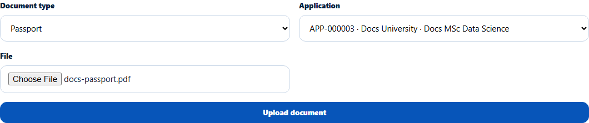
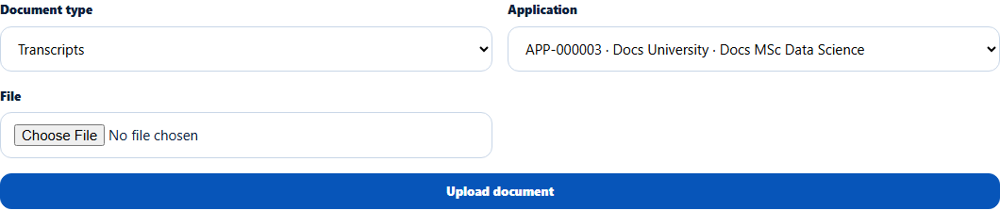

# Upload a document for the student
> Doc ID: DOC-CNS-DOC-004 · Verified on 2026-10-30 against `main` @ `045d8c40` · Roles: Counselor

## Purpose
Upload a document on the student's behalf, for example a passport copy they brought to the office or an offer letter. The student sees it in their Documents straight away.

## Who Can Use This Feature
Overseas counselors, for their students (not archived students).

## Prerequisites
A PDF, JPEG or PNG file up to 20 MB.

## How to Access
Student 360 → **Documents** → **Upload a document**.

## Steps
### Step 1 — Choose the document type and application
Pick the **Document type**. **Offer letter** appears once the student has an application. Choose the **Application**. Always choose one if the document is for an application: only documents tied to your application can be reviewed in Document Verification.

### Step 2 — Choose the file and upload
Choose the **File** and select **Upload document**. **Uploaded. The student can see it in their Documents.** appears. The document starts as **Pending review** and is linked to the matching checklist item automatically.

## Fields
| Field | Description | Required | Example |
|---|---|---|---|
| Document type | As for requests, plus Offer letter | Yes | Passport |
| Name | Only for Other (2–80 characters) | For Other | — |
| Application | The application it belongs to, or "Not tied to an application" | Required for Offer letter | APP-000003 · Docs University |
| File | PDF, JPEG or PNG, up to 20 MB | Yes | docs-passport.pdf |

## Expected Result
The document appears on the student's Documents tab and, if tied to your application, in Document Verification.

## Validation Messages
| Message | When |
|---|---|
| Uploaded. The student can see it in their Documents. | Success |
| Choose the application this offer letter belongs to | Offer letter without application |
| Upload a PDF, JPEG or PNG file / The file is empty / The file must be at most 20 MB | File problems |
| Describe the document (2-80 characters) when the type is Other | Other without a name |
| Too many documents uploaded today -- try again later | Daily limit |

## Related Features
- [Documents page and document status](doc-002-documents-and-status.md)
- [Request documents from the student](doc-003-document-requests.md)
