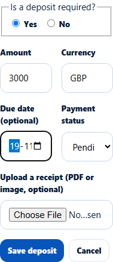

# University deposit record
> Doc ID: DOC-CNS-FIN-001 · Verified on 2026-10-30 against `main` @ `045d8c40` · Roles: Counselor

## Purpose
Record whether a university needs a deposit for an application, how much, by when, and whether it has been paid.

## Who Can Use This Feature
The counselor assigned to a direct application. On agency applications the deposit is paid through EduSphere and shown read-only.

## Prerequisites
The application has an offer.

## How to Access
**Evaluate Applications** → the application → **Offers** → **University deposit** → **Record deposit** (or **Update deposit**).

## Steps
### Step 1 — Fill in the deposit
Answer **Is a deposit required?** (**Yes** or **No**). Then enter the **Amount**, **Currency** and **Due date (optional)**, and choose the **Payment status**: **Pending**, **Paid directly to the university** or **Paid via EduSphere**. When it is paid, add **Paid on**. You can attach a receipt now or later.

### Step 2 — Save
Select **Save deposit**. **Deposit saved.** appears and the deposit shows under **University deposit**.

## Fields
| Field | Description | Required | Example |
|---|---|---|---|
| Is a deposit required? | Yes / No | Yes | Yes |
| Amount, Currency | Deposit amount | When required | 3000 GBP |
| Due date (optional) | When it must be paid | No | 19 Nov 2026 |
| Payment status | Pending, Paid directly to the university, Paid via EduSphere | Yes | Pending |
| Receipt | Upload or pick a receipt | No | — |

## Expected Result
The deposit appears on the student's [Finance tab](fin-002-finance-tab.md). The student is notified ("Deposit updated"). The due date feeds the "Deposit due" reminder.

## Validation Messages
| Message | When |
|---|---|
| Deposit saved. | Success |
| The agency pays this deposit through EduSphere -- it is shown read-only | Agency application |
| Choose a deposit receipt uploaded for this application | Wrong receipt |

## Related Features
- [Finance tab](fin-002-finance-tab.md)
- [Upload a deposit receipt or payment proof](fin-003-upload-receipt.md)
